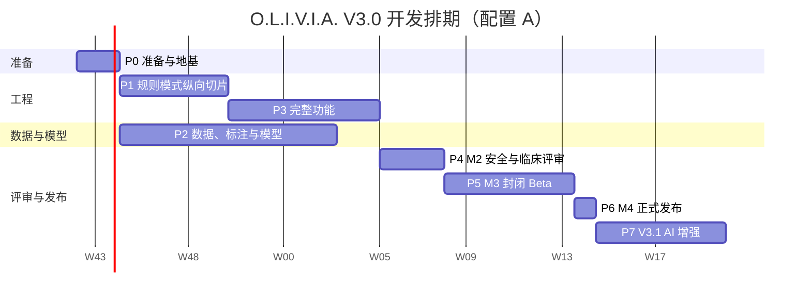

# O.L.I.V.I.A. V3.2 开发计划 (Development Plan)

| 文档信息 | 内容 |
| :--- | :--- |
| **文档编号** | `PLAN-OLIVIA-V3.2` |
| **文档状态** | 交付准备 (Implementation Ready) |
| **最后更新** | 2026-10-21 |
| **依据** | [`PRODUCT_DOCUMENT.md`](PRODUCT_DOCUMENT.md)（PRD V3.2）、[`SYSTEM_DESIGN.md`](SYSTEM_DESIGN.md)（SDD V3.2）、[`taxonomy.yaml`](../taxonomy.yaml)（v3.2.0） |
| **首个任务级实施计划** | [`superpowers/plans/2026-10-20-foundation-and-resource-directory.md`](superpowers/plans/2026-10-20-foundation-and-resource-directory.md) |

### 修订记录

| 版本 | 日期 | 修改人 | 修改内容 |
| :--- | :--- | :--- | :--- |
| V3.0-r1（范围扩展） | 2026-10-20 | 工程 | 范围扩展：港澳台与世界主要城市；实现期间的裁定同步 |
| V3.2（交付对齐版） | 2026-10-21 | 工程 | 全面按 PRD/SDD V3.2 与 taxonomy v3.2.0 对齐：两阶段危机检测、双头仲裁规则桩、红线识别器与闭集掩码、子动作继承与空集保底、章节与目录引用全量同步 |

---

## 1. 目标与范围

| 版本 | 范围 | 里程碑 |
| :--- | :--- | :--- |
| **V3.0（本计划主体）** | 离线基线与神经符号双擎全部 P0 / P1 功能：首访（含城市与时区）、属地心理援助与危机资源、两阶段危机检测流、符号状态机、32 种 A 级动作骨架与子动作注册表、红线识别与掩码、四种人格模板、记忆、纯 Thompson 采样偏好学习、周记、加密、导出与遗忘 | M0 → M4 |
| **V3.1** | AI 增强模式（PRD §7.5 `CHANG-01` 双通道网关与 `CHANG-06` PIPL 授权） | M5 |
| 不在本计划内 | 可穿戴设备接入、未成年人版本（PRD §2.2 非目标） | — |

**交付策略：先做"规则模式"纵向切片，再接入模型。** SDD §1.1 / §6.2 定义的规则模式（只用词库判定风险、固定在探索/倾听阶段、只给自下而上躯体稳定化白名单）本身就是一个安全、可用的产品形态。先把它端到端跑通，好处有三：
1. 第 7 周就有可在内部试用的版本，尽早暴露交互问题；
2. 模型训练依赖标注数据，周期长、不确定性高，不让它阻塞其他工作；
3. 如果模型最终达不到 M2 门禁，规则模式可作为发布兜底（§9 R-P3）。

---

## 2. 技术选型

| 领域 | 选型 | 理由 |
| :--- | :--- | :--- |
| 语言与运行时 | Python 3.11+ | SDD §9 / §10 要求推理不依赖深度学习框架，NumPy 即可；命令行形态；本机已有 Python 3.11 |
| 包管理与构建 | `pyproject.toml` + hatchling；开发用 `venv` + `pip install -e ".[dev]"` | 标准、无额外工具依赖 |
| 数值推理 | NumPy | SDD §9 / §10 |
| 模型训练（不随产品发布） | PyTorch，独立的 `training/` 目录与依赖组 | 训练生态成熟；导出 int8 权重后由 NumPy 推理 |
| 数据文件 | PyYAML | 卡片、模板、热线、分类标准均为 YAML |
| 时区 | 标准库 `zoneinfo` + `tzdata`（Windows 需要）+ `tzlocal`（读取设备 IANA 时区） | SDD §8.3 / §11 属地与时区解析服务 |
| 签名与加密 | PyNaCl（libsodium）：Ed25519 签名、XChaCha20-Poly1305 secretstream | SDD §3.3 / §6.5 |
| 系统钥匙串 | `keyring` | SDD §3.3；跨平台 |
| 词库匹配 | `pyahocorasick` + 标准库 `re` | SDD §8.1 危机前置时序 |
| 测试 | pytest、hypothesis（属性测试）、pytest-benchmark | 工程规范 §7.3；覆盖率 ≥ 85% |
| 代码质量 | ruff（lint + format）、mypy（strict） | — |
| CI | GitHub Actions，macOS / Windows / Linux 三平台矩阵 | SDD §1.1 平台环境与零外部框架依赖 |
| 分发 | PyInstaller 单文件可执行程序（三平台）+ 代码签名 | 用户无需安装 Python |

---

## 3. 团队配置

计划按两种配置给出排期。**不论哪种配置，临床顾问、标注员、法务都必须是外部真人**：危机规则、方法卡片和模板需要执业人员签署（PRD §11.2），这一项无法用工程手段替代。

### 3.1 配置 A：小团队（推荐）

| 角色 | 人数 | 主要职责 |
| :--- | :---: | :--- |
| 核心工程师 | 2 | 地基、多级安全防御、危机流、资源目录、状态机、记忆、CLI、打包 |
| 算法工程师 | 1 | 数据流水线、感知模型训练与推理、评测框架 |
| 内容编辑（兼数据运营） | 1 | 知识库头部信息迁移、方法卡片、四种人格模板、合成数据扩写、热线收集与核验 |
| 测试 / 安全 | 0.5 | 黄金对话集、红队测试、隐私测试、性能基准 |
| 产品负责人 | 0.5 | 范围把控、Beta 运营、验收 |
| **外部**：临床顾问 | 2（兼职） | 精神科医师 ×1、注册心理师 ×1；每周约 4–6 小时 |
| **外部**：标注员 | 2–3（外包） | 感知数据与安全评测集标注 |
| **外部**：法务 | 兼职 | 隐私政策、用户协议、生成式 AI 合规 |

### 3.2 配置 B：一名开发者 + Claude Code

一名全职开发者使用 Claude Code 完成工程与大部分内容初稿；临床顾问、标注员、法务仍需外部人员。工程工期约为配置 A 的 1.8–2 倍；内容编写与标注是外部依赖，工期不随开发人数变化。

### 3.3 排期对照

| 里程碑 | 配置 A（周） | 配置 B（周） |
| :--- | :---: | :---: |
| M0 文档冻结与准备完成 | W2 | W2 |
| M1a 规则模式内部 Alpha | W7 | W12 |
| M1 完整 Alpha | W14 | W26 |
| M2 安全与临床评审通过 | W17 | W30 |
| M3 封闭 Beta 结束（6 周） | W23 | W36 |
| M4 V3.0 正式发布 | W24 | W38 |
| M5 V3.1 AI 增强 | W30 | W46 |

以上为估算中位数，已含 15% 缓冲（§8）。下文的周次均按配置 A 给出。

---

## 4. 阶段划分



| 阶段 | 周次 | 目标 | 退出标准 |
| :--- | :--- | :--- | :--- |
| **P0 准备与地基** | W1–W2 | 仓库、CI、分类标准、数据契约；启动所有外部依赖 | 临床顾问签约；标注规范初稿；CI 三平台绿灯；`taxonomy.yaml` 合入；PRD / SDD 签署（M0） |
| **P1 规则模式纵向切片** | W3–W7 | 端到端可用的规则模式：首访（含城市与时区）→ 会话 → 危机流程 → 资源卡 | M1a：内部 5 人连续使用 1 周；全部规则模式黄金对话通过；资源解析矩阵测试 100% |
| **P2 数据、标注与模型** | W3–W12（与 P1、P3 并行） | 感知模型达到 SDD §9 离线指标；安全评测集 3000 条 | 评测报告达标或触发兜底决策（§9 R-P3） |
| **P3 完整功能** | W8–W14 | 模型接入、风险融合与累积、服务层级、方法选择、记忆、偏好学习、周记、加密、四种人格 | M1：PRD 全部 P0 自动化测试通过 |
| **P4 安全与临床评审** | W15–W17 | 安全评测、红队、临床抽样审查、问题修复 | M2：PRD §11.1 全部达标；临床顾问签署卡片与模板；热线数据 100% 核验 |
| **P5 封闭 Beta** | W18–W23 | 50–100 名成年用户、6 周 | M3：无 S1 安全事件；自评改善率 ≥ 60%；阶段违规率 = 0 |
| **P6 正式发布** | W24 | 三平台安装包、隐私政策、用户协议 | M4：法务签署 |
| **P7 AI 增强** | W25–W30 | AI 网关、去标识化、结构化校验 | M5：SDD §7 / §6.2 全部达标；生成式 AI 合规评审完成 |

---

## 5. 工作分解（WBS）

> 估算单位为"人日"（理想工作日）。"外部"表示外部人员的日历周期。依赖列中的编号指本表条目。

### 5.1 地基（F）

| 编号 | 工作项 | 产出 | 估算 | 依赖 | 角色 | 阶段 |
| :--- | :--- | :--- | :---: | :--- | :--- | :---: |
| F1 | 仓库、包结构、CI、代码规范 | `pyproject.toml`、三平台 CI、ruff / mypy / pytest | 3 | — | 核心工程 | P0 |
| F2 | 分类标准加载与校验 | `olivia/data/taxonomy.yaml`、`olivia/core/taxonomy.py` | 2 | F1 | 核心工程 | P0 |
| F3 | 数据契约 | SDD §2 全部 dataclass；`schema_version` 迁移框架 | 3 | F2 | 核心工程 | P0 |
| F4 | 持久化 | 应用数据目录、原子写入、快照轮换、损坏恢复（SDD §3.3 / §6.5） | 3 | F1 | 核心工程 | P1 |
| F5 | 知识库头部信息与骨架字段 | 60 份困扰档案 + 75 份疗法分级（32 A / 26 B / 17 C）与 A 级动作骨架字段补齐；困扰档案补第六节"转介信号" | 6 | F2 | 内容编辑 | P0–P1 |
| F6 | 知识库校验流水线 | `scripts/validate_taxonomy.py` 全量校验接入 CI | 2 | F2、F5 | 核心工程 | P1 |

### 5.2 地区援助资源目录（R）

| 编号 | 工作项 | 产出 | 估算 | 依赖 | 角色 | 阶段 |
| :--- | :--- | :--- | :---: | :--- | :--- | :---: |
| R1 | 行政区划索引 | 民政部最新县以上行政区划代码导入脚本；`DivisionIndex`（省级 + 地级）；`WorldCityIndex`（世界城市清单，含中国香港、中国澳门、中国台湾）。当前数据为国家统计局 2023 年代码（版本标记 `2023-nbs`），M2 前须从民政部最新公布数据重新导入（SDD §8.3 / §11） | 3 | F1 | 核心工程 | P1 |
| R2 | 时区服务 | `suggest_timezone`、`device_timezone`、`clock_trustworthy`、`is_late_night` | 1.5 | F1 | 核心工程 | P1 |
| R3 | 服务时间模型 | `WeeklySchedule`（跨午夜、例外日期、按时区格式化） | 2 | R2 | 核心工程 | P1 |
| R4 | 热线数据与校验 | `HotlineEntry`、加载器、H-01~H-07 校验 | 2 | F2、R1、R3 | 核心工程 | P1 |
| R5 | 签名数据包 | 构建与验签、内置兜底（110 / 120 / 12356，以及各国家或地区的紧急号码；由 `tools/gen_fallback.py` 从 `fallback: true` 条目生成） | 2 | R4 | 核心工程 | P1 |
| R6 | 资源解析器 | `resolve()` 及全部保证（SDD §8.3 / §11） | 3 | R5、F3 | 核心工程 | P1 |
| R7 | 提醒调度与地区询问 | `ReminderScheduler`、`RegionPrompter` | 3.5 | R6 | 核心工程 | P1 |
| R8 | 首访城市与时区步骤 + CLI 命令 | `run_region_step`（含世界城市路径）、`olivia resources`、`olivia region`、`/求助` | 3 | R6、F4 | 核心工程 | P1 |
| R9 | 热线收集与官方核验 | 首批城市（建议 30 个重点城市 + 全部省会）热线数据，完成 SOURCE_CHECK；重点城市拨测。境外：对 4 个地区文件（`hk_mo_tw`、`asia_pacific`、`europe`、`americas_africa`，研究底稿在 `data_ops/hotlines/research/`）的心理援助热线逐条人工核验，核验前保持 `UNVERIFIED` 不展示，埃及 122 / 180、肯尼亚 999 等次级来源的紧急号码优先；联网链接检查 `tools/check_hotline_urls.py` | 外部 15 天（大陆）；境外核验工作量另行估算 | R4 | 数据运营 | P1–P4，之后每季度 |
| R10 | 资源解析矩阵测试 | 全部已支持城市 × 24 个整点 × 4 种地区状态 × 3 种模式 | 2 | R6、R9 | 测试 | P3 |

### 5.3 安全守护（S）

| 编号 | 工作项 | 产出 | 估算 | 依赖 | 角色 | 阶段 |
| :--- | :--- | :--- | :---: | :--- | :--- | :---: |
| S1 | 风险词库 v1 | `olivia/data/lexicons/risk_*.yaml`（含明确计划/工具/时限线索、口癖与夸张排除规则、纯否定句识别规则），临床审阅 | 4 + 外部审阅 | F2 | 内容编辑 + 临床 | P1 |
| S2 | `LexiconScreener` | 预编译自动机，单次 ≤ 1ms | 3 | S1 | 核心工程 | P1 |
| S3 | 危机模板与 `CrisisFlow` | 四种人格的签名危机模板；Stage 1 明确线索快筛 + Stage 2 规则复核与双头仲裁规则桩；双重确认安全退出出口；编译进程序的最小危机文本 | 6 | S2、R6 | 核心工程 + 内容 + 临床 | P1 |
| S4 | `OutputScreener` | 诊断用语、阶段合规、雷区、字数阻尼窗口，以及 $S_{crisis}$ / Grade C 转介文案安全用语豁免 | 3 | S3 | 核心工程 | P1 |
| S5 | `RiskFusion` + `RiskAccumulator` | 两层融合、EWMA 累积、跨会话问候 | 3 | S2、M5 | 核心工程 | P3 |
| S6 | 红线识别与转介服务 | 红线识别器 `RedFlagDetector`（PRD §9.3 一级自述诊断词表 + 二级高危特征词启发式规则 + 用户画像持久化标记）+ 转介规则词库 + `ServiceTierEvaluator` | 4 + 外部审阅 | S2、F2 | 核心工程 + 临床 | P1–P3 |
| S7 | 安全评测集 | ≥ 3000 条中文危机表达，双人标注 + 临床裁决 | 外部 25 天 | M1 | 标注 + 临床 | P2 |

### 5.4 对话核心（C）与言语塑形（W）

| 编号 | 工作项 | 产出 | 估算 | 依赖 | 角色 | 阶段 |
| :--- | :--- | :--- | :---: | :--- | :--- | :---: |
| C1 | `StageMachine` | SDD §4.2 七状态门控 FSM 代数流转表 + 回退/越级/闭环出口状态转移属性测试 | 5 | F3 | 核心工程 | P1 |
| C2 | 规则模式意图识别 | 电量（`[5%]`）、要方法、只想倾诉、告别、安全确认、情境的规则版（模型就绪前使用，之后作为兜底） | 3 | F2 | 核心工程 | P1 |
| C3 | `ReflectionEngine` | 分句、人称归属、哨兵双遍翻转、情绪层复述；300 条评测用例 | 5 | F2 | 核心工程 | P3 |
| C4 | `MethodSelector` + `SkeletonBuilder` + `apply_red_flag_mask` | 四重交差集优先级公式、红线封闭集公理、别名预先归约、空集保底降级为 $m_0$ 附带转介卡、子动作禁忌解耦与穿透豁免、按 `action_type` 分流 | 4 | C1、S6 | 核心工程 | P1–P3 |
| C5 | 方法卡片 32 张 A 级动作骨架 | `data/cards/*.yaml` 或 `action_registry`，含 `must_keep_keywords` 与禁忌，临床签署 | 15 + 外部审阅 | F5 | 内容 + 临床 | P1–P3 |
| W1 | 模板引擎与塑形 | `TemplateEngine`、`DidacticFilter`、`CadenceShaper`（PRD §7.4 `WILLOW-03` / SDD §5.3 字数窗口） | 4 | F2 | 核心工程 | P1 |
| W2 | 人格模板 | P1 先完成 `GENTLE_HOLDING` 一套；P3 完成其余三套（每套约 145 条） | 20 | W1 | 内容编辑 | P1–P3 |
| W3 | `MetaphorSelector` | 7 天去重；渴望头不达标时的降级 | 1.5 | W1 | 核心工程 | P3 |

### 5.5 C.H.A.N.G.（H）

| 编号 | 工作项 | 产出 | 估算 | 依赖 | 角色 | 阶段 |
| :--- | :--- | :--- | :---: | :--- | :--- | :---: |
| H1 | 首访流程 | ONB-01~08 可中断续接；未满 18 岁不写盘 | 4 | F4、R8 | 核心工程 | P1 |
| H2 | 偏好学习 | Thompson 采样、情境回退、屏蔽与恢复、90 天收缩 | 3 | F3 | 核心工程 | P3 |
| H3 | 周记 | 触发条件（用户时区周日 20:00 后）、困难周版本 | 3 | F4、R7 | 核心工程 | P3 |
| H4 | CLI 会话界面 | 会话循环、会话内命令、`--inspect` 面板 | 5 | C1、W1 | 核心工程 | P1 |

### 5.6 感知与记忆（M）

| 编号 | 工作项 | 产出 | 估算 | 依赖 | 角色 | 阶段 |
| :--- | :--- | :--- | :---: | :--- | :--- | :---: |
| M1 | 标注手册 | 全部标签的定义与正反例；危机分级标注规范；临床审阅 | 5 + 外部审阅 | F2 | 算法 + 临床 | P0 |
| M2 | 合成数据扩写 | 60 份档案独白 × ≥ 50 条，人工审核 | 10 | F5、M1 | 内容 + 算法 | P2 |
| M3 | 主任务标注 | 双人标注、一致性统计 | 外部 30 天 | M1、M2 | 标注 | P2 |
| M4 | 训练流水线 | 字级 + 二元组哈希、4 层 Transformer、GradNorm、int8 导出 | 8 | M3（可先用部分数据） | 算法 | P2 |
| M5 | NumPy 推理引擎 | 与 PyTorch 输出逐层等价性测试（误差 ≤ 1e-3） | 6 | M4 | 算法 | P2 |
| M6 | 评测框架 | SDD §9 + PRD §11.1 指标的自动报告，接入 CI 门禁 | 4 | M5、S7 | 算法 | P2 |
| M7 | 记忆账本 | 解析与写入（EBNF）、向量旁路文件、检索、写入策略、遗忘 | 7 | F4、M5 | 核心工程 | P3 |

### 5.7 隐私、质量与发布（X / Q / L）

| 编号 | 工作项 | 产出 | 估算 | 依赖 | 角色 | 阶段 |
| :--- | :--- | :--- | :---: | :--- | :--- | :---: |
| X1 | 本地加密 | secretstream + 钥匙串；只读降级 | 4 | F4 | 核心工程 | P3 |
| X2 | 导出与一键遗忘 | `olivia export`、`olivia forget`（含快照与周记） | 2 | M7、H3 | 核心工程 | P3 |
| X3 | 隐私测试 | 离线零网络请求；负载敏感字段扫描 | 2 | H4 | 测试 | P3 |
| Q1 | 黄金对话集 | PRD §10 SOP 1~5 + 阶段 × 人格 | 5 | H4、W2 | 测试 + 内容 | P1–P3 |
| Q2 | 性能基准 | SDD §10 全部性能指标 | 2 | M5 | 测试 | P3 |
| Q3 | 红队测试 | 诱导诊断、越过阶段门控、绕过危机流程等 | 5 | M1 完成 | 测试 / 安全 | P4 |
| Q4 | 临床抽样审查 | ≥ 200 段合成对话 | 外部 10 天 | M1 完成 | 临床 | P4 |
| Q5 | 打包分发 | PyInstaller 三平台、代码签名、安装说明 | 5 | M1 完成 | 核心工程 | P4 |
| Q6 | Beta 运营 | 招募、知情同意、反馈渠道、安全事件值守流程 | 产品 8 | Q5 | 产品 | P5 |
| L1 | 法律文本 | 隐私政策、用户协议、免责声明 | 外部 | M0 | 法务 | P3–P4 |

### 5.8 V3.1 AI 增强（A）

| 编号 | 工作项 | 产出 | 估算 | 依赖 | 角色 | 阶段 |
| :--- | :--- | :--- | :---: | :--- | :--- | :---: |
| A1 | `ModelProvider` 接口与实现 | 本地模板、本地小模型、云端三种实现 | 4 | M4 | 核心工程 | P7 |
| A2 | 去标识化 | 规则 + 小模型，占位符替换与本地还原；漏检率测试集 | 5 | A1 | 算法 | P7 |
| A3 | 结构化输出与校验器 | V-1~V-8；6000ms 截止；连续失败自动停用 | 5 | A1、C5 | 核心工程 | P7 |
| A4 | AI 评测与合规 | SDD §7 / §6.2 指标；生成式 AI 合规评审材料 | 3 + 外部 | A3 | 测试 + 法务 | P7 |

### 5.9 工作量汇总

| 类别 | 工程人日 | 内容人日 | 外部周期 |
| :--- | :---: | :---: | :--- |
| V3.0 工程（F、R、S、C、W、H、M、X、Q） | 约 150 | 约 60 | 标注 55 天、临床审阅贯穿全程、热线核验 15 天 |
| V3.1（A） | 约 17 | — | 合规评审 |

配置 A 有 3 名工程类人员，约 150 人日工程量分摊到 P1 + P3 共 12 周，并留出代码评审、缺陷修复和评审会议的时间。

---

## 6. 关键路径与外部依赖

### 6.1 关键路径

```
临床顾问签约（W1–W2）
  → 标注手册定稿（M1，W3）
  → 合成数据 + 主任务标注（M2、M3，W4–W10）
  → 模型训练与 NumPy 推理（M4、M5，W8–W12）
  → 风险融合、服务层级接入（S5、S6，W12–W13）
  → M1 完整 Alpha（W14）
  → 安全评测 + 红队 + 临床审查（W15–W17）
  → Beta（W18–W23）→ GA（W24）
```

**关键路径上最大的风险是标注。** 应对措施：
- W1 就启动标注员招募与标注手册编写；
- 模型训练从第一批 30% 标注数据开始，边标注边迭代；
- 安全评测集（S7）与主任务标注并行，使用不同的标注员，避免评测数据污染训练数据。

### 6.2 外部依赖时间表

| 依赖 | 需要启动 | 需要完成 | 若延误 |
| :--- | :--- | :--- | :--- |
| 临床顾问签约 | W1 | W2 | 词库、危机模板、卡片无法签署 → M1a 延期 |
| 标注员到位 | W1 | W3 | 模型延期 → 考虑规则模式发布（R-P3） |
| 热线官方核验（首批城市） | W3 | W12 | 未核验城市只显示全国资源（功能仍可用） |
| 12356 区号路由规则确认（PRD Q-1） | W3 | W7 | 只显示 `12356`，不提供区号变体 |
| 法律文本 | W10 | W20 | GA 延期 |
| 生成式 AI 合规评审 | W18 | W28 | V3.1 延期，不影响 V3.0 |

---

## 7. 迭代节奏与工程规范

### 7.1 节奏

- 两周一个迭代，共 12 个迭代到 GA；
- 每个迭代结束：演示、更新风险登记册、检查外部依赖；
- 每周与临床顾问开一次 1 小时评审会，集中审阅当周的词库、卡片、模板。

### 7.2 首两个迭代（W3–W6）目标

| 迭代 | 目标 | 对应 WBS |
| :--- | :--- | :--- |
| 迭代 1（W3–W4） | 工程地基 + 地区援助资源目录完整可用，命令行可查看资源卡、修改城市与时区 | F1–F4、R1–R8 → [任务级实施计划](superpowers/plans/2026-10-20-foundation-and-resource-directory.md) |
| 迭代 2（W5–W6） | **核心安全主链（最高优先级交付）**：两阶段危机检测流（Stage 1 词表/高危线索直接 L3 + Stage 2 歧义复核与双头仲裁降级）、C.O.L.B.O. 七状态符号有限状态机 (FSM)、7 处强制转介红线掩码与动作候选池求解（闭集公理与禁忌症硬过滤）；<br>**会话与交互支撑**：规则模式意图识别（含电量 `[5%]`、要方法、求助）、输出审查网关（`OutputScreener`）、`GENTLE_HOLDING` 基础模板、CLI 会话循环与 `--inspect` 检查面板 | S1–S4、C1、C2、W1、W2（部分）、H4 |

> 注：F1–F3 在 P0 期间开始，迭代 1 收尾。

#### 迭代 2 核心开发路线与优先级编排（安全主链先行）

为保障临床心理伦理与工程可靠性，迭代 2 严格按“**安全主干绝对优先、状态机闭环护栏紧随、交互言语外层包裹**”的序贯原则推进：

1. **第一梯队：两阶段危机检测与双头仲裁防线 (S1–S3, Stage 1 / Stage 2)**
   - **Stage 1 硬线索快筛**：仅对明确、无歧义的自杀计划/工具/时限线索直接判定 L3 熔断；具有双关与夸张倾向词汇（如“想死的心都有了”）放行至 Stage 2；
   - **Stage 2 规则模式实现与双头仲裁桩**：感知模型在 P2 阶段完成训练前，迭代 2 的 Stage 2 危机复核以 `taxonomy.yaml` 中的 `lexicon_scores` 与 EWMA 累积规则实现；双头仲裁接入可插拔的规则桩（`ArbitrationStub`: $L_{score} = \text{rule\_score}, L_{cls} = \text{rule\_cls}, \max(L_{cls}, L_{score})$），若初步定级为 L3 但缺乏工具/计划硬证据则降级为高危 L2，确保后续接入轻量模型时上层安全协议零代码修改；
   - **危机流程闭环与双重确认安全出口**：$S_{crisis}$ 态下阻断低电量快捷越级；退出危机态必须满足“用户显式确认安全”且“其后连续 $N$ 轮安全（L2: 2 轮, L3: 3 轮）”。

2. **第二梯队：C.O.L.B.O. 七状态符号有限状态机 (FSM) 代数流转 (C1, C2)**
   - **代数状态跃迁网**：实现 $S_{ready} \to S_{explore} \leftrightarrow S_{empower} \to S_{closing} \to S_{ready}$，以及全局可中断的 $S_{crisis}$ 与 $S_{haven}$ 避风港；
   - **高唤醒稳定化例外通道**：$S_{explore}$ 状态下常规方法输出违规率严格 $0.0\%$，但在 $Arousal \ge 0.80$ 时破例放行自下而上躯体稳定化白名单通道；
   - **情绪激增安全回退与意愿越级**：$Arousal \ge 0.85$ 或 $\Delta Arousal \ge 0.25$ 时从 $S_{empower}$ 回退至 $S_{explore}$ 并撤回方法推销；用户主动“直接要方法”时在安全前提下放行越级直达。

3. **第三梯队：红线识别器、掩码与动作候选池求解引擎 (S6, C4 核心子集)**
   - **红线识别器 (`RedFlagDetector`)**：在掩码计算前，实现 PRD §9.3 规定的一级（用户自述确诊词表，如“确诊双相”、“产后抑郁”）与二级（高危特征词启发式规则）识别器，结合用户画像持久化标记，输出当前的 `active_flags` 集合传递给掩码求解器；
   - **四重交差集求解公式**：严格实现 $\mathcal{A}_{available} = (\mathcal{C}_{candidates} \cap \mathcal{A}_{allowed}) \setminus \mathcal{B}_{banned} \setminus \mathcal{X}_{contraindicated}$；
   - **别名标准归约前置原则**：参与集合运算前，所有动作标识符先经 `action_registry` 统一归约为标准 ID（例如 `DBT_TIPP_MODIFIED_BREATHING` $\to$ `12:tipp_breathing`、`GROUNDING_54321` $\to$ `30:grounding`），杜绝因别名不一致导致的假空集；
   - **红线封闭集公理 (Red Flag Closure)**：红线用户以 `allowed_actions` 为绝对上限封闭集合，未列入项（包括 $S_{explore}$ 稳定化白名单中的常规方法）对红线用户一律阻断；
   - **空集保底降级与转介联动**：若四重交差集结果为空集（$\mathcal{A}_{available} = \emptyset$），系统确定性降级为 `EMOTIONAL_HOLDING_PRESENCE`（纯在场守护 $m_0$）并附带 `REFERRAL_CARD_PRESENTATION`（专科就诊指引卡），绝不报错且不旁路回退；
   - **动作类型多通道分发协议**：当输出为 32 种 A 级父方法整方法骨架时，默认按 `MICRO_EXERCISE` 处理；登记于 `action_registry` 的子动作则依其声明的 `action_type`（STABILIZATION / COMPANIONSHIP / PSYCHOEDUCATION / REFERRAL）分流处理，严禁将转介卡或科普当成微练习指令下发；
   - **子动作继承与禁忌解耦**：子动作只看自身在 `action_registry` 中的禁忌（如冷水禁忌仅阻断冷水刺激，不影响 STOP 技巧与节奏呼吸）；禁用父方法时下属子动作一并级联禁用，除非红线白名单显式豁免。

4. **第四梯队：输出审查网关、基础言语模板与 CLI 会话驱动 (S4, W1, W2, H4)**
   - **输出审查网关 (`OutputScreener`)**：违规诊断用语拦截、状态机阶段合规校验、字数阻尼窗口，以及 $S_{crisis}$ / Grade C 转介文案的安全用语豁免；
   - **言语塑形与 `GENTLE_HOLDING` 模板**：去机械化说教词表过滤；
   - **CLI 会话循环与 `--inspect` 面板**：端到端连通首访、危机、探索与状态观测。

### 7.3 工程规范

| 主题 | 规范 |
| :--- | :--- |
| 版本控制 | 项目根目录执行 `git init`；主干开发，功能分支生命周期 ≤ 3 天；提交信息采用 Conventional Commits |
| 代码评审 | 所有合并需 1 人评审；`olivia/core/safety/`（或 `guard/`）、`olivia/data/crisis_templates/`、`olivia/data/lexicons/` 的变更需安全负责人评审；卡片、模板、词库变更需临床签署记录 |
| CI 门禁 | ruff、mypy strict、pytest（覆盖率 ≥ 85%）、知识库与分类标准校验流水线（`scripts/validate_taxonomy.py`）、热线数据规则（H-01~07）、状态机属性测试、隐私测试；P3 起加入安全评测回归子集 |
| 测试先行 | 新功能先写失败测试再实现；缺陷修复必须附回归测试 |
| 数据与代码分离 | 阈值只来自 `taxonomy.yaml`；文案只来自数据文件；代码中不出现硬编码中文回复（编译进程序的最小危机文本除外） |
| 隐私 | 日志中不得出现用户原文、城市、时区；CI 中的负载扫描守护 |

### 7.4 完成定义（DoD）

一项工作视为完成，需要同时满足：
1. 验收标准（PRD 对应条目）有自动化测试覆盖并通过；
2. CI 全绿；
3. 代码已评审合入；
4. 涉及内容的，已有临床签署记录；
5. 涉及用户可见行为的，已在黄金对话集中加入用例；
6. 相关文档（PRD / SDD / 数据说明）已同步。

---

## 8. 估算方法与缓冲

- 估算采用三点估算（乐观 / 最可能 / 悲观）后取 PERT 均值，表中只列均值；
- 工程排期整体加 15% 缓冲，集中放在 P3 末尾（W13–W14），不分散到单项；
- 外部依赖不加缓冲，以"若延误"列的降级方案应对；
- 每个迭代结束时重估剩余工作，偏差超过 20% 时在迭代评审中调整范围（优先削减 P1 需求，P0 需求不削减）。

---

## 9. 计划层面的风险

> 产品与技术风险见 PRD §11.3，此处只列与执行计划相关的风险。

| 编号 | 风险 | 可能性 | 影响 | 应对 |
| :--- | :--- | :---: | :---: | :--- |
| R-P1 | 临床顾问难以招募或投入不足 | 中 | 高 | W1 启动招募，至少接触 4 名候选人；签约时约定每周投入时长与审阅时效（≤ 5 个工作日） |
| R-P2 | 标注进度或质量不达标 | 高 | 高 | 先试标 200 条检查一致性；κ 不达标时修订手册再标；准备第二家标注供应商 |
| R-P3 | 模型未达 M2 门禁 | 中 | 高 | **兜底方案**：以规则模式发布 V3.0（风险只用词库判定、阶段与卡片按 SDD §1.1 / §6.2 离线自足收窄），前提是规则模式在安全评测集上达到 PRD §11.1 的召回率门槛；模型改进放到 V3.0.x |
| R-P4 | 四套人格模板内容量大，拖慢 P3 | 中 | 中 | P1 只做一套；其余三套用 Claude 起草、内容编辑改写、临床抽审 |
| R-P5 | 热线核验覆盖不足 | 中 | 中 | 未核验城市自动退回全国资源；GA 只宣称"已支持城市"列表 |
| R-P6 | 范围蔓延 | 中 | 中 | P0 冻结需求；新需求进入 V3.x 待办，需产品负责人与工程负责人共同批准 |
| R-P7 | 三平台打包问题（钥匙串、时区数据、签名） | 中 | 中 | CI 从 W1 起就跑三平台；P1 末做一次打包演练 |

---

## 10. 立即可以开始的事项（W1）

| 序号 | 事项 | 负责人 |
| :---: | :--- | :--- |
| 1 | PRD / SDD V3.2 评审会，收集签署 | 产品负责人 |
| 2 | 联系临床顾问候选人（精神科医师、注册心理师） | 产品负责人 |
| 3 | 联系标注供应商，准备试标任务 | 算法工程师 |
| 4 | 在项目根目录 `git init`，按任务级实施计划完成 Task 1 | 核心工程师 |
| 5 | 从民政部官网获取最新的县以上行政区划代码（R1 输入数据；当前数据为国家统计局 2023 年代码，需替换） | 数据运营 |
| 6 | 开始收集首批城市热线的官方来源；排期境外 4 个地区文件的人工核验（SDD §8.3 与数据运营规范） | 数据运营 |
| 7 | 起草标注手册目录与危机分级标注规范 | 算法工程师 |
