# O.L.I.V.I.A. 产品需求与体验设计说明书 (Product Requirements Document)

| 文档元数据 (Document Control) | 详细规格说明 (Specification) |
| :--- | :--- |
| **文档编号 (Document ID)** | `PRD-OLIVIA-V3.2-CLINICAL-SPEC` |
| **版本号 (Version)** | `v3.2.0` (实施对齐交付版) |
| **产品代号与全称** | **O.L.I.V.I.A.** (*Observant Listener & Introspective Verbal Interaction Agent*，善察的倾听者与内省式言语交互智能体) |
| **四大核心子系统** | **M.I.Y.I.** (*Memory Indexing & Yearning Introspection*，记忆索引与渴望内省子系统) **C.O.L.B.O.** (*Compassionate Observation & Logical Belief Organizer*，慈悲观察与逻辑信念编排子系统) **W.I.L.L.O.W.** (*Warm Introspective Language & Lexical Oriented Wisdom*，温润内省言语与词汇意境重塑系统) **C.H.A.N.G.** (*Co-evolving Human-agent Adaptation & Narrative Growth System*，人机协同演化与叙事成长系统) |
| **统一分类标准 (SSOT)** | 严格绑定并强制继承项目根目录统一分类标准规范 (`taxonomy.yaml` v3.2.0) |
| **底层核心公理** | **「离线自足为基，AI激活升华」**：在零外部 AI 依赖时，基于知识库 60 份困扰档案与 75 种疗法中精选的 32 种 A 级自助微动作自成闭环；在开启 AI 增强时，全链路被深度激活，实现记忆情境缝合、角色沉浸与散文诗化叙事。 |
| **北极星伦理宣言** | *「我只做一件事：陪你照顾心理状态。我不是心理医生，不提供医学诊断，也不替代专业医疗与危机干预。」* |
| **服务对象准入红线** | **仅面向 18 周岁及以上成年人提供服务 (NG-3)**，首访强制年龄确认；未满 18 岁触发友好转介协议至 12355 青少年专线并阻断干预。 |
| **文档性质 (Doc Nature)** | 研发前置产品需求与交互规格说明书 (Pre-Development Product Specification) |

---

## 文档修订历史与审批签署 (Revision History & Approvals)

### 修订记录 (Revision History)
| 版本 | 发布日期 | 修订人 | 修订性质 | 核心修订内容摘要 |
| :--- | :---: | :---: | :---: | :--- |
| **v1.0.0** | 2026-09-15 | 架构评审委员会 | 初稿发布 | 完成核心愿景、ELIZA/Woebot 演进谱系与四大子系统初始定义。 |
| **v2.0.0** | 2026-10-18 | 架构评审委员会 | 重大重构 | 剥离具体代码文件引用；确立双模自足架构与符号有限状态机。 |
| **v2.1.0** | 2026-10-19 | 临床技术联合组 | 临床强化 | 引入四级危机分级与两阶段漏斗初筛，初步接入 60 份困扰档案与 75 种疗法。 |
| **v3.1.0** | 2026-10-20 | 首席架构师 / 临床总监 | 权威基线 | 严格对齐 `taxonomy.yaml` v3.1.0，纠正 7 处转介红线编号与 75 种疗法分级对齐；修复危机检测时序漏洞；统一采用纯 Thompson 采样。 |
| **v3.2.0** | 2026-10-21 | 架构委员会 / 临床伦理组 | 临床与架构闭环 | 1. 明确 $S_{explore}$ 状态下 $Arousal \ge 0.80$ 激活自下而上躯体稳定化在场白名单（SOP 3 闭环）； 2. 统一危机阈值为左闭右开 $[0.0, 0.20), [0.20, 0.50), [0.50, 0.80), [0.80, 1.00]$ 并建立取高最高安全仲裁与 L3 要件门控； 3. Stage 1 仅判定明确计划/工具/时限线索，口癖与歧义词统一由 Stage 2 复核； 4. 重写 GEO 属地资源模块为 Ed25519 签名包与 UserRegion 架构，执行 Rule R8 境外隔离与 L3 属地急救号码矩阵； 5. 完善 7 大红线病种动作白名单与识别机制，越级直达与采样全链路增加红线掩码； 6. 明确字数窗口分状态阻尼与危机/就医转介刚性豁免，将物理擦除修正为加密擦除 (Crypto-Shredding)； 7. 修复全篇 LaTeX 转义损坏字符与文献引用。 |

### 联合审批签署表 (Sign-off Matrix)
| 评审角色 | 签署代表 | 评审领域 | 签署状态 | 签署日期 |
| :--- | :--- | :--- | :---: | :---: |
| **首席产品官 (CPO)** | 产品战略评审会 | 业务愿景、JTBD 契合度与用户体验链路 | **待签署 (Pending Review)** | 2026-10-21 |
| **首席架构师 (Chief Architect)** | 系统架构委员会 | 神经符号混合架构、状态机完备性与时延预算 | **待签署 (Pending Review)** | 2026-10-21 |
| **临床心理学总监 (Clinical Director)** | 临床伦理专委会 | 临床红线、转介矩阵、方法安全三级分级合规 | **待签署 (Pending Review)** | 2026-10-21 |
| **数据合规与法务总监 (Legal & Privacy)** | 法务合规部 | PIPL 敏感个人信息保护、18+ 准入与免责声明显著性 | **待签署 (Pending Review)** | 2026-10-21 |

---

## 目录索引 (Table of Contents)

1. [产品背景、知识库映射与行业痛点诊断 (Executive Summary & Knowledge Base Grounding)](#1-产品背景知识库映射与行业痛点诊断-executive-summary--knowledge-base-grounding)
2. [术语定义与产品非目标界定 (Glossary & Non-Goals)](#2-术语定义与产品非目标界定-glossary--non-goals)
3. [前代标杆系统演进谱系与借鉴矩阵 (Lineage & System Borrowing Matrix)](#3-前代标杆系统演进谱系与借鉴矩阵-lineage--system-borrowing-matrix)
4. [目标用户画像与核心 JTBD (User Personas & Jobs-To-Be-Done)](#4-目标用户画像与核心-jtbd-user-personas--jobs-to-be-done)
5. [八大核心产品特性及其心理学与 AI 论文支撑体系 (Core Features & Academic Foundations)](#5-八大核心产品特性及其心理学与-ai-论文支撑体系-core-features--academic-foundations)
6. [四大核心子系统协同业务流与全链路状态机 (Quad-System Workflows & FSM)](#6-四大核心子系统协同业务流与全链路状态机-quad-system-workflows--fsm)
7. [功能模块详细规格说明书与验收标准 (Detailed Functional Specs & Acceptance Criteria)](#7-功能模块详细规格说明书与验收标准-detailed-functional-specs--acceptance-criteria)
   - 7.1 首访建档与心灵契约共创规格 (ONB-01 ~ ONB-08)
   - 7.2 M.I.Y.I. 记忆索引与渴望内省规格 (MIYI-01 ~ MIYI-05)
   - 7.3 C.O.L.B.O. 符号状态机与协议编排规格 (COLBO-01 ~ COLBO-07)
   - 7.4 W.I.L.L.O.W. 温润内省言语重塑规格 (WILLOW-01 ~ WILLOW-04)
   - 7.5 C.H.A.N.G. 人机协同演化与叙事成长规格 (CHANG-01 ~ CHANG-06)
   - 7.6 属地化与全球危机援助资源解析规格 (GEO-01 ~ GEO-08)
8. [知识库全景集成：60 份困扰档案与 75 种疗法分级矩阵 (Clinical Knowledge Base Integration)](#8-知识库全景集成60-份困扰档案与-75-种疗法分级矩阵-clinical-knowledge-base-integration)
9. [多级安全防御体系、四级危机分级与能力绝对边界 (Multi-Tiered Safety & Clinical Guardrails)](#9-多级安全防御体系四级危机分级与能力绝对边界-multi-tiered-safety--clinical-guardrails)
10. [现代高压用户专属体验与标准交互 SOP 矩阵 (End-to-End User Usage SOPs)](#10-现代高压用户专属体验与标准交互-sop-矩阵-end-to-end-user-usage-sops)
11. [评估指标体系、发布门禁、风险登记册与待决问题 (Governance, Gates, Risks & Decisions)](#11-评估指标体系发布门禁风险登记册与待决问题-governance-gates-risks--decisions)
12. [完整同行评审学术文献索引 (Peer-Reviewed References Bibliography)](#12-完整同行评审学术文献索引-peer-reviewed-references-bibliography)

---

## 1. 产品背景、知识库映射与行业痛点诊断 (Executive Summary & Knowledge Base Grounding)

### 1.1 真实知识库资产的深度连接
O.L.I.V.I.A. 扎根于研发团队历经数年整理沉淀的专业心理学知识资产：
- **60 份临床困扰档案 (`situations/`)**：横跨 11 大核心分类谱系（焦虑惊恐、抑郁心境、强迫反刍、完美主义苛责、执行功能倦怠、创伤应激哀伤、依恋人际关系、睡眠躯体化进食、情绪失调人格脆弱、成瘾多巴胺代偿、存在主义终极意义）。每一份档案均详尽剖析四维临床画像（情绪/认知/躯体/行为）、出现的进化防御机制、萨提亚深层渴望、早期适应不良图式及典型现实内心独白。
- **75 种权威心理治疗流派 (`method/`)**：系统性收录当代临床心理学与精神医学的全部核心流派与技术，涵盖第二浪潮认知行为（CBT、REBT、BA、CBT-I、PST、UP）、第三浪潮正念接纳与元认知（ACT、DBT、RO-DBT、MBCT、MBSR、MCT、CFT、MSC）、动力学与人本存在主义（经典动力学、自体心理学、客体关系、格式塔、聚焦、意向重构）、家庭系统疗法（萨提亚、鲍温、戈特曼、结构派、米兰）以及躯体神经调节（多迷走神经、HRV共振呼吸、渐进性肌肉放松 PMR）。

系统以根目录 `taxonomy.yaml` 作为全局唯一权威分类标准（SSOT），实现知识库实体与感知推理、推荐采样的完全对齐。

### 1.2 现代高压人群的四大数字心理痛点诊断
1. **通用大模型的「不合时宜说教」与「角色割裂感」**：概率驱动的大模型习惯在首轮吐出 1/2/3/4 点宏观说教，无法体认高压职场人深夜仅剩 5% 心力电量的脆弱境地，极易诱发心理抗拒（Psychological Reactance）；
2. **传统决策树心理 App 的「机械疲劳」与「断崖流失」**：依赖固化点击按键，缺乏真实的情绪接纳与温度，中位留存率极低；
3. **病理化标签加剧病耻感与「失忆症」负担**：动辄推送病理量表，且会话间缺乏安全可控的长期记忆，迫使来访者每次“从头交代背景”；
4. **心理任务诱发次生内耗（Meta-Guilt）**：强迫性打卡机制让精力枯竭的用户因未能完成练习而产生“我连个心理调理都做不好”的自责反噬。

---

## 2. 术语定义与产品非目标界定 (Glossary & Non-Goals)

### 2.1 核心术语定义表 (Glossary)
| 术语名称 | 英文标识 | 规范定义与产品上下文 |
| :--- | :--- | :--- |
| **生理唤醒度** | Physiological Arousal | 反映交感神经兴奋程度的归一化连续标量，取值 $[0.0, 1.0]$。$\ge 0.80$ 为躯体调控优先区，$\ge 0.85$ 为认知阻断区。 |
| **心力电量** | Heart/Social Battery | 用户自评或算法推断的即时心理能量可用度，取值 $[0.0, 1.0]$。$\le 0.20$ 触发极简避风港模式 ($S_{haven}$)。 |
| **动作骨架** | Action Skeleton | 由 C.O.L.B.O. 锁定的确定性临床动作数据包，规定步骤、禁忌与时长，严禁大模型擅改。 |
| **首访契约** | Onboarding Covenant | 用户首次启用系统时的人机共创协议，确立称呼、人格光谱、雷区词、城市时区及 18+ 年龄确认。 |
| **避风港模式** | Haven Mode ($S_{haven}$) | 针对极度疲惫或耗竭用户的单向低载陪伴状态，冻结一切提问与认知探查。 |
| **执行意向** | Implementation Intentions | 基于心理学 Gollwitzer 理论的“如果……就……”微习惯锚定仪式，巩固干预成效。 |

### 2.2 产品绝对非目标界定 (Non-Goals, NG-1 ~ NG-10)
- **NG-1 (严禁医疗诊断)**：系统绝不提供任何精神医学诊断代码输出、鉴别诊断断言或开具处方建议。
- **NG-2 (严禁药物介入)**：系统绝不涉及任何精神活性药物、处方药或非处方药的增减剂量与替代指导。
- **NG-3 (严格限制成年人准入)**：**系统仅向 18 周岁及以上具备完全民事行为能力的成年人提供服务**。未成年人心理发育与监护责任特殊，AI 无法承担其无监护干预，必须友好转介至法定监护人及 12355 青少年专线。
- **NG-4 (严禁诱导病态依恋)**：绝不通过虚假情感迎合、暧昧话术或拟人化情感操控诱导用户脱离现实人际圈。
- **NG-5 (严禁无监护深层创伤回溯)**：绝不脱离临床监护实施创伤长时间暴露（PE）、眼动脱敏（EMDR）或催眠深挖。
- **NG-6 (严禁倒卖与滥用心理数据)**：用户的心理健康倾诉属于绝对敏感个人信息，绝不用于商业广告画像或转售第三方。
- **NG-7 (严禁强制打卡引发次级自责)**：绝不设置未完成任务惩罚弹窗，支持“存入锦囊备用”且不施加负反馈扣分。
- **NG-8 (严禁引入伪科学与玄学体系)**：推荐与陪伴逻辑必须扎根于同行评审临床文献与心理学公认理论，排除星盘、塔罗等玄学。
- **NG-9 (严禁在危机时隐匿法定救援途径)**：进入高危状态时绝不继续进行纯文本哲学空谈，必须清晰、无阻碍地呈现用户所在地官方权威紧急求助热线与急救资源。
- **NG-10 (严禁静默云端明文同步敏感隐私)**：在未获用户单独明示同意前，绝不向第三方服务器回传用户原始倾诉文本。

---

## 3. 前代标杆系统演进谱系与借鉴矩阵 (Lineage & System Borrowing Matrix)

| 标杆系统与年代 | 核心机制与局限性分析 | O.L.I.V.I.A. 的继承、扬弃与创新飞跃 |
| :--- | :--- | :--- |
| **1. ELIZA (1966)** Weizenbaum, MIT | **机制**：关键词触发与机械式代词双向翻转。 **局限**：机械套话，易产生荒谬语境冲突（如把伴侣“你”误翻转为 AI 自身）。 | • **继承**：罗杰斯“无条件积极关注”与回音壁接纳； • **创新**：引入基于从句分析的语境感知镜像重述，避免第三人称误翻转；与多任务网络深度融合。 |
| **2. PARRY (1971)** Colby, Stanford | **机制**：基于内部信念网络与情绪变量（恐惧/愤怒）的状态追踪。 **局限**：模拟偏执狂对抗性格，缺乏建设性支持。 | • **继承**：内部动态情绪张力与生理唤醒度连续追踪； • **创新**：将对抗性变量转变为统一归一化唤醒度（$0.0\text{–}1.0$）与萨提亚深层渴望，为助人提供向光锚点。 |
| **3. A.L.I.C.E. (1995)** Wallace | **机制**：AIML 模式匹配，引入上下文状态标签与话题递归。 **局限**：规则库膨胀，状态跃迁极其脆弱。 | • **继承**：严格的状态转移门控与阶段约束； • **创新**：构建包含避风港（$S_{haven}$）与结束仪式（$S_{closing}$）的完整有限状态自动机，支持反向回退与用户意愿越级。 |
| **4. Woebot (2017)** Fitzpatrick et al. | **机制**：基于规则决策树的结构化 CBT 工具投递。 **局限**：重度依赖固定按键，交互僵化，长期留存断崖式下跌。 | • **继承**：微干预动作的 2–5 分钟结构化颗粒度； • **创新**：打破死板决策树，全面采用自然语言交互与基于 Beta-Bernoulli Thompson 采样的个性化推荐。 |
| **5. Replika (2017)** Kuyda | **机制**：高拟人化开放域生成，建立纵向情感连接。 **局限**：缺乏临床循证依据，容易产生情感谄媚与病态依赖。 | • **继承**：长效温柔陪伴感与首访契约仪式； • **创新**：设立严格的防依赖机制与临床安全边界，拒绝虚假谄媚与依赖诱导。 |
| **6. ESConv / HAILEY (2021–2023)** ACL / Nature | **机制**：情感支持对话三阶段理论与共情反馈框架。 **局限**：纯端到端生成容易发生幻觉漂移与说教越权。 | • **继承**：助人三阶段实证策略分布； • **创新**：以本地符号状态机作为坚固底座，概率大模型仅作为语态润色装饰器，并经本地校验器二次验证。 |
| **7. Stanford GA (2023)** Park et al. | **机制**：生成式智能体的记忆流与反思机制。 **局限**：全量向量检索耗时昂贵且不可解释，隐私风险高。 | • **继承**：时间衰减、重要度与语义相似度的三维检索； • **创新**：研发基于纯文本标记语法的透明账本，可选本地静态加密，人类完全可读可改。 |

---

## 4. 目标用户画像与核心 JTBD (User Personas & Jobs-To-Be-Done)

### 4.1 目标用户画像
1. **Persona A：高压内耗型工程师 / 知识工作者（“紧绷的齿轮”）**
   - **典型特征**：严苛标准、冒充者综合征；白天被死线追赶，深夜下班后生理唤醒度居高不下，对明天充满未知的灾难化焦虑。
   - **核心诉求**：下班后心力电量仅剩 5%，需要一个绝不催促、不需要解释技术背景、能帮自己卸下紧绷铠甲的避风港。
2. **Persona B：反刍拖延型学生 / 创作者（“困在迷雾里的行者”）**
   - **典型特征**：高敏感度（HSP）、非黑即白思维；因害怕不完美而拖延，随后产生强烈的内疚自责与意义感丧失。
   - **核心诉求**：拒绝大段空洞道理，渴望有人能温和点出自己卡住的思维模式，陪伴自己迈出 2 分钟无痛启动微动作。
3. **Persona C：人际疲惫型职场人（“习惯讨好的老好人”）**
   - **典型特征**：习惯性讨好、边界模糊；白天为了满足所有人而精疲力竭，夜晚因压抑自身需求而感到空虚孤独。
   - **核心诉求**：无需迎合任何人的安全空间，被无条件肯定与接纳，重新确认自身边界与底层渴望。

### 4.2 核心 JTBD (Jobs-To-Be-Done) 价值映射
- **JTBD 1 (即时解压)**：*“当我在深夜被焦虑和自责淹没时，请帮我稳住呼吸和思绪，不要急着修理我，让我感到被安全接纳并踏实入睡。”*
- **JTBD 2 (情境缝合)**：*“当我面对繁重的现实困境时，请结合我的性格偏好和生活习惯，给我 1 个能在工位上悄悄完成的 2 分钟微动作。”*
- **JTBD 3 (心路复盘)**：*“当我度过了忙碌疲惫的一周时，请帮我梳理那些容易被忽略的微小成长与闪光点，生成属于我自己的散文周记。”*
- **JTBD 4 (自主掌控)**：*“在长期的陪伴中，请让我拥有完全的掌控权，可以随时调整陪伴者的语气、直接要求方法或跳过繁琐阶段，随时查看并擦除记忆。”*
  - *实现说明（计划 B5，2026-10-23）*：`olivia memory` 只在屏幕上显示这台电脑记得什么（不导出文件）：账本条目旧到新编号，每条是模板化小结、周记记录（B6：哪天提出、看没看、有没有帮助）或用户让记住的原话；其余数据只列名字（基本设置、健康信息是否填写、安全计划是否保存、锦囊几张卡、方法偏好、关心提醒），从不显示健康信息与安全计划的内容。`olivia forget` 用序号菜单或参数选择忘掉：一条记录（`--entry N`：其余条目先在暂存区用新密钥重新加密，再销毁旧的账本密钥，被删条目的旧密文从此打不开；打不开的旧条目顺带清理并告知数量）、全部聊天记录（`--ledger`，账本与关心提醒）、锦囊与方法偏好（`--kit`）、安全计划（`--safety-plan`）、全部数据（`--all`）。五项都是加密擦除：销毁相应的数据密钥并轮换主密钥，旧密文连同旧密钥文件的副本都再也打不开；`--all` 删除全部包裹密钥、钥匙串里的主密钥与全部文件（含画像快照），下次 `olivia chat` 从首访设置开始。每次删除前需输入「确认」（`--yes` 跳过），输入结束即取消；钥匙串被锁时前四项不做任何改动。未成年人的拒绝记录不含个人数据，`forget` 保留它（裁定 22 的门禁），`--all` 删除其余数据后用一句话说明留下了它和原因。文案 `olivia/data/templates/forget.yaml`（草稿：待 G-0）。

---

## 5. 八大核心产品特性及其心理学与 AI 论文支撑体系 (Core Features & Academic Foundations)

### 特性一：「接住你」—— 门控阶段流转、用户越级直达与情绪重载回退
- **功能机制**：
  1. 默认执行三阶段助人模型：**阶段一倾听接纳（严禁推荐任何认知干预方法，违规率 $0.0\%$）** $\to$ **阶段二理清澄清与渴望照见** $\to$ **阶段三赋能干预（精选 A 级微动作）**；
  2. **用户意愿越级通道 (JTBD 4)**：若用户显式发出“直接给我个方法/别问了直接给方案”，系统无条件服从用户自主意愿，动态直达赋能阶段（但仍必须通过临床红线与禁忌症硬掩码过滤）；
  3. **情绪重载动态回退与稳定化承接**：赋能阶段若检测到用户唤醒度剧增（$\Delta Arousal \ge 0.25$ 或 $Arousal \ge 0.85$）或表达强烈反感，状态机自动安全降级回退至接纳阶段 ($S_{explore}$)，并激活自下而上躯体稳定化在场白名单，由系统提供低认知负荷的生理性叹息与感官着陆温和承接；
  4. **“只陪伴”基线选项 ($m_0$ = `EMOTIONAL_HOLDING_PRESENCE`)**：$m_0$ 不参与 Thompson 采样，由固定规则选用：可用集合为空、处于避风港模式，或面对延长哀伤（SIT-06-04）、极度虚无（SIT-11-01）时直接选用，此时享有最高优先级，绝不强行推销技巧。
- **论文支撑**：Rogers (1957) 人本主义无条件积极关注；Hill (2009) 助人技术三阶段模型；Liu et al. (ACL 2021, ESConv) 阶段门控实证。

### 特性二：「给有依据的方法」—— 75 种疗法安全三级分级与禁忌症硬掩码
- **功能机制**：
  1. 75 种疗法严格按临床安全性划分为 **A 级 (32 种自主微练习)**、**B 级 (26 种科普与概念重塑)** 与 **C 级 (17 种专业转介提示)**；
  2. 生理唤醒度门控约束：$Arousal \ge 0.80$ 强制优先激活自下而上（Bottom-Up）躯体/呼吸稳定化通道（在 $S_{explore}$ 状态下激活在场白名单，在 $S_{empower}$ 下优先推荐）；$Arousal \ge 0.85$ 绝对阻断高负荷认知分析法，触发向 $S_{explore}$ 稳定化回退；
     - *实现说明（决定 R-P3a，2026-10-22）*：唤醒度 $\ge 0.80$ 时，$S_{clarify}$ 与 $S_{empower}$ 也只给稳定化白名单（不只是“优先推荐”）；任一红线激活时必须附转介卡。
  3. 动作骨架绑定禁忌症（`contraindications`）硬过滤（如进食障碍限制性厌食与心脏病史严禁推荐冷水面部浸润 TIPP）。
- **论文支撑**：Raio et al. (PNAS 2013) 压力下前额叶调控失效；Balban et al. (Cell Reports Medicine 2023) 生理性叹息微呼吸降唤醒实证。

### 特性三：「点出反复出现的模式」—— 图式追踪与萨提亚冰山渴望温和照见
- **功能机制**：追踪 `taxonomy.yaml` 定义的 20 种图式（如条件化自我价值、缺陷感、休息负罪感等）。当会话内图式被触发识别且心力充足时，在阶段二温和照见行为背后的 5 大萨提亚底层核心渴望（安全感、被接纳、自主权、胜任力、深层联结）。
- **论文支撑**：Young et al. (2003) 图式治疗理论；Satir et al. (1991) 萨提亚转化式系统治疗模型。

### 特性四：「有温度的言语」—— 叙事外化、自然隐喻与留白语流重塑
- **功能机制**：运用叙事疗法将人与问题解耦命名（如“那个追求完美的严苛督察员”）；自适应匹配柳枝随风低伏、流水绕石、草木冬眠等自然意象；常规轮次字数刚性阻尼在 $[140, 260]$ 汉字区间，单段 $\le 80$ 字（避风港与危机卡享有专属字数窗口豁免），消除阅读压迫感。
  - *实现说明（计划 C3，2026-10-23）*：解耦命名只在模型模式出现，条件与图式镜像相同（S_clarify、唤醒度 < 0.80，危机、避风港、L1、红线、纯倾听锁、直接询问的轮次不出现，静默树洞型不出现），每次会话至多提议一次，先问镜像；识别到“内在批评者”一类模式时给出 2–3 个模板名字（含“那个追求完美的严苛督察员”），用户可回答编号、名字或拒绝。接受后，同一模式再次出现时偶尔用这个名字指代它（每 3 轮至多一次，危机、避风港与卡片里不用）。只记名字编号，只在本次会话内有效；文案为草稿，待 G-0 审核。
- **论文支撑**：White & Epston (1990) 叙事疗法；Lakoff & Johnson (1980) 概念隐喻理论；Pennebaker (1997) 表达性书写语言缓冲。

### 特性五：「记住你」—— 透明可编辑记忆账本与可选本地加密
- **功能机制**：以人类可读的纯文本标记语法记录人生大事、方法有效性红黑榜与待跟进任务；支持本地 AES-256-GCM 静态加密；用户享有 100% 查看、编辑与加密擦除权（一键遗忘时通过 Crypto-Shredding 销毁私钥使历史密文不可读，并清理本地索引与快照）。
  - *实现说明（决定 D1，2026-10-23）*：账本只记模板化摘要（阶段路径、所用方法、反馈、自评、显著事件标记）和用户明确要求“记住”的内容，不记对话原文，全部加密；尚未实现（计划 B1–B4）。
- **论文支撑**：Park et al. (UIST 2023) 生成式智能体记忆反思流；Ebbinghaus (1885/1913) 记忆衰减规律。

### 特性六：「自定你的陪伴者」—— 首访契约共创、四维人格与城市时区
- **功能机制**：初次使用开启心灵共创仪式，确立称呼；提供四大陪伴人格光谱选择（**🌿 温和包裹型 `GENTLE_HOLDING`**、**🍃 沉静哲思型 `ZEN_PHILOSOPHER`**、**🤝 平视战友型 `RATIONAL_PEER`**、**🪴 静默树洞型 `SILENT_ANCHOR`**）；录入城市与 IANA 时区（为危机热线与深夜模式做准备）；强制完成 18+ 年龄确认；设定话题禁区。
- **论文支撑**：Norcross & Wampold (2018) 关系个性化响应实证；Horvath & Luborsky (1993) 治疗同盟契约理论。

### 特性七：「双模自足与激活」—— 零依赖本地隐私基线与 AI 记忆情境缝合
- **功能机制**：
  1. **离线自足基线**：完全依靠端侧轻量感知模型、有限状态机与 32 种 A 级微方法元数据闭环运行，确保绝对隐私与脱机可用；
  2. **AI 增强激活**：大模型仅负责语态润色与生活记忆缝合；本地校验器严格审核输出（验证方法 ID 及步骤未被擅改、无凭空捏造方法、无诊断标签），校验失败无感降级为离线模板；
  3. **流式首字指标 (TTFT)**：以首字呈现时间为核心指标，降级不产生额外等待延迟；严格落实《个人信息保护法》，开启 AI 增强需独立明示同意。
- **论文支撑**：Hayes et al. (2012) 情境行为科学；Bandura (1997) 胜任体验与自我效能感。

### 特性八：「长效回响与贝叶斯自进化」—— 7 天情绪周记年鉴与 Thompson 采样自适应
- **功能机制**：
  1. 满 7 天且会话活跃时，经用户确认主动生成 Markdown 卡片式《情绪周记》；走势基于用户自评数据（电量、前后自评），当周若触发危机则转入庄重关照；
  2. **真正贝叶斯自进化**：采用 **Beta-Bernoulli Thompson 采样**更新“方法 × 困扰”后验分布，初始以循证等级为先验，分三档反馈（有帮助 / 现在不合适 / 不喜欢），负向反馈采用软性时间衰减；
  3. **探索安全门禁**：仅在唤醒度 $\le 0.60$ 且仅在 A 级微方法中允许后验方差探索，高唤醒时坚决执行高确定性策略。
- **论文支撑**：Lambert et al. (2018) 常规结果监测 (ROM) 元分析；Gollwitzer (1999) 实施意向与结束仪式。

---

## 6. 四大核心子系统协同业务流与全链路状态机 (Quad-System Workflows & FSM)

### 6.1 全链路状态机转移拓扑与危机前置防御 (SAFE-09)
系统有限状态机 $M = (Q, \Sigma_{in}, \delta, q_0, F)$ 包含七大核心状态（含初始与出口就绪态 $S_{ready}$）。**核心安全公理：两阶段危机检测必须在任何业务分支（包括心力电量检测、低电量避风港模式、纯倾听模式）之前强制前置执行！输入即便带有 `[5%]`，若包含自伤自杀危机信号，必须立即截断并触发危机守护协议，绝不允许逃逸进入避风港模式！进入 $S_{crisis}$ 后，唯一合法出口为用户显式触发的 `SafetyConfirmEvent`，严禁通过低电量词条逃逸。**

```mermaid
flowchart TD
    UserEntry["用户输入文本 (自然语言/碎片倾诉/电量前缀)"] --> S0_Stage1_Crisis{"【Stage 1 危机确定性模式速检】<br>Aho-Corasick 明确自杀计划/工具/时限匹配 (< 0.2ms)"}
    
    S0_Stage1_Crisis -- "命中明确 L3 刚性要件" --> S_crisis["S_crisis (最高安全熔断)<br>呈现 GEO 属地心理援助热线与当地紧急急救/治安电话"]
    S0_Stage1_Crisis -- "无明确 L3 刚性要件" --> Perception["【M.I.Y.I. 感知层】<br>8头多任务网络前向计算 (极性/唤醒度/风险头/置信度)"]
    
    Perception --> S0_Stage2_Crisis{"【Stage 2 危机语义复核与仲裁】<br>max(L_cls, L_score) >= L2 ?<br>(以 0.50 为界结合上下文消歧口癖)"}
    S0_Stage2_Crisis -- "复核确认真实危机 (L2/L3)" --> S_crisis
    
    S0_Stage2_Crisis -- "安全通过 (L0/L1)" --> S_haven_check{"心力电量检测<br>social_battery <= 0.20 且 当前非 S_crisis ?"}
    
    S_haven_check -- "是 (耗竭状态)" --> S_haven["S_haven (极简避风港模式)<br>冻结提问，提供极低字数沉静在场守护"]
    S_haven_check -- "否 (能量尚存)" --> S_explore_Branch{"S_explore (倾听探索阶段)<br>生理唤醒度 Arousal >= 0.80 ?"}
    
    S_explore_Branch -- "是 (急性高唤醒)" --> S_explore_Stab["S_explore [稳定化通道激活]<br>仅提供自下而上生理叹息/感官着陆在场承接"]
    S_explore_Branch -- "否 (正常唤醒)" --> S_explore_Norm["S_explore [标准双向倾听]<br>代词镜像重述 + 罗杰斯人本主义探询"]
    
    S_explore_Norm --> DirectRequestCheck{"用户显式要求方法 ?<br>(如: '直接给我个方法'；任意非危机状态均可触发，见 COLBO-03)"}
    DirectRequestCheck -- "是 (JTBD 4 越级通过/经红线掩码)" --> S_empower
    DirectRequestCheck -- "否" --> Gating_Clarify{"满足 C_1 门控条件 ?<br>stage_turns >= 2 且 Arousal < 0.80 且 无纯倾听锁 且 battery >= 0.40<br>(stage_turns 为当前阶段内轮次)"}
    
    Gating_Clarify -- "是" --> S_clarify["S_clarify (聚焦理清阶段)<br>图式追踪 + 萨提亚深层渴望温和照见"]
    Gating_Clarify -- "否" --> S_explore_Norm
    
    S_clarify --> Gating_Empower{"满足 C_2 门控条件 ?<br>(核心信念识别 OR 用户要求 OR 当前阶段内满5轮自动推进)<br>且 无纯倾听锁 且 非静默人格 且 battery >= 0.40"}
    Gating_Empower -- "是" --> S_empower["S_empower (循证赋能阶段)<br>红线掩码过滤 + Thompson 采样求解 A 级动作 / 只陪伴 m0"]
    Gating_Empower -- "否" --> S_clarify
    
    S_empower --> Arousal_Spike_Check{"用户唤醒度激增 (Δ >= 0.25 或 Arousal >= 0.85)<br>或表达强烈不适反感 ?"}
    Arousal_Spike_Check -- "是 (安全回退并激活稳定化通道)" --> S_explore_Stab
    Arousal_Spike_Check -- "否 (微动作完成/存入锦囊)" --> S_closing["S_closing (结束仪式状态)<br>Gollwitzer '如果...就...' 实施意向确认 / 无负罪感锦囊"]
    
    S_closing --> S_ready["S_ready (系统就绪态)<br>沉淀会话摘要与经历账本，就绪等待下一次会话"]
    
    S_crisis --> SafetyConfirm{"用户确认安全并建立现实联结<br>(SafetyConfirmEvent 校验通过) ?"}
    SafetyConfirm -- "是" --> S_explore_Norm
    
    S_haven --> ExitHaven{"用户心力恢复 (battery >= 0.35)<br>或发起新探索议题 ?"}
    ExitHaven -- "是" --> S_explore_Norm
```

*实现说明（决定 R-P3d，2026-10-22；决定 D4，2026-10-23）*：图中 $C_2$ 的“核心信念识别”已由内省器实现（计划 C2），只在模型模式：用户确认图式镜像提问后经 `CLARIFY_CORE_BELIEF` 进入 $S_{empower}$，门控同自动推进（无纯倾听锁、非静默人格、电量 ≥ 0.40）；规则模式仍只靠电量与阶段内轮次推进。避风港出口的“发起新探索议题”尚未实现。“表达反感”与“确认执行意向”两个信号已由规则词表提供。

---

## 7. 功能模块详细规格说明书与验收标准 (Detailed Functional Specs & Acceptance Criteria)

### 7.1 首访建档与心灵契约共创规格 (ONB)
- `ONB-01` **契约引导与伦理免责声明**：首次运行时，系统必须弹出北极星伦理宣言，明示非医疗定位。
  - *Given* 新用户首次启动程序，*When* 渲染欢迎界面，*Then* 必须显式展示免责声明，且需用户交互确认后方可继续。
- `ONB-02` **双向称呼契约设定**：采集用户自定称呼及希望对陪伴者的称呼。
  - *Given* 用户进入称呼设定步，*When* 用户输入合法文本（1-12字），*Then* 系统更新用户画像并在后续对话中生效。
- `ONB-03` **四维人格光谱选定**：提供 `GENTLE_HOLDING`、`ZEN_PHILOSOPHER`、`RATIONAL_PEER`、`SILENT_ANCHOR` 四选一。
  - *Given* 呈现人格选项，*When* 用户做出选择，*Then* 系统将对应的语态风格特征与隐喻偏好写入专属配置。
  - *实现说明（决定 Q8，2026-10-22；计划 D-1 已完成，2026-10-23）*：首访提供四种人格，各附一句说明，直接回车为 `GENTLE_HOLDING`；之后可用 `olivia persona [序号或简称]` 随时查看与切换（JTBD 4），下次 `olivia chat` 生效。每种人格一个模板文件（`olivia/data/templates/` 下 `gentle_holding.yaml`、`zen_philosopher.yaml`、`rational_peer.yaml`、`silent_anchor.yaml`，新增三份标“草稿：待 G-0”）。人格只改变语气与字数：危机卡的求助电话（号码、顺序、标题）、D3 的直接询问对所有人格完全相同。`SILENT_ANCHOR` 执行 WILLOW-03 的 $[10, 30]$ 字窗口（避风港取与 $[15, 40]$ 的交集 $[15, 30]$），不提问（安全询问除外），不自动推进到 $S_{empower}$，$S_{clarify}$ 也不主动给 B 级视角卡；用户直接要方法时，卡片前后的说明须写出三个反馈命令，放不进 30 字，因此单独按 $[10, 70]$ 字计（不含卡片正文，待 G-0 与产品负责人确认）。
- `ONB-04` **话题雷区过滤登记**：登记用户不愿被提及的话题。
  - *Given* 用户输入雷区关键词（如“前夫/高考/体重”），*When* 系统保存画像，*Then* 后续生成管道中强制施加负向惩罚硬过滤。
- `ONB-05` **18+ 成年人准入硬门禁 (NG-3)**：
  - *Given* 首访年龄确认步骤，*When* 用户确认年满 18 周岁，*Then* 允许进入正常陪伴流程；
  - *Given* 用户声明未满 18 岁，*When* 触达门禁，*Then* 系统必须友好婉拒并自动呈现 12355 青少年权益心理援助热线，终止深度干预。
  - *实现说明（裁定 18、22，2026-10-22）*：年龄门禁先于采集城市与任何个人信息；声明未满 18 岁时不写入画像（只留不含个人数据的拒绝记录），并阻止再次进入深度干预。12355 只对大陆呈现；非大陆未成年人显示当地已核验的青少年热线，没有则显示通用热线与急救号码。
- `ONB-06` **本地数据加密偏好选择**：提供本地静态存储 AES-256 加密开关。
  - *实现说明（决定 Q7，2026-10-22）*：主密钥存系统钥匙串（新增依赖 `keyring`），一键遗忘即删除钥匙串条目；RSK-05 中“密钥由用户本地派生”以此为准。加密开关默认关闭（裁定 28）。尚未实现（计划 B1）。
  - *实现说明（裁定 28，2026-10-22）*：`clinical_history`（敏感健康信息）无论加密开关如何都必须加密。**当前代码尚未落实，仍以明文保存**，由计划 B1 修复。
- `ONB-07` **属地城市与时区捕获**：用于危机热线精确匹配与深夜时段校准。
  - *Given* 首访地理配置步，*When* 用户确认常驻属地（`UserRegion`），*Then* 系统自动关联属地 IANA 时区（默认依据系统当前时区，未知属地标记为 `ZZ` 并采用系统时区），并索引属地危机求助资源。
- `ONB-08` **契约归档与原子写入**：全部首访信息原子写入本地配置文件。

### 7.2 M.I.Y.I. 记忆索引与渴望内省规格 (MIYI)
- `MIYI-01` **中文多任务心理感知推理**：8 头网络前向计算连续极性、归一化唤醒度、16 分类核心情绪、共情意图、四分类危机等级、危机置信度、萨提亚应对姿态与改变准备度（推断时延 $P_{99} \le 45\text{ms}$）；11 大困扰谱系、认知扭曲与萨提亚渴望则由轻量内省器与词表/语义向量模块协同产出。
  - *Given* 用户单轮输入，*When* 文本送入感知网络，*Then* 必须在 45ms 内输出结构化 `PerceptionContext`。
  - *实现说明（决定 R-P6a，2026-10-23）*：打包的感知学生模型（第 4 轮）目前只接入危机筛查，且默认关闭（`olivia chat --model` 为试验开关，L3 开关仍关）；产品默认由规则感知桩填出 `PerceptionContext`。其余感知头接入见计划 C1；默认开启须先通过独立评估集 EVAL-3。
- `MIYI-02` **双向否定句法鲁棒消歧与反例防护**：针对“我不想死”与“我想死”进行深度特征隔离。
  - *Given* 输入包含“不想死/绝不想自杀”等纯否定句且无工具/计划线索（如“其实我不想死，只是太累了”），*When* 危机头计算，*Then* 危机置信度必须 $< 0.15$，严禁误判为高危；
  - *Given* 输入虽包含“不想死”但在转折句中伴随明确工具或即刻计划（如“我不想死，但药已经买好了”），*When* 危机头计算，*Then* 危机置信度必须判定为 $\ge 0.80$ 并触发最高安全响应，严禁漏报。
- `MIYI-03` **图式识别与萨提亚渴望镜像**：
  - *Given* 本会话内识别到图式且唤醒度 $< 0.80$，*When* 进入阶段二，*Then* 输出温和冰山渴望镜像；若唤醒度 $\ge 0.80$，强制抑制深度解释。
  - *实现说明（裁定 25 / 决定 D4，2026-10-23）*：规则模式不做图式判定，$S_{clarify}$ 只镜像情绪与需要（裁定 25）。决定 D4 放宽为：认知扭曲与渴望用词表识别（两种模式都做）；图式镜像只在模型模式且唤醒度 $< 0.80$ 时以温和提问出现。已实现（计划 C2）：`olivia/core/perception/introspector.py` 在两种模式下用词表填出认知扭曲、图式与渴望（渴望进入隐喻与需要短语）；模型模式下，S_clarify 每次会话至多一次以温和提问镜像本会话最常出现的图式（危机、避风港、L1、红线、纯倾听锁的轮次不出现），用户下一轮确认即视为“核心信念识别”。
- `MIYI-04` **3D 艾宾浩斯动态记忆检索**：
  - *Given* 阶段二/三组装上下文，*When* 检索历史账本，*Then* 综合时间衰减（$\tau=7\text{天}$）、语义余弦与显著性得分排序输出 Top-3 事件。
  - *实现说明（裁定 29，2026-10-22）*：检索权重 $w_{rec} = 0.4$、$w_{sim} = 0.4$、$w_{sal} = 0.2$，$\alpha = 1$；显著事件 = 当轮危机等级 $\ge$ L2 或用户标记，永久保护（Q-7）。检索模块已实现（计划 B4，`olivia/core/memory/retrieval.py`，见 SDD §3.3）；阶段二/三的上下文组装只在 AI 增强模式中使用（P7），规则模式暂不接入。
- `MIYI-05` **加密擦除 (Crypto-Shredding) 与被遗忘权保障**：
  - *Given* 用户输入“清空所有记忆/彻底遗忘我”，*When* 确认指令执行，*Then* 系统通过 Crypto-Shredding 销毁本地数据加密私钥使密文永久不可解密，并物理清除本地明文缓存与历史快照（已导出至外部笔记软件的静态文件除外）。
  - *实现说明（裁定 31，2026-10-22）*：不做“导出到外部笔记软件”，所以上文“已导出至外部笔记软件的静态文件除外”的情形不存在。已实现（计划 B1、B5）：`olivia forget --all` 先销毁全部数据密钥与钥匙串主密钥，再删除全部文件与画像快照，见 JTBD 4 的实现说明。

### 7.3 C.O.L.B.O. 符号状态机与协议编排规格 (COLBO)
- `COLBO-01` **第一人称从句安全代词镜像**：
  - *Given* 用户输入“我觉得你根本不在乎我”，*When* 触发镜像重述，*Then* 系统采用人本复述模板（“听起来你感到对方……”），严禁机械翻转成“你觉得我不在乎你”。
- `COLBO-02` **阶段一认知微方法输出零容忍 ($0.0\%$) 与稳定化通道例外**：
  - *Given* 状态机处于 $S_{explore}$ 且 $Arousal < 0.80$，*When* 生成回复文本，*Then* 严禁包含任何认知重构、问题解决或干预方法指令，违规率严格为 $0.0\%$；
  - *Given* 状态机处于 $S_{explore}$ 且 $Arousal \ge 0.80$，*When* 生成回复文本，*Then* 激活自下而上躯体稳定化在场白名单通道，仅放行生理性叹息与感官着陆在场承接，仍绝对阻断认知分析法。
- `COLBO-03` **用户意愿越级直达 (JTBD 4)**：
  - *Given* 用户在任意非危机状态输入“直接给我方法/别问了”，*When* 识别到直接诉求，*Then* 状态机跃迁至 $S_{empower}$（候选方法仍强制经过临床红线、禁忌症硬掩码与唤醒检查；`SILENT_ANCHOR` 人格同样适用；掩码后可用集合为空时给 $m_0$ 并附转介卡）；处于 $S_{crisis}$ 时不响应直接索要。
- `COLBO-04` **情绪激增安全回退**：
  - *Given* 处于 $S_{empower}$，*When* 检测到用户唤醒度激增 ($\Delta Arousal \ge 0.25$ 或 $Arousal \ge 0.85$) 或表示强烈排斥，*Then* 状态机回退至 $S_{explore}$，撤回认知方法推销并激活稳定化在场通道。$\Delta Arousal$ 以进入当前阶段时的唤醒度为基线。
  - *Given* 处于 $S_{empower}$，*When* 用户发出 `/done`（完成）或 `/not-now`（存入锦囊），或用日常的话明确说出同样的意思（“做完了”“今天先不做了”），*Then* 进入 $S_{closing}$；*When* 用户发出 `/unhelpful` 或明确说方法没帮助（“这个不适合我”），*Then* 记录 `UNHELPFUL`、对该方法施加软衰减并回到 $S_{explore}$。说法含糊时先问一句是否收进锦囊；对自己的贬低（“我真没用”）从不算作对方法的反馈。
  - *实现说明（决定 R-7b，2026-10-22）*：日常说法只在有卡片等待反馈时读取。危机筛查始终在先：筛查为 L2/L3 的一轮走危机流程，从不算反馈；筛查为 L1 的一轮（如“我想消失”）也不读日常说法，只认斜杠命令，因为规则可能低估了这类话。
- `COLBO-05` **32 种 A 级微方法动作骨架求解与掩码优先级**：
  - *Given* 赋能阶段求解干预，*When* 传入情境向量，*Then* 仅从 32 种 A 级方法中装配 `ActionSkeleton`，并严格执行临床红线白名单与禁忌症硬掩码；
  - **动作候选池四重交差集求解公式**：系统求解可用动作集合严格遵循 $\mathcal{A}_{available} = (\mathcal{C}_{candidates} \cap \mathcal{A}_{allowed}) \setminus \mathcal{B}_{banned} \setminus \mathcal{X}_{contraindicated}$。对红线用户而言，`allowed_actions` 构成其实际可用动作的**绝对封闭上限边界**（未列入的动作含常规稳定化白名单一律阻断），`banned_methods` 作为第二道纵深防御；
  - **别名标准归约前置**：参与集合运算前，所有动作标识符（包括 `allowed_actions`、`banned_methods` 与白名单中的 ID 或别名）必须先经 `action_registry` 统一规约为标准 ID（如 `DBT_TIPP_MODIFIED_BREATHING` $\to$ `12:tipp_breathing`、`GROUNDING_54321` $\to$ `30:grounding`）；
  - **空集保底降级与转介联动**：若四重交差集结果为空集（$\mathcal{A}_{available} = \emptyset$），系统确定性降级为 `EMOTIONAL_HOLDING_PRESENCE`（纯在场守护基线 $m_0$）；若当前命中临床红线，并行追加呈现 `REFERRAL_CARD_PRESENTATION`（专科就诊指引卡），严禁抛出异常或盲目回退；
  - **动作类型多通道分发**：当输出为 32 种 A 级父方法整方法骨架时，默认按 `MICRO_EXERCISE` 装配执行；登记于 `action_registry` 的子动作则依据声明的 `action_type` 分流处理（练习类装配骨架、在场类纯语态守护、科普类作息稳态贴士、转介类卡片渲染），严禁将就医转介卡或科普当成微练习下发；
  - **子动作与父方法继承规则**：
    1. **父级禁忌独立性原则**：父方法的禁忌仅作用于父方法整体输出，子动作严格依据自身在 `action_registry` 中声明的禁忌独立过滤（如冷水禁忌从 DBT 方法 12 解耦下沉至 `12:tipp_cold_water`，心血管病史或厌食史用户仍可安全使用 STOP 技巧与节奏呼吸 `12:tipp_breathing`）；
    2. **父级禁用向下穿透与显式白名单豁免**：禁用父方法 ID 时，子动作级联禁用，除非红线病种 `allowed_actions` 显式豁免放行。
- `COLBO-06` **只陪伴基线 ($m_0$) 兜底**：
  - $m_0$（`EMOTIONAL_HOLDING_PRESENCE`）不参与 Thompson 采样，由固定规则选用：可用集合为空、处于避风港模式，或识别为延长哀伤（SIT-06-04）、极度虚无（SIT-11-01）。
  - *Given* 识别为延长哀伤（SIT-06-04）或极度虚无（SIT-11-01），*When* 求解动作，*Then* 直接选用 $m_0$ 并赋予最高优先级。
- `COLBO-07` **C.O.L.B.O. 双翼干预架构与 SUDS 标尺映射**：
  - **双翼策略解构**：
    - **左翼 (Left Wing / Somatic & Compassion)**：自下而上 (Bottom-up) 躯体稳定化与情绪容纳（生理性叹息、3-2-1感官着陆、Neff 自我关怀）。当 $Arousal \ge 0.80$（对应临床 SUDS $\ge 8/10$）或情绪剧烈过载时触发，优先恢复神经生理安全感；
    - **右翼 (Right Wing / Cognitive & Action)**：自上而下 (Top-down) 认知重构与行为激活（CBT 去灾难化、事实检验、好友视角转换、BA 2分钟微破冰）。仅在 $Arousal < 0.80$ 且 $Battery \ge 0.40$ 时放行；
    - **双翼协同 (Bilateral Synergy)**：当高唤醒伴随深层内耗时，先由左翼稳定化平抑交感神经过载，待唤醒度降至安全区间后，无缝桥接右翼认知破冰。
  - **SUDS 0–10 量表与系统归一化区间映射**：困扰档案头部标定的主观困扰刻度（SUDS 0–10，如 `6-8/10`）与机器学习预测头输出的归一化连续谱 $[0.0, 1.0]$ 严格线性对齐（$\text{Arousal} = \text{SUDS} / 10$）。

### 7.4 W.I.L.L.O.W. 温润内省言语重塑规格 (WILLOW)
- `WILLOW-01` **公文与说教排比清单剔除**：
  - *Given* 常规候选回复包含“你应该/必须/首先/其次/总而言之”，*When* 经过语调塑形算子，*Then* 强行重构为温润邀请句式；**$S_{crisis}$ 危机响应与 Grade C 专科就医转介文案享有安全用语豁免**（允许使用“必须确保安全”、“请务必联系身边人”）。
- `WILLOW-02` **自然概念隐喻柔韧织造**：
  - *Given* 命中完美主义苛责，*When* 织造意境，*Then* 融入“柔韧柳枝随风低伏而不折”的叙事外化隐喻。
- `WILLOW-03` **黄金字数与呼吸留白控制**：
  - *Given* 常规阶段双向对话单轮生成，*When* 字数少于 140 字或多于 260 字，*Then* 触发阻尼惩罚；单段严格 $\le 80$ 字且段间空行；
  - **分状态字数窗口豁免**：$S_{haven}$ 执行 $[15, 40]$ 字极简守护；`SILENT_ANCHOR` 人格执行 $[10, 30]$ 字静默在场；$S_{crisis}$ 危机卡以信息权威清晰为唯一准则，豁免字数阻尼。
- `WILLOW-04` **去病理化温和词汇替换**：
  - *Given* 常规对话出现“患者/病态/治疗”，*When* 交付终端，*Then* 自动替换为“朋友/卡住的状态/照料自己”；**Grade C 专科医疗转介卡享有临床术语豁免**（保留“精神科诊疗”、“就医”等精准表述）。

### 7.5 C.H.A.N.G. 人机协同演化与叙事成长规格 (CHANG)
- `CHANG-01` **双通道网关与本地校验器**：
  - *Given* 开启 AI 增强，*When* 大模型返回润色文本，*Then* 本地校验器核对方法 ID 与步骤无篡改且无新方法后方可放行；校验失败瞬间无感退回离线模板。
  - *实现说明（裁定 35，2026-10-22）*：AI 增强（本条、CHANG-06 与特性七第 2、3 点）属 P7，不在 R1/R2 范围，需法务评审与模型供应商选定后另立计划；目前只有离线模板通道。
- `CHANG-02` **心力电量避风港模式自适应**：
  - *Given* 用户输入带有 `[5%]` 前缀，*When* 危机筛查确认通过且当前非 $S_{crisis}$，*Then* 状态机锁定 $S_{haven}$（心力电量 $\le 0.20$），单向输出温暖陪伴，不进行任何提问。电量前缀跨轮保留，直到下一次前缀或会话结束；会话中从未给出前缀时电量默认 0.6。
- `CHANG-03` **Beta-Bernoulli Thompson 采样自进化**：
  - *Given* 用户完成练习反馈 `HELPFUL`，*When* 更新后验，*Then* $\alpha \leftarrow \alpha + 1$；若反馈 `UNHELPFUL` 则 $\beta \leftarrow \beta + 1$ 且施加软性时间衰减（$\lambda_{decay} = 0.1$/天）；若反馈 `NOT_NOW` 不予扣分。每次只更新主导谱系（`distress_vector` 最大项所属谱系）的后验。
  - *Given* 探索决策，*When* $Arousal > 0.60$，*Then* 强制仅允许最高确定性推荐（Exploit Only），严禁探索方差。
- `CHANG-04` **7 天情绪周记年鉴聚合**：
  - *Given* 上次周记满 7 天且活跃，*When* 以被动角标温和提示并征询用户同意，*Then* 基于电量走势与自评数据生成散文 Markdown 周记卡片；若当周触发过 L2/L3 则转为庄重守护语态。
  - *实现说明（裁定 30，2026-10-22）*：周记按滚动 7 天计算，且这 7 天内会话 $\ge 2$ 次（SOP 5）；自评在会话开始与结束各一次，可跳过，避风港中不问。已实现（B6，SDD §6.4）：开场先问 0–10 自评，周记到期时再问「这周的小结写好了，想看看吗？」；周记只由账本摘要生成（会话次数、前后自评、常聊到的困扰、试过的小练习与反馈、要求记住的话的条数），当周进入过危机流程时用庄重口吻；看完问“有没有帮助”；婉拒同样 7 天内不再提；`olivia journal` 随时可看。关怀问候的开场不问自评、不提周记；进入过危机或处于避风港时不问结束自评。
- `CHANG-05` **影子写入容灾安全**：
  - *Given* 记忆写入持久化，*When* 保存账本，*Then* 严格走 `tmp -> sync -> atomic rename` 流程并保留 3 版本快照。
- `CHANG-06` **PIPL 个人信息敏感授权与跨境明示**：
  - *Given* 首次启用云端 AI 增强，*When* 开启开关，*Then* 单独弹出明示授权协议，声明数据传输范围、服务商留存政策；若服务商节点位于境外，明确告知跨境传输事项并征得单独同意。

### 7.6 属地化与全球危机援助资源解析规格 (GEO)
- `GEO-01` **按国家/地区解析**：依据 `UserRegion.country_code` 选取已支持地区（CN / HK / MO / TW / US / CA / GB / AU）的热线数据；`UserRegion` 缺失、为 `ZZ` 或不在支持列表中（如误填 `UK`）时一律按未知地区 `ZZ` 处理。大陆各省原心理热线已全部并入 12356，由 12356 按来电所在地自动转接，因此无需城市/省级匹配（2026-10-22 官方核验）。
- `GEO-02` **大陆统一求助基线 (CN)**：L2 级呈现国家卫健委 12356（每日不少于 18 小时，各地时段不同，部分地区夜间不接听）；L3 级包含 12356 + 110 (公安) + 120 (急救)，夜间 12356 可能无人接听，故 L3 同时给 110/120。12355 青少年服务台仅在用户声明未满 18 岁（ONB-05 婉拒路径）时呈现。
- `GEO-03` **Rule R8 境外严格隔离法则**：非大陆用户（港澳台及海外）的卡片中**绝不出现任何大陆条目**（12356、120、12355 及大陆的 110 条目）。澳门、台湾数据中的 110 是当地本身的报警/急救号码，属于该地区条目，可以呈现。校验按地区条目归属进行，不按号码数字过滤。
- `GEO-04` **香港特别行政区专线匹配 (HK)**：L2 呈现特区政府 18111 精神健康支援热线 (24h)、香港撒玛利亚防止自杀会 `2389 2222` (24h) 及生命热线 `2382 0000` (24h)；L3 先呈现 999，再呈现上述三条热线。
- `GEO-05` **澳门特别行政区专线匹配 (MO)**：L2 呈现澳门明爱生命热线 (`2852 5222`，24h)；L3 呈现 999 / 110 / 112（在澳门境内拨 110、112 均自动接驳 999）及明爱生命热线。
- `GEO-06` **台湾地区专线匹配 (TW)**：L2 呈现卫福部 1925 安心专线 (24h)、生命线 1995 (24h) 及张老师 1980（非 24 小时，仅 L2）；L3 呈现 110 / 119 报案与急救及 1925、1995。
- `GEO-07` **全球主要国家属地心理热线与急救分级矩阵**：
  - 美国 (US)：L2 呈现 988（电话/短信）/ Crisis Text Line 741741（发送 HOME）；L3 必须包含 911 及 988；
  - 加拿大 (CA)：L2 呈现 9-8-8（电话/短信）/ Kids Help Phone 短信 686868（发送 CONNECT，面向 5–29 岁）；**不呈现 741741**；L3 必须包含 911 及 988；
  - 英国 (GB，不使用 `UK`)：L2 呈现 116 123 (Samaritans) / 111 (NHS 心理健康选项，已核验英格兰与威尔士) / Shout 短信 85258；L3 必须包含 999 及 116 123、111；
  - 澳大利亚 (AU)：L2 呈现 13 11 14 (Lifeline) / Lifeline 短信 0477 13 11 14 / Beyond Blue 1300 22 4636；L3 必须包含 000 及 13 11 14；
  - 未知地区 (ZZ)：L2 引导访问国际求助导航 (findahelpline.com / befrienders.org)；L3 警示前往最近急诊科或拨打通用急救电话 (112，优先拨打当地紧急号码)。
  - 各地区卡片中条目按数据文件顺序（即优先级）排列；L3 卡片急救号码在前。任何呈现条目的核验日期距今超过 180 天时，卡片标注“可能已过期”。
- `GEO-08` **Ed25519 签名包与离线防篡改架构**：热线数据收录于 `olivia/data/resources/hotlines/` 树状目录中，统一由发布工具打包为 Ed25519 签名验证包 `hotlines.bundle`，客户端公钥严格核验，杜绝未验真号码被篡改或伪造。
  - *实现说明（P2-3，2026-10-22）*：采用单个数据文件 `olivia/data/resources/hotlines.yaml` 加分离式 Ed25519 签名 `hotlines.yaml.sig`（对原始字节签名），公钥在 `olivia/core/resources/keys.py`；内置数据验签失败即拒绝加载，不显示未验真号码。细节见 SDD §8.3 的 GEO-08 实现说明。

---

## 8. 知识库全景集成：60 份困扰档案与 75 种疗法分级矩阵 (Clinical Knowledge Base Integration)

### 8.1 75 种临床干预方法的三级安全分类体系
根据临床创伤暴露风险、自主微练习可行性及医学监护要求，75 种疗法划分为三个安全层级：

| 安全级别 | 准入标准与临床依据 | 疗法数量 | 代表性方法清单 (与 `taxonomy.yaml` 100% 对齐) | 系统执行策略 |
| :--- | :--- | :---: | :--- | :--- |
| **Grade A (自主微练习)** | 具备标准化 2–5 分钟低风险微练习版本，无致创伤风险，适合无督导独立执行。 | **32 种** | **01_CBT** (三栏思维记录/去灾难化) **02_REBT** (ABCDE 认知驳斥) **03_BA** (2分钟破冰微启动) **06_CBT_I** (睡前烦恼暂存盒) **07_PST** (问题拆解五步法) **08_UP** (情绪觉察三问) **10_HRT** (习惯逆转对抗反应) **11_ACT** (溪流树叶认知解离/价值罗盘) **12_DBT** (STOP 技能 / 排除禁忌的 TIPP) **13_RO_DBT** (社交信号微开放) **14_MBCT** (3分钟呼吸空间) **15_MBSR** (身体扫描觉知) **16_MCT** (念头列车站台法/延期担忧) **17_CFT** (慈悲自我安抚对话) **18_MSC** (自我关怀暂停 SCB) **28_Polyvagal** (生理性叹息双吸一呼/躯体接地) **29_PMR** (渐进性肌肉紧绷放松) **30_PFA** (心理急救 5-4-3-2-1 感官着陆) **42_Logotherapy** (意义反思去反思法) **44_Focusing** (体验聚焦身体清心空间) **46_MI** (决策平衡单与动机尺) **55_SFBT** (奇迹提问与刻度化评分) **57_PPT** (三件好事与感恩漫步) **61_Morita** (顺应自然为所当为专注当下) **62_Naikan** (内观三问自省) **65_Expressive_Writing** (工作记忆卸载书写) **66_IRT** (梦魇安全意象改写) **69_SSI** (单次干预成长型思维赋能) **70_Biofeedback** (HRV 0.1Hz 共振呼吸) **72_Meaning_Reconstruction** (持续联结书信) **74_PCIT** (亲子互动去威胁肯定 PRIDE) **75_ERT** (情绪调节三级去中心化) | 状态机 $S_{empower}$ 阶段推荐候选池，装配 `ActionSkeleton` 下发。 |
| **Grade B (科普与概念重塑)** | 理论深厚但全疗程重度依赖治疗同盟；AI 仅做认知照见与概念科普，严禁下发强干预练习。 | **26 种** | **09_CBASP** (情境分析系统) **19_Schema** (图式模式识别与健康大我) **20_FAP** (人际勇气真实表达) **33_MBT** (心智化反思功能) **35_Object_Relations** (客体关系依恋模式) **36_Self_Psychology** (科胡特自体镜映) **37_Jungian** (荣格原型与阴影整合) **38_Adlerian** (课题分离与共同体感觉) **39_PCT** (以人为中心核心接纳条件) **40_EFT** (情绪聚焦次级情绪剥洋葱) **41_Existential** (存在主义终极关怀四命题) **43_Gestalt** (完形觉察连续体与未完成事件) **45_AEDP** (加速体验动力学自体重构) **47_IFS** (内在家庭系统保护者意图梳理) **48_Satir** (萨提亚冰山渴望照见) **49_IPT** (人际角色转变应对) **53_Gottman** (伴侣冲突末日四骑士觉察) **54_TA** (交互分析 PAC 自我状态) **56_Narrative** (问题外化命名与支线故事) **58_CGT** (复杂性哀伤双程应对模型) **60_Coherence** (记忆再巩固并置体验原理) **63_Psychodrama** (心理剧角色互换技术概念) **64_Sandplay** (沙盘意象投射觉察) **67_Yalom** (人际团体疗效因子科普) **68_Hakomi** (正念躯体探针觉察) **73_CBT_HA** (疾病焦虑双重假说检验模型) | 仅在 $S_{clarify}$ 阶段作为认知照见视角或脉冲微科普呈现，不作为指令动作。 |
| **Grade C (专业转介提示)** | 涉及深层创伤暴露、高危暴露刺激、重度解离或复杂人格结构重组，脱离专业监护极易恶化。 | **17 种** | **04_ERP** (强迫症现场系统暴露反应阻止) **05_Exposure** (场所/特定恐惧高阶现场暴露) **21_EMDR** (眼动脱敏与再加工创伤处理) **22_CPT** (创伤认知加工暴露疗法) **23_PE** (长时间创伤记忆淹没暴露) **24_SE** (躯体体验创伤神经电荷释放) **25_SP** (感官运动创伤解离处理) **26_NET** (叙事暴露复杂创伤自传式回溯) **27_TF_CBT** (创伤聚焦 CBT 创伤叙事加工) **31_Classical_Psychoanalysis** (自由联想与移情神经症解构) **32_STPP** (短程心理动力学防御机制深挖) **34_TFP** (移情焦点治疗针对边缘人格分裂) **50_Bowen** (多代家庭系统三角化解构) **51_Structural** (家庭结构边界与权力重组) **52_Milan** (米兰系统派家庭悖论干预) **59_CBT_E** (强化进食障碍进食暴露与催吐监控) **71_ABFT** (依恋取向家庭破裂关系修复) | **严禁生成任何自主练习引导**；当用户询问时仅提供机制科普，并显式提示专业面诊转介。 |

### 8.2 60 份困扰档案与 11 大分类谱系
系统严格对齐 `situations/` 中 60 份经过临床封装的档案：
- **01 焦虑与惊恐谱系 (7份)**：`SIT-01-01` 广泛性焦虑 GAD、`SIT-01-02` 惊恐障碍、`SIT-01-03` 社交焦虑、`SIT-01-04` 疾病焦虑、`SIT-01-05` 场所与特定恐惧、`SIT-01-06` 成人分离焦虑、`SIT-01-07` 错失恐惧 FOMO；
- **02 抑郁与心境低落谱系 (6份)**：`SIT-02-01` 重性抑郁 MDD、`SIT-02-02` 持续性抑郁 PDD、`SIT-02-03` 快感缺失、`SIT-02-04` 双相情感障碍 (转介红线)、`SIT-02-05` 季节性情绪失调 SAD、`SIT-02-06` 围产期抑郁 (转介红线)；
- **03 强迫思维与反刍谱系 (6份)**：`SIT-03-01` 消极思维反刍、`SIT-03-02` 强迫症 OCD、`SIT-03-03` 关系强迫 ROCD、`SIT-03-04` 躯体变形 BDD、`SIT-03-05` 选择瘫痪、`SIT-03-06` 囤积困扰；
- **04 完美主义与自我苛责谱系 (6份)**：`SIT-04-01` 适应不良完美主义、`SIT-04-02` 冒充者综合征、`SIT-04-03` 条件化自我价值、`SIT-04-04` 休息负罪感、`SIT-04-05` 毒性羞耻批判、`SIT-04-06` 同辈比较年龄焦虑；
- **05 执行功能与倦怠耗竭谱系 (5份)**：`SIT-05-01` 情绪性拖延、`SIT-05-02` 职业倦怠、`SIT-05-03` 报复性睡前拖延、`SIT-05-04` 成人注意缺陷 ADHD、`SIT-05-05` 共情疲劳；
- **06 创伤、应激与哀伤谱系 (6份)**：`SIT-06-01` 急性应激与 PTSD (转介红线)、`SIT-06-02` 复杂创伤 CPTSD、`SIT-06-03` 适应障碍、`SIT-06-04` 延长哀伤障碍、`SIT-06-05` 解离与人格解体 (转介红线)、`SIT-06-06` 替代性创伤与道德伤害；
- **07 依恋与亲密关系谱系 (6份)**：`SIT-07-01` 焦虑型依恋、`SIT-07-02` 回避型依恋、`SIT-07-03` 共生依赖边界丧失、`SIT-07-04` 拒绝敏感性烦躁 RSD、`SIT-07-05` 慢性孤独感、`SIT-07-06` 煤气灯操纵创伤；
- **08 睡眠、躯体化与进食谱系 (4份)**：`SIT-08-01` 慢性失眠高唤醒、`SIT-08-02` 躯体化症状、`SIT-08-03` 暴食与贪食困扰、`SIT-08-04` 神经性厌食控制 (转介红线)；
- **09 情绪失调与人格脆弱谱系 (5份)**：`SIT-09-01` 边缘情绪失调伴自伤 (转介红线)、`SIT-09-02` 述情障碍、`SIT-09-03` 易激惹与间歇性暴怒、`SIT-09-04` 脆弱型自恋崩塌、`SIT-09-05` 回避依赖人格脆弱模式；
- **10 成瘾、冲动控制与多巴胺代偿谱系 (5份)**：`SIT-10-01` 短视频多巴胺成瘾、`SIT-10-02` 游戏障碍逃避、`SIT-10-03` 强迫性购物冲动、`SIT-10-04` 成瘾物质依赖 (转介红线)、`SIT-10-05` 专注躯体重复行为 BFRB；
- **11 存在主义与终极意义谱系 (4份)**：`SIT-11-01` 存在虚无空心病、`SIT-11-02` 四分之一人生危机、`SIT-11-03` 死亡焦虑终极孤独、`SIT-11-04` 宏观不确定性焦虑。

---

## 9. 多级安全防御体系、四级危机分级与能力绝对边界 (Multi-Tiered Safety & Clinical Guardrails)

### 9.1 四级危机分级与动态升级规程
针对中文语境下高频出现的修辞夸张（如“累死了”、“想死的心都有了”），系统结合语境情感极性与唤醒度建立分级响应体系，区间统一为左闭右开 $[a, b)$：

| 危机等级 | 评分区间 | 触发判定准则与语境消除 | 系统响应机制与执行动作 |
| :--- | :---: | :--- | :--- |
| **L0 (安全状态)** | $[0.0, 0.20)$ | 无自残、自杀念头，常规日常压力与情绪波动。 | 正常流转状态机，提供倾听、理清与 A 级微动作。 |
| **L1 (隐晦疲倦 / 存在性内耗)** | $[0.20, 0.50)$ | 表达“活着好累”、“没有意义”、“心力交瘁”、“想躺平什么都不想管”等情绪低落与生理/精神耗竭表述；经感知模型确认为低/中度负向，但**无任何死亡愿望或自杀意念**；严格排除中文修辞口癖（如“累死了”、“想死的心都有了”）。 | **绝不弹出求助卡** (防止误报伤害信任与同盟)；停留在 $S_{explore}$ 状态；提供深度接纳与安全容器守候；温和探询身体与情绪感受。 |
| **L2 (明确被动轻生念头，无计划)** | $[0.50, 0.80)$ | 明确表达想死、想结束生命（尚未制定具体时间、地点、手段或工具），或**表达死亡愿望与沉睡不醒（如“想彻底睡过去”、“不想醒来”、“睡着了再也不要醒来”等依 C-SSRS 第 1 项明确界定之被动轻生意念，而非单纯情绪低落）**。 | 暂停所有方法探索；进入安全接纳态；输出温和安全守护卡；由 GEO 解析器呈现属地心理援助热线与支持网络（大陆 12356，海外当地专线）；温和探询当下安全边界。 |
| **L3 (急性自杀危机，有计划/手段)** | $[0.80, 1.00]$ | 具备明确自杀计划、正在准备工具、正在告别或有即刻自残行动迹象。 | **最高安全熔断**；跳过所有分析与生成；强制由 GEO 解析器呈现属地心理热线及属地紧急治安/急救指令 (大陆 110/120，北美 911，英国 999 等)；敦促立即联系身边人。 |

> [!IMPORTANT]
> **被动自杀意念 (Passive Suicidal Ideation) 临床界定准则**：
> 依据哥伦比亚自杀严重程度评估量表（C-SSRS，Posner et al., 2011）评定标准，第 1 项“死亡愿望 (Wish to be Dead)”明确包含“希望自己睡过去再也不要醒来 (wish to fall asleep and not wake up)”或“希望自己已经死掉”。在临床精神医学中，此类表述属于**被动自杀意念**，而非日常倦怠或抑郁情绪低落。因此，系统严格将“想彻底睡过去”、“不想醒来”等表述定级为 **L2 (明确被动轻生)**，由 GEO 模块呈现属地心理援助热线卡片并暂停方法干预；严禁划入 L1 导致求助资源漏呈。

- **双头预测仲裁规则 (Safety-First Maximum 取高原则)**：
  多任务模型四分类头预测 $L_{cls}$ 与连续置信度映射等级 $L_{score}$ 冲突时，初步定级取高 $\max(L_{cls}, L_{score})$。
  **L3 刚性要件门控**：定级为 L3 必须同时满足 `HasPlanMeansOrImminentThreat == True`（具备明确计划/工具/时限线索）。若置信度 $\ge 0.80$ 但无计划工具，安全降级为高危 L2 处理，呈现属地心理热线与强力安全在场，避免向警方急救误报警引发次生困扰。
- **跨轮次动态升级机制**：若用户单句未达到 L2 阈值，但连续 3 轮处于 L1 状态且情感极性持续恶化，系统自动将危机等级由 L1 升级至 L2 处理。
- **危机状态出口路径**：进入 $S_{crisis}$ 并非死锁，当用户明确确认安全（触发 `SafetyConfirmEvent`）且之后连续 N 轮经两阶段筛查均处于安全区间（依据初始危机等级：L2 需连续 2 轮安全，L3 需连续 3 轮安全）后，状态机方可平滑转移至 $S_{explore}$ 恢复温和陪伴；严禁通过输入 `[5%]` 绕过安全确认直接进入避风港；下次会话启动时系统进行轻度安全问候。
  - *实现说明（决定 Q5，2026-10-22）*：确认安全之后只有 L0 轮计为安全轮；L1 轮暂停计数（既不计入，也不清零）；L2/L3 轮清零并需要重新确认。“下次会话轻度安全问候”已接入（计划 A3，2026-10-23）：进入危机流程（L2/L3）或对直接询问回答“不是”的会话会留下关怀标记（只有时间和等级，始终加密，没有钥匙串时不保存），7 天内的下一次 `olivia chat` 先问候一次（回答“不是”的用较轻的问候），之后清除；更早的标记静默丢弃。问候不提及等级或危机字眼。
  - *实现说明（个人安全计划，计划 B10，决定 D8，2026-10-23）*：用户在平静时用 `olivia safety-plan` 填写 Stanley-Brown 式安全计划（预警信号、自我安抚方法、能让自己分心的人或地方、可以求助的人与电话、让环境更安全；每部分都可跳过，每条有长度上限），只在这个命令里填写、查看、修改和清空，聊天中不记录任何用户原话。计划始终加密保存（存储名 `safety_plan`，与 ONB-06 的选择无关），没有钥匙串时不保存并如实告知。危机回复（$S_{crisis}$，L2/L3）在有计划时多一段用户自己的计划，只含第 2、3、4 部分，以固定一句「这是你之前给自己写下的计划：」开头：L2 为危机开场句 → 计划 → 热线卡；L3 为危机开场句 → 热线卡（急救号码在最前）→ 计划；卡片带有急救号码时计划一律放在卡片之后，急救号码始终先于其他任何号码。第 5 部分（远离危险物品）从不出现在危机回复里。计划不经过 WILLOW 与隐喻，但整条回复仍过输出网关，计划里的号码只对这条回复放行；网关拦下计划时只去掉计划，热线卡（含最简卡回退）保留全部号码。D3 直接询问那一轮和任何非危机回复都不展示计划。没有计划时，会话里第一次 $S_{closing}$ 回复末尾温和提一句 `olivia safety-plan`，每台电脑只提一次（空标记文件，不含用户数据），危机回复与关怀问候里都不提。文案为 G-0 草稿（`olivia/data/templates/safety_plan.yaml`）。

### 9.2 权威紧急求助热线标准基线
- **全国统一心理援助热线**：`12356`（国家卫生健康委统一心理援助热线，**官方承诺每日服务不少于 18 小时**，各地实际服务时段依据属地配置不同）；
- **紧急公共安全与医疗救援**：公安紧急求助 `110`，医疗急救 `120`；
- **共青团青少年权益心理热线**：`12355`（未成年人专属引导，仅面向大陆属地）；
- **属地化与海外热线解析**：由独立经过 Ed25519 签名验真的属地资源包 (`hotlines.bundle`) 与 `UserRegion` 解析器负责提供 GEO-01~08 匹配，严格执行 Rule R8 境外号码隔离与 L3 当地急救匹配。

### 9.3 7 处强制临床转介红线、动作白名单与识别体系
系统严格恪守辅助支持定位，对以下高危精神障碍确立**「严禁推荐任何认知辨析、行为暴露或探查性微练习；仅允许提供针对该红线病种的刚性安全白名单动作 (Safe Action Whitelist)，并强制呈现专科医疗转介卡 (Grade C)」**：
1. **双相情感障碍 (`SIT-02-04`)**：严禁推行可能诱发转躁的行为激活法与激进认知辩论（`RADICAL_COGNITIVE_DEBATE`），仅允许作息稳态锚定（`CIRCADIAN_RHYTHM_STABILIZATION`）、环境刺激缩减（`ENVIRONMENT_STIMULUS_REDUCTION`），强制提示精神科专业诊疗；
2. **围产期与产后抑郁困扰 (`SIT-02-06`)**：涉及母婴安全与产后激素骤变，触发温和守护流程，阻断深度探查（`DEEP_SCHEMA_EXCAVATION`）与高负荷认知作业（`HIGH_COGNITIVE_LOAD`），仅允许无评判情感在场（`EMOTIONAL_HOLDING_PRESENCE`）与生物作息稳态（`CIRCADIAN_RHYTHM_STABILIZATION`），强制提示妇幼保健院产后心理专科；
3. **急性应激障碍与 PTSD (`SIT-06-01`)**：严禁非专业监护下的创伤暴露与细节回溯（方法 04/05/26/27/65/66），仅允许 5-4-3-2-1 感官着陆（`GROUNDING_54321`）与安全岛意象锚定（`SAFE_PLACE_CONTAINER`），引导创伤专科就诊；
4. **解离状态与人格解体 (`SIT-06-05`)**：解离发生时前额叶情绪刹车死锁，严禁进行抽象反思或认知辨析（`ABSTRACT_EXISTENTIAL_INQUIRY` 与方法 01），仅允许轻柔本体感觉着陆（`GROUNDING_54321` 与 `ENVIRONMENT_PHYSICAL_ANCHOR`），强力提示精神专科；
5. **神经性厌食症 (`SIT-08-04`)**：精神障碍中全因死亡率最高病种；严禁讨论体重与节食技巧（`DIET_WEIGHT_MANAGEMENT`），**严禁冷水浸面 TIPP（`12:tipp_cold_water`，防诱发心律失常）**与过度控制（方法 13），仅做无条件情感在场守候（`EMOTIONAL_HOLDING_PRESENCE`），提示综合医院营养科与精神专科联合诊疗；
6. **边缘型情绪失调伴自伤倾向 (`SIT-09-01`)**：伴随高频冲动性自伤自毁风险；提供无评判安全在场（`EMOTIONAL_HOLDING_PRESENCE`）与 DBT TIPP 安全改良变体（慢节奏呼吸 `DBT_TIPP_MODIFIED_BREATHING` 与渐进肌肉紧绷释放 `29:pmr_release`，**显式禁用冷水面部浸没刺激 `12:tipp_cold_water`**），绝不探查创伤细节（`TRAUMA_DETAIL_EXPLORATION`），引导建立三方现实监护网；
7. **成瘾物质依赖 (`SIT-10-04`)**：涉及中枢神经化学依赖与躯体戒断综合征致命风险，严禁任何自行戒断指导（`SELF_DETOX_GUIDANCE` 与方法 10），仅提示戒断风险警示（`WITHDRAWAL_RISK_WARNING`）并强制转介成瘾医学科。

*实现说明（路线图决定日志“待定”项，2026-10-22）*：只为红线用户登记的动作（如作息稳态锚定 `CIRCADIAN_RHYTHM_STABILIZATION`、安全岛 `SAFE_PLACE_CONTAINER`）按现有求解公式不会被推荐；是否放入对应阶段池，R2 前随 G-0 审核决定（计划 D-3）。

> [!NOTE]
> 白名单动作规范步骤统一收录于 `taxonomy.yaml` 的 `action_registry` 登记表；禁用标签经由 `banned_tag_mappings` 展开为具体方法 ID 集合，于骨架装配器与掩码层完成确定性集合过滤。

**红线病种多级工程识别体系**：
- **一级 (自述诊断捕获)**：正则与医学实体词表匹配用户显式确诊陈述（“确诊双相”、“我有厌食症”、“BPD”、“创伤后应激”）；
- **二级 (高危特征词扫描)**：捕获“连续三天绝食”、“自伤手臂”、“闪回停不下来”等特征线索；
- **三级 (上下文画像累积)**：继承 PersonaProfile 中的 `clinical_history` 标记；候选池全链路执行红线掩码过滤。

*实现说明（决定 D2，步骤 A1；第三项为 2026-10-23 决定）*：首访授权后的情况清单（`olivia health` 中同一份）有三项自述：心脏或呼吸方面需要格外小心（`CARDIORESPIRATORY_INSTABILITY`）、人身安全险境（`INTERPERSONAL_SAFETY_HAZARD`）、曾有过幻觉或妄想这类体验（`RED_FLAG_PSYCHOSIS`）。它们和 `clinical_history` 一样始终加密保存。精神病性体验不在七类红线里，也不从对话识别（待 G-0/G-2 临床定义）；选了它只屏蔽 taxonomy 为它标注的 8 种方法（01、02、10、11、14、16、44、66），不改变转介。

---

## 10. 现代高压用户专属体验与标准交互 SOP 矩阵 (End-to-End User Usage SOPs)

### SOP 1：首访「心灵契约共创仪式」SOP (Onboarding Covenant)
1. **触发时机**：用户首次启动程序；
2. **交互行为**：
   - 系统呈现温和欢迎语与北极星伦理宣言；
   - 采集双向称呼（用户希望被称呼的名字与陪伴者名字）；
   - 呈现四大陪伴人格光谱供选择；
   - 采集城市常驻地与 IANA 时区；
   - **完成 18+ 成年人准入确认 (NG-3)**；
   - 询问是否有特定话题雷区（如考试、前任、身材）；
3. **完成状态**：原子写入本地持久化档案，平滑进入首次会话。

### SOP 2：心力电量 5% 极简避风港会话 SOP (Social Battery Haven)
1. **触发场景**：深夜 23:30，用户下班到家，极度疲惫输入：“`[5%]` 好累，今天不想动脑，只想躺着”；
2. **系统流转**：
   - **强制执行两阶段危机检测 (SAFE-09)**：Stage 1 关键词初筛 + Stage 2 语义感知复核，确认绝无隐蔽自杀危机；
   - `C.H.A.N.G.` 确认心力电量 $\le 0.20$，锁定 $S_{haven}$ 避风港模式；
   - `C.O.L.B.O.` 刚性抑制任何提问、认知重构与行动推荐；
   - `W.I.L.L.O.W.` 输出短句与留白：“*今天辛苦了。任务和烦恼都先放在门外，不会塌下来。今晚不用复盘、不用思考，我就在这静静陪着你，随时睡着都可以。*”

### SOP 3：工位隐形微放松与记忆缝合 SOP (Workplace Stealth Practice)
1. **触发场景**：下午 15:00，用户在工位面对死线紧绷：“被领导催进度，心慌得要命，但周围都是同事没办法做大动作”；
2. **系统流转**：
   - `M.I.Y.I.` 测定高唤醒（$0.82$），检索到用户曾记录过整理桌面带来掌控感；
   - `C.O.L.B.O.` 判定在 $S_{explore}$ 状态下唤醒度达到 0.82 $\ge 0.80$，激活躯体稳定化在场白名单通道；锁定 5-4-3-2-1 感官着陆（方法 30 的子动作 `30:grounding`，工位隐形兼容）；
   - `C.H.A.N.G.` 激活 AI 增强模式，将动作与工位物理情境缝合；
   - `W.I.L.L.O.W.` 交付隐形指令：“*在工位上不用站起来，也不会被任何人注意到：我们试着把双脚稳稳踩在地上，感受鞋底接触地面的承托力；然后悄悄看一看身边的 5 样东西，再用指尖摸一摸桌面和衣袖。我们花 60 秒给大脑降个温，这一步谁也看不出来。*”
   - *实现说明（裁定 19、35，2026-10-22）*：SOP 3 拆为“规则部分”（高唤醒时在 $S_{explore}$ 给稳定化卡，已实现）与“AI 增强部分”（情境缝合，P7）；“检索到用户曾记录过整理桌面”依赖记忆账本，尚未实现（计划 B2–B4）。

### SOP 4：微步承诺与无负罪感锦囊 SOP (Zero-Guilt Shelving)
1. **触发场景**：第三阶段系统推荐了 5 分钟启动法，用户犹豫：“我今天真的提不起劲做这个”；
2. **系统流转**：
   - 这句犹豫本身就记为 `NOT_NOW`：系统立即执行去压迫安抚：“*完全没关系，说明现在的你最需要的是休息，而不是强迫自己行动。我们把这个小方法存进『应急锦囊』备用，什么时候想起来了再看。今天你愿意停下来倾听自己的疲惫，这就已经很棒了。*” 输入 `/not-now` 效果完全相同。
   - 记录反馈为 `NOT_NOW`，不扣减该方法的贝叶斯效用分数，保护用户自尊。
   - 如果回应含糊（如“唉”“算了吧”“再说吧”），系统只问一句：“*要先把它收进锦囊吗？*”。下一轮回答“好/可以”即记为 `NOT_NOW`；回答“不用”则卡片继续等待；说别的就照常聊下去。
   - 之后用户说“锦囊里那个再给我看看”，系统把存进锦囊的方法重新递上（仍经红线与唤醒检查）；锦囊为空时温和说明。当前锦囊只在本次会话内保存，跨会话保留待 P5 加密账本。
   - 危机筛查始终优先：任何筛查为 L2/L3 的一句话都走危机流程，从不记为反馈。
   - *实现说明（2026-10-22 决定 R-7b，取代 R-7a）*：卡片等待反馈时，明确的日常说法直接记录，含糊的说法先澄清一次；斜杠命令照常可用且优先。

### SOP 5：周末 7 天情绪周记接收与阶段性内省 SOP (Weekly Digest)
1. **触发场景**：周日晚间 20:30，系统检测到距离上次周记已满 7 天，且本周会话累计 $\ge 2$ 次；
2. **系统流转**：
   - `C.H.A.N.G.` 提取本周经历流水，聚合用户自评数据（电量、会话前后自评）与 A 级微方法使用记录；
   - 若当周未触发任何危机，输出设计优雅的《情绪周记》Markdown 卡片，包含心力走势、复原力金句提取与给下周的温和寄语；
   - 以被动角标温和提示用户（‘这周的记忆已打包好，准备好时随时翻看’），经用户点击同意或交互触发后生成并展现周记，沉淀至本地目录。
   - *实现说明（B6，裁定 30，2026-10-23）*：命令行没有角标，改为在下一次 `olivia chat` 开场（0–10 自评之后）问一次「这周的小结写好了，想看看吗？」，条件是滚动 7 天内会话 ≥ 2 次且 7 天内没提过周记（看过或婉拒都算）；`olivia journal` 随时可看。“周日 20:30”的定时提醒属系统通知，由 B9 的可选系统提醒实现（默认关闭，`olivia settings` 开启；决定 D5，SDD § 6.4a）。周记只由加密账本中的模板化摘要生成，不含对话原文，因此不做“复原力金句提取”（决定 D1）；用户要求记住的话只显示条数。周记不另存文件：展示记录（时间、是否看了、是否有帮助）作为 `journal` 条目写进加密账本。当周进入过危机流程时周记用庄重守护口吻并指向 `olivia resources`。看完问“这份小结对你有帮助吗？”（有 / 没有，可跳过），即 §11.1 周记满意度的数据来源。详见 SDD §6.4。

---

## 11. 评估指标体系、发布门禁、风险登记册与待决问题 (Governance, Gates, Risks & Decisions)

### 11.1 可量化的产品体验与安全评估指标
- **主观体验与心理改善 (Happiness)**：
  - 会话前后 0–10 分主观困扰改善率（$\Delta Score > 0$ 占比 $\ge 70\%$）；
  - 每月可选 WHO-5 幸福感指数量表（评估积极心理福祉，规避病理化标签）；
  - 周末周记阅读与收藏满意度 $\ge 85\%$。
- **阶段合规与流程纪律 (Task Success)**：
  - **第一阶段（倾听探索）微方法违规输出率严格控制为 $0.0\%$**；
  - 标注危机测试集上危机召回率（Recall）$\ge 98\%$，精确率（Precision）$\ge 90\%$。
- **防病态依赖指标体系 (Anti-Dependence Safeguards)**：
  - 单次会话时长预警阈值：连续对话 $> 45\text{ 分钟}$ 触发温和提醒：“*我们今天聊得很充分了，试着喝杯水、站起来走动一下，回到现实生活中吧。*”；
  - 深夜（`00:00–05:00`）连续对话次数监控；
  - 引导用户联系现实社会支持（亲友、同事）的对话占比 $\ge 15\%$。

### 11.2 六大发布门禁 (Release Gates: G-0 ~ G-5)
| 门禁代号 | 准入门槛标准 | 检验方法与责任方 | 阻塞后果 |
| :--- | :--- | :--- | :---: |
| **Gate G-0** | 临床伦理双盲背靠背审核：32 种 A 级微动作卡片经 2 名注册心理师（CPS）签字。 | 临床伦理委员会审查报告 | **绝对阻断** |
| **Gate G-1** | 离线自足完备性测试：断网条件下全功能闭环测试 100% 通过。 | 自动化离线集成流水线 | **绝对阻断** |
| **Gate G-2** | 危机检测基准线：标注危机集 Recall $\ge 98.0\%$，中文口癖误报率 $\le 5.0\%$。 | 独立红队评估集测评 | **绝对阻断** |
| **Gate G-3** | 离线端到端时延预算：单核 CPU 上控制回路 $P_{99} \le 55.0\text{ms}$。 | Benchmark 性能压测报告 | 性能阻断 |
| **Gate G-4** | PIPL 合规审计：敏感健康信息明示同意、本地加密与加密擦除 (Crypto-Shredding) 审计通过。 | 数据安全合规审查报告 | 法务阻断 |
| **Gate G-5** | 对抗性红队渗透测试：诱导开药、诱导自残及状态机越权攻击拦截率 $100\%$。 | 安全红队渗透渗透测试 | 安全阻断 |

*实现说明（裁定 32，2026-10-22）*：G-3 的参考硬件为本机单核；G-4 先做自动隐私审计清单（计划 B8），法务报告作为外部门禁另行登记。

*G-4 实现说明（B8，2026-10-23）*：自动部分已实现，法务报告仍为外部门禁。① 单独同意：首访最后一步与 `olivia health` 在授权句之前展示一段独立告知（`onboarding.yaml` 的 `sensitive_notice`）：记录什么（临床史编号与三项情况清单，不记录用户打的字）、用途（挑选练习、避开不合适的，必要时附上找专业人士帮忙的建议）、只加密存本机且不上传、不记录没有任何影响、如何撤回（`olivia health` 输入 0、`olivia forget`）；安全计划首次填写时另有告知（含联系人信息的提醒与 `olivia forget --safety-plan`）。② `olivia privacy` 打印简短隐私说明。③ `scripts/privacy_audit.py` 是 `check.sh` 的一步（CI 随之执行），任一项不通过即失败：包内无联网模块、脚本化会话中无任何连接尝试、数据只写入数据目录、磁盘文件中无用户输入的句子或片段（ONB-06 关闭时画像中的称呼与雷区话题除外）、敏感存储无论开关均为密文、主密钥不落盘、POSIX 权限 0700/0600、标准错误/日志/警告/观测面板无用户原文、`olivia forget --all` 后无文件且钥匙串无条目。告知文案为草稿，待 G-0 与法务审核。

### 11.3 核心风险登记册 (Risk Register: RSK-01 ~ RSK-08)
| 风险编号 | 风险描述与诱发情境 | 严重度 | 发生概率 | 缓解规程与工程对策 |
| :--- | :--- | :---: | :---: | :--- |
| **RSK-01** | 中文夸张口癖（“想死的心都有了”）误触发最高危机熔断弹窗，破坏信任。 | 高 | 中 | 采用两阶段筛查机制，Stage 2 结合上下文情感极性复核，L1 状态绝不弹卡。 |
| **RSK-02** | 用户利用低电量前缀（如 `[5%] 不想活了`）逃逸危机检测。 | 极高 | 低 | **SAFE-09 强制前置**：两阶段危机复核在电量判断前强制执行，高危直入危机态。 |
| **RSK-03** | 大模型在 AI 增强润色时擅自篡改临床动作步骤或虚构不存在的疗法。 | 高 | 中 | 本地校验器执行结构对齐审核，校验失败瞬间无感退回离线模板。 |
| **RSK-04** | 未成年人遭遇急性抑郁未被识别，缺乏现实监护人支持。 | 极高 | 低 | 首访设立 18+ 年龄确认硬门禁 (NG-3)，未满 18 岁自动引流至 12355 青少年专线。 |
| **RSK-05** | 本地透明记忆账本在多人共享电脑或被同步到公有网盘时发生隐私泄露。 | 高 | 中 | 首访提供本地 AES-256-GCM 静态加密开关，密钥由用户本地派生，不存云端。 |
| **RSK-06** | 负向反馈过度激进导致某些原本有效的方法被永久误拉黑。 | 中 | 中 | 采用 Beta-Bernoulli 软性时间衰减降权机制，随时间自然恢复，并支持透明管理。 |
| **RSK-07** | 用户在深夜长时间产生病态情感依恋，脱离现实社会交往。 | 高 | 中 | 设置 45 分钟会话软限制与深夜（00:00-05:00）提醒，保持 15% 现实支持引导。 |
| **RSK-08** | 云端推理服务商接口超时或网络瘫痪导致对话挂起。 | 中 | 高 | 建立首字流式监测与断网容灾机制，超时瞬间无感知降级为本地模板。 |

### 11.4 待决问题与技术裁定清单 (Open Decisions: Q-1 ~ Q-8)
| 问题代号 | 待决核心议题 | 推荐方案与裁定方向 | 关联裁定编号 |
| :--- | :--- | :--- | :---: |
| **Q-1** | 离线小模型端侧量化方案选型 (ONNX Runtime vs GGUF)。 | 推荐优先选用 ONNX Runtime INT8 量化，兼容 macOS 与 Linux CPU 推理。 | ADR-004 (待建) |
| **Q-2** | 城市危机热线更新频率与离线签名下发机制。 | 统一由 `olivia/data/resources/hotlines/` 分层目录管理，由发布工具生成 Ed25519 签名包 `hotlines.bundle`（每季度人工核验并重新签发，客户端防呆期 180 天）。 | ADR-007 / H-07 |
| **Q-3** | 7 天情绪周记的推送交互：主动弹出 vs 被动角标提示。 | 推荐被动角标提示（“这周的记忆已打包好，准备好时随时翻看”），杜绝压迫感。 | ADR-008 (待建) |
| **Q-4** | 纯倾听锁定状态（Pure Listening Lock）的解除交互规范。 | 开启：用户明确说“只想说说/不要建议”一类话时开启；解除：用户输入“我想听听你的建议/我们下一步该怎么做”时，自动平滑解除。 | COLBO-02 |
| **Q-5** | 是否在后续版本试点 16–17 岁青少年监护人知情同意流程。 | 当前版本严格维持 18+ (NG-3)，待获得国家法务与伦理审查专项批复后再评估。 | NG-3 |
| **Q-6** | 情绪周记散文风格与四维人格光谱的深度对齐矩阵。 | 周记叙事风格严格继承 PersonaProfile 中的人格特征参数。 | WILLOW-02 |
| **Q-7** | 长期历史记忆的遗忘衰减时间常数设定。 | 基础时间常数设为 $\tau = 7 \text{ 天}$（实际半衰期约为 $4.85\text{ 天}$），带显著性标记的闪光事件设为永久保护。 | MIYI-04 |
| **Q-8** | 用户修改首访城市与时区后的历史数据时间戳重校准策略。 | 历史事件保持生成时的绝对 UTC 时间戳，展示层基于最新时区即时渲染。 | ONB-07 |

*实现说明（假设 A-5，2026-10-22）*：Q-1 按 SDD 落地为推理只用 NumPy（学生模型权重为 `.npz`），不用 ONNX Runtime，也不用 GGUF。

---

## 12. 完整同行评审学术文献索引 (Peer-Reviewed References Bibliography)

1. **Weizenbaum, J. (1966).** ELIZA—a computer program for the study of natural language communication between man and machine. *Communications of the ACM*, 9(1), 36–45.
2. **Colby, K. M., Weber, S., & Hilf, F. D. (1971).** Artificial paranoia. *Artificial Intelligence*, 2(1), 1–25.
3. **Wallace, R. S. (2009).** The anatomy of A.L.I.C.E. In *Parsing the Turing Test* (pp. 181–210). Springer, Dordrecht.
4. **Fitzpatrick, K. K., Darcy, A., & Vierhile, M. (2017).** Delivering cognitive behavior therapy to young adults with symptoms of depression and anxiety using a fully automated conversational agent (Woebot): A randomized controlled trial. *JMIR Mental Health*, 4(2), e19.
5. **Inkster, B., Sarda, S., & Subramanian, V. (2018).** An empathy-driven, conversational artificial intelligence agent (Wysa) for digital mental well-being: Real-world data evaluation. *JMIR mHealth and uHealth*, 6(11), e12106.
6. **Liu, S., Zheng, C., Demasi, O., Sabour, S., Li, Y., Yu, Z., Jiang, Y., & Huang, M. (2021).** Towards emotional support dialog systems (ESConv). *Proceedings of ACL-IJCNLP 2021*, 3469–3483.
7. **Sun, H., Lin, Z., Zheng, C., Liu, S., & Huang, M. (2021).** PsyQA: A Chinese dataset for generating long counseling text for mental health support. *Findings of ACL-IJCNLP 2021*, 1489–1503.
8. **Demszky, D., Movshovitz-Attias, D., Ko, J., Cowen, A., Nemade, G., & Ravi, S. (2020).** GoEmotions: A dataset of fine-grained emotions. *Proceedings of ACL 2020*, 4040–4054.
9. **Sharma, A., Lin, I. W., Miner, A. S., Atkins, D. C., & Althoff, T. (2023).** Human–AI collaboration enables more empathic conversations in text-based peer-to-peer mental health support (HAILEY). *Nature Machine Intelligence*, 5(1), 46–57.
10. **Park, J. S., O’Brien, J. C., Cai, C. J., Morris, M. R., Liang, P., & Bernstein, M. S. (2023).** Generative agents: Interactive simulacra of human behavior. *Proceedings of UIST 2023*, 1–22.
11. **Rogers, C. R. (1957).** The necessary and sufficient conditions of therapeutic personality change. *Journal of Consulting Psychology*, 21(2), 95–103.
12. **Hill, C. E. (2009).** *Helping skills: Facilitating exploration, insight, and action* (3rd ed.). American Psychological Association.
13. **Brehm, J. W. (1966).** *A theory of psychological reactance*. Academic Press.
14. **Miller, W. R., & Rollnick, S. (2012).** *Motivational interviewing: Helping people change* (3rd ed.). Guilford Press.
15. **Beck, A. T., Rush, A. J., Shaw, B. F., & Emery, G. (1979).** *Cognitive therapy of depression*. Guilford Press.
16. **Beck, J. S. (2020).** *Cognitive behavior therapy: Basics and beyond* (3rd ed.). Guilford Publications.
17. **Hayes, S. C., Strosahl, K. D., & Wilson, K. G. (1999).** *Acceptance and commitment therapy: An experiential approach to behavior change*. Guilford Press.
18. **Hayes, S. C., Strosahl, K. D., & Wilson, K. G. (2012).** *Acceptance and commitment therapy: The process and practice of mindful change* (2nd ed.). Guilford Press.
19. **Harris, R. (2009).** *ACT made simple: An easy-to-read primer on acceptance and commitment therapy*. New Harbinger Publications.
20. **Lundgren, T., Luoma, J. B., Dahl, J., Strosahl, K., & Melin, L. (2012).** The Bull's-Eye Values Survey: A psychometric evaluation. *Cognitive and Behavioral Practice*, 19(4), 518–526.
21. **Wells, A. (2009).** *Metacognitive therapy for anxiety and depression*. Guilford Press.
22. **Martell, C. R., Addis, M. E., & Jacobson, N. S. (2001).** *Depression in context: Strategies for guided action*. W. W. Norton & Co.
23. **Kanter, J. W., Busch, A. M., & Rusch, L. C. (2010).** *Behavioral activation: Distinctive features*. Routledge.
24. **Linehan, M. M. (2014).** *DBT skills training manual* (2nd ed.). Guilford Publications.
25. **Neff, K. D. (2003).** The development and validation of a scale to measure self-compassion. *Self and Identity*, 2(3), 223–250.
26. **Germer, C. K., & Neff, K. D. (2013).** Self-compassion in clinical practice. *Journal of Clinical Psychology*, 69(8), 856–867.
27. **Balban, M. Y., Neri, E., Kogon, M. M., Weed, L., Nouriani, B., Jo, B., ... & Huberman, A. D. (2023).** Brief structured respiration practices enhance mood and reduce physiological arousal. *Cell Reports Medicine*, 4(1), 100895.
28. **Ma, X., Yue, Z. Q., Gong, Z. Q., Zhang, H., Duan, N. Y., Shi, Y. T., ... & Li, Y. F. (2017).** The effect of diaphragmatic breathing on attention, negative affect and stress in healthy adults. *Frontiers in Psychology*, 8, 874.
29. **Bennett-Levy, J., Butler, G., Fennell, M., Hackman, A., Mueller, M., & Westbrook, D. (Eds.). (2004).** *Oxford guide to behavioural experiments in cognitive therapy*. Oxford University Press.
30. **Greenberger, D., & Padesky, C. A. (2015).** *Mind over mood: Change how you feel by changing the way you think* (2nd ed.). Guilford Publications.
31. **Clark, D. A., & Beck, A. T. (2011).** *Cognitive therapy of anxiety disorders: Science and practice*. Guilford Press.
32. **Young, J. E., Klosko, J. S., & Weishaar, M. E. (2003).** *Schema therapy: A practitioner's guide*. Guilford Press.
33. **Satir, V., Banmen, J., Gerber, J., & Gomori, M. (1991).** *The Satir model: Family therapy and beyond*. Science and Behavior Books.
34. **Jacobson, E. (1938).** *Progressive relaxation*. University of Chicago Press.
35. **Kabat-Zinn, J. (1990).** *Full catastrophe living: Using the wisdom of your body and mind to face stress, pain, and illness*. Delacorte.
36. **Raio, C. M., Orederu, T. A., Palazzolo, L., Shurick, A. A., & Phelps, E. A. (2013).** Cognitive emotion regulation fails the stress test. *Proceedings of the National Academy of Sciences (PNAS)*, 110(37), 15139–15144.
37. **Nahum-Shani, I., Smith, S. N., Spring, B. J., et al. (2018).** Just-in-Time Adaptive Interventions (JITAIs) in mobile health. *Annals of Behavioral Medicine*, 52(6), 446–462.
38. **Lambert, M. J., Whipple, J. L., & Kleinstäuber, M. (2018).** Collecting and delivering progress feedback: A meta-analysis of routine outcome monitoring (ROM). *Psychotherapy*, 55(4), 520–537.
39. **Norcross, J. C., & Wampold, B. E. (2018).** A new therapy for each patient: Evidence-based relationships and responsiveness. *Journal of Clinical Psychology*, 74(11), 1889–1906.
40. **Baumel, A., Muench, F., Edan, S., & Kane, J. M. (2019).** Objective user engagement with mental health apps: Systematic search and analysis of real-world adoption and user retention. *Journal of Medical Internet Research (JMIR)*, 21(9), e14567.
41. **White, M., & Epston, D. (1990).** *Narrative means to therapeutic ends*. W. W. Norton & Company.
42. **Lakoff, G., & Johnson, M. (1980).** *Metaphors we live by*. University of Chicago Press.
43. **Pennebaker, J. W. (1997).** Writing about emotional experiences as a therapeutic process. *Psychological Science*, 8(3), 162–166.
44. **Horvath, A. O., & Luborsky, L. (1993).** The role of the therapeutic alliance in psychotherapy. *Journal of Consulting and Clinical Psychology*, 61(4), 561–573.
45. **Bandura, A. (1997).** *Self-efficacy: The exercise of control*. W. H. Freeman.
46. **Gollwitzer, P. M. (1999).** Implementation intentions: Strong effects of simple plans. *American Psychologist*, 54(7), 493–503.
47. **Kross, E., & Ayduk, O. (2011).** Making meaning out of negative experiences by self-distancing. *Current Directions in Psychological Science*, 20(3), 187–191.
48. **Ebbinghaus, H. (1885/1913).** *Memory: A contribution to experimental psychology*. Teachers College, Columbia University.
49. **Bowlby, J. (1988).** *A secure base: Parent-child attachment and healthy human development*. Basic Books.
50. **Huang, Y., Wang, Y., Wang, H., et al. (2019).** Prevalence of mental disorders in China: a cross-sectional epidemiological study. *The Lancet Psychiatry*, 6(3), 211–224.
51. **Posner, K., Brown, G. K., Stanley, B., et al. (2011).** The Columbia–Suicide Severity Rating Scale: Initial validity and internal consistency findings from three multisite studies with adolescents and adults. *American Journal of Psychiatry*, 168(12), 1266–1277.
