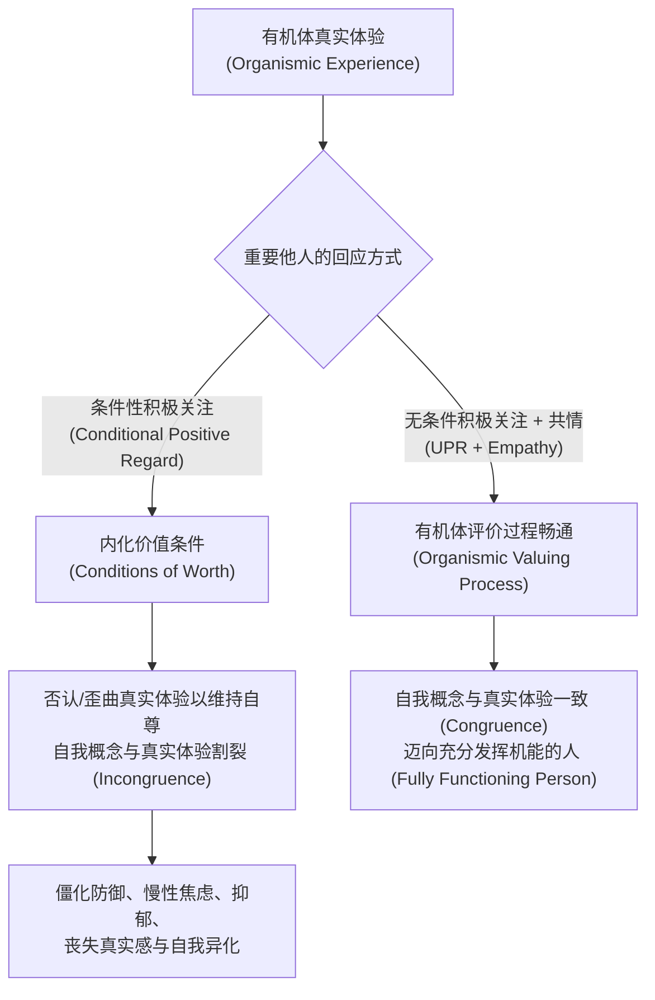

# 以人为中心疗法 / 来访者中心疗法 (Person-Centered Therapy, PCT / Client-Centered Therapy)

| 属性维度 | 核心内容 |
| :--- | :--- |
| **创立者与代表人物** | 卡尔·罗杰斯 (Carl R. Rogers, 1902–1987)；现代发展代表：Eugene Gendlin、Natalie Rogers、Brian Thorne、Mick Cooper |
| **所属流派** | 人本主义心理学派 (Humanistic Psychology) / 体验取向心理治疗先驱 |
| **循证等级** | **Level I - II**（APA第12分会及英国NICE指南认可对轻中度抑郁、人际关系困扰、自我认同危机、适应障碍具显著疗效；其“共同因素/治疗联盟”研究获最高级别元分析支持） |
| **核心作用机制** | 通过提供**真诚一致 (Congruence)**、**无条件积极关注 (Unconditional Positive Regard)** 与**准确共情理解 (Empathic Understanding)** 的关系氛围，消解外在**价值条件化 (Conditions of Worth)**，弥合真实自我与理想自我的割裂，激活个体内在的**自我实现倾向 (Actualizing Tendency)** 与有机体评价过程 |

---

## 一、 理论基础与作用机制 (Theoretical Foundation & Mechanism)

### 1. 人性观与有机体自我实现倾向 (The Actualizing Tendency)
卡尔·罗杰斯于20世纪40至50年代创立的以人为中心疗法（早期称“非指导性治疗 Non-directive Therapy”，后称“来访者中心疗法 Client-Centered Therapy”，最终扩展为“以人为中心取向 Person-Centered Approach”），彻底颠覆了精神分析的“决定论/病理学视角”与行为主义的“机械环境控制视角”，奠定了心理咨询与治疗领域的**人本主义第三势力**。

其核心哲学假设认为：人类有机体天生具备一种建设性的、指向成长与潜能充分绽放的内在生物与心理动力——**实现倾向 (Actualizing Tendency)**。如同植物即使被困在幽暗地下室，只要有一缕阳光便会向光生长一样，每一个人本质上都是值得信赖的、足智多谋的（Resourceful），具备自我理解、自我导向与建设性改变的内在潜能。治疗师并非“诊断并修理故障机器的专家”，而是“提供肥沃土壤、阳光与水分的园丁”。

### 2. 病理发生学：价值条件化与自我不一致 (Conditions of Worth & Incongruence)
既然人类天生具备实现倾向，心理痛苦与神经症又是如何产生的？罗杰斯提出了经典的**自我理论 (Self-Theory)** 与不一致模型：
* **有机体评价过程 (Organismic Valuing Process, OVP)**：婴幼儿最初依靠自身真实的内在生理与情感体验来判断事物的好坏（如饿了哭泣、被拥抱感到温暖舒适），此时**有机体体验 (Organismic Experience)** 与**自我概念 (Self-Concept)** 是高度重合、协调一致的。
* **积极关注的需要与价值条件化 (Need for Positive Regard & Conditions of Worth)**：随着个体成长，儿童极度渴望获得重要他人（父母、师长、社会文化）的爱、认可与接纳。然而，重要他人往往给出带有附加条件的关爱（例如：“只有当你考第一名、不发脾气、顺从听话时，爸爸妈妈才爱你”）。儿童被迫将这些外在评判内化为**价值条件 (Conditions of Worth)**。
* **不一致状态 (Incongruence) 与防御瓦解**：为了维持自我概念并获得条件性自尊，个体不得不歪曲（Distortion）或否认（Denial）那些不符合“价值条件”的真实有机体体验（例如：压抑合理的愤怒、否认内心的脆弱与个人真实志趣）。由此，**真实有机体体验 (Organismic Self)**、**退缩狭窄的自我概念 (Self-Concept)** 与**苛刻的理想自我 (Ideal Self)** 之间产生了深刻的割裂——即**自我不一致 (Incongruence)**。当现实生活事件强烈冲击这一脆弱的防御体系，导致个体无法继续否认真实感受时，便会爆发剧烈的存在性焦虑、抑郁、自我陌生感与心理失调。

### 3. 治疗改变的六个充分必要条件 (The Six Necessary and Sufficient Conditions)
罗杰斯在1957年发表的里程碑式论文《治疗性人格改变的必要与充分条件》中提出，无论采用何种流派技术，建设性的人格改变只需满足以下**六个条件**并持续一段时间：
1. **心理接触 (Psychological Contact)**：两个人（治疗师与来访者）处于真实的心理接触之中。
2. **来访者的不一致状态 (Client Incongruence)**：来访者处于自我不一致、脆弱（Vulnerable）或焦虑的状态。
3. **治疗师的真诚一致 (Therapist Congruence / Genuineness)**：治疗师在关系中是真实的、整合的、透明的，不隐藏在专业的面具或权威角色背后，其内在体验、意识觉察与外在表达高度一致。
4. **无条件积极关注 (Unconditional Positive Regard, UPR)**：治疗师对来访者的每一个面向都抱持温暖的、非占有的关切与接纳（Prizing），不附加任何评判标准，不论来访者此刻表现出怯懦、愤怒、防御还是欣喜，都同等地尊重其作为独立生命个体的价值。
5. **准确共情理解 (Empathic Understanding)**：治疗师能够敏锐、准确地进入来访者的**内部参照系 (Internal Frame of Reference)**，仿佛身临其境般体会来访者的私人世界（带有“宛如 as if”的品质，既感同身受又不丧失自我边界），并将这种理解传达给来访者。
6. **来访者的感知 (Client Perception)**：来访者哪怕在最低限度上，也能够感知并体验到治疗师所传递的无条件积极关注与共情理解。

### 4. 迈向“充分发挥机能的人” (The Fully Functioning Person)
在上述安全、无评判的治疗氛围中，来访者不再需要维持昂贵的心理防御，开始重新倾听并接纳曾经被否认的真实有机体体验。人格改变沿着罗杰斯提出的**过程连续体七阶段 (Seven Stages of Process)** 演进（从僵化封闭、远离内在体验的第一阶段，逐步走向情感自由流动、当下体验被充分觉察与接纳的第七阶段），最终成为**充分发挥机能的人 (Fully Functioning Person)**：对一切内在与外在体验开放（Openness to Experience）、活在当下的存在性生活（Existential Living）、高度信任自身的有机体感受（Organismic Trusting）、体验到自由感与创造力。

---

## 二、 适用情况与边界 (Applicable Conditions & Contraindications)

### 1. 临床适应症 (Clinical Indications)
* **轻中度抑郁障碍与心境恶劣 (Mild-to-Moderate Depression & Dysthymia)**：尤其是由长期自我压抑、活在他人期待中、丧失生命热情引发的抑郁状态。
* **人际关系困扰与依恋创伤修复**：长期在亲密关系或家庭关系中感到被控制、被评判、不敢表达真实自我、习惯性讨好（People-Pleasing）的个体。
* **适应障碍与生活转变危机 (Adjustment Disorders & Life Transitions)**：丧亲与哀伤辅导、职业转型迷茫、离婚/分手恢复、慢性疾病适应等需要情感倾诉与内在力量整合的阶段。
* **自我认同与自尊问题 (Identity & Self-Esteem Issues)**：严苛的自我批判、冒充者综合征（Impostor Syndrome）、青少年及成年早期的“我是谁”认同危机。
* **所有心理治疗的基础底色**：作为建立稳固治疗同盟（Therapeutic Alliance）、处理治疗破裂（Rupture Repair）及危机干预初期建立安全感的黄金准则。

### 2. 适用日常情绪、认知扭曲与心理图式
* **核心情绪困扰**：慢性羞耻感（“真实的我是丑陋/不配被爱的”）、自体异化与空虚感（“我像个提线木偶，不知道自己真正想要什么”）、委屈感、评价焦虑。
* **典型认知扭曲**：应该化陈述（Should Statements：“我必须时刻完美体面，绝不能流露软弱”）、贴标签（Labeling）、读心术与过度概括他人评判。
* **早期适应不良图式 (EMS)**：**缺陷/羞耻图式 (Defectiveness/Shame)**、**顺从图式 (Subjugation)**、**寻求认可/关注图式 (Approval-Seeking)**、**过高标准/苛刻批判图式 (Unrelenting Standards)**。

### 3. 适用人群特征
* 具备基本的言语表达与内省意愿，渴望被深度倾听与理解，而非寻求冷冰冰的“专家指令或说教”。
* 在成长经历中遭受过严厉控制、情感忽视或高条件性评价（“直升机父母”或高压功绩主义环境），对权威指导高度敏感甚至逆反的来访者。

### 4. 禁忌症与转介红线 (Contraindications & Referral Red Lines)
* **精神病性障碍急性发作期**：如精神分裂症伴随活跃幻觉、妄想或严重思维散漫，纯粹的非指导性探索可能加重其现实检验能力丧失，需优先进行精神科药物治疗与结构化支持。
* **急性自杀/自伤高风险或暴力危机**：当来访者处于即刻生命安全危机时，不能仅停留在非指导性倾听，必须立即启动结构化危机干预、安全计划制定（Safety Planning）及医疗/家属联动。
* **重度物质成瘾急性戒断期、重度强迫症 (OCD) 或特定惊恐障碍**：此类患者往往需要高度结构化的暴露与反应预防（ERP）、认知行为干预或脱毒医疗支持；若来访者强烈期待明确的行为技能训练且对非结构化探索感到极度焦虑挫败，需结合更结构化的疗法或进行知情协商。

---

## 三、 核心技术与具体方法 (Core Techniques & Sub-Methods)

罗杰斯反复强调，以人为中心疗法的精髓在于**治疗师的存在方式与态度 (Way of Being)**，而非机械套用技巧。但在临床实操中，要将三大核心条件精准传递给来访者，治疗师需要炉火纯青地掌握以下五大核心方法：

### 1. 深度主动倾听与跟随内部参照系 (Deep Active Listening & Tracking the Internal Frame of Reference)
* **原理**：放弃诊断评估的“外部参照系 (External Frame of Reference)”（即不站在旁观者角度分析来访者“为什么会这样”、“谁对谁错”、“有什么症状”），完全沉浸并跟随来访者主观体验到的现象学世界（Phenomenological World）。
* **操作公式**：
  $$\text{专注临在 (Presence)} + \text{悬置预设与评判 (Bracketing)} + \text{捕捉言语背后的情绪微表情与语调}$$
* **实操要点**：保持开放温和的躯体姿态与目光接触；允许建设性的沉默（Silence），不急于用提问填补空白，给来访者留出向内触碰感受的心理空间；绝不打断或生硬转移来访者正在深入的情感脉络。

### 2. 情感反映与意义反映 (Reflection of Feeling & Meaning)
* **原理**：这是传递“准确共情”最核心的载体。不仅复述事件内容（Paraphrasing），更要像一面清澈温暖的镜子，将来访者话语中显性或隐性的**核心情绪体验**与**个人意义**精准提炼并反馈回去，帮助来访者“听见并认领自己的真实感受”。
* **操作公式**：
  $$\text{共情反映} = \text{精准情绪词汇 (含强度级别)} + \text{触发该情绪的内在核心意义/关切} + \text{试探性核对语调}$$
* **句式模板**：
  * *“听起来，当[情境]发生的时候，你内心涌起了一股很深的[核心情绪，如无力感/被背叛的寒心]，因为对你而言，[核心价值/意义]是那么重要……是这样吗？”*
  * *“一方面你觉得必须承担起这个责任，另一方面你内心好像有个声音在喊‘我真的太累了’，这两种力量把你撕扯得好痛苦。”*（**矛盾情感反映 Double-sided Reflection**）

### 3. 切中边缘体验的深层共情 (Advanced Empathy / Edge-of-Awareness Reflection)
* **原理**：当来访者处于自我不一致状态时，某些深层脆弱体验（如愤怒背后的恐惧、冷漠背后的渴望）正处于意识觉察的“边缘”（Edge of Awareness / Gendlin所称的隐含体验）。治疗师捕捉这些呼之欲出却尚未被直接说出的弦外之音，温和地将其点亮。
* **操作要求**：必须永远保持**试探性 (Tentativeness)**，把修正权完全交给来访者。若来访者说“不完全是这样，其实更像是……”，说明共情成功激发了来访者的自我探索与有机体核对。

### 4. 无条件积极关注的去评判化接纳 (Non-Judgmental Prizing & Affirmation)
* **原理**：消解“价值条件化”的唯一解药，是让来访者在治疗关系中真实体验到：无论我暴露出多么“不够好、阴暗、矛盾或软弱”的部分，都不会遭到贬低、说教或抛弃；同时，我也不会因为表现得“懂事、顺从”而获得虚假的夸奖（注意：**表扬 Praise 往往也是一种条件性评判**，而**珍视 Prizing 是对人本身的无条件尊重**）。
* **操作禁忌与转换**：
  * **严禁做**：道德评判、提供廉价建议（“你应该跟他沟通一下”）、盲目乐观安慰（“别多想了，一切都会好起来的”——这实质上否认了来访者当下的痛苦）、盘问式连环提问（“你为什么不……？”）。
  * **应当做**：全然接纳来访者此刻的防御、退缩甚至不想改变的意愿（例如：*“我能感受到，现在去触碰那段回忆让你觉得太危险了，你想把自己保护起来，这完全是可以理解的，我们完全可以停在这里。”*）。

### 5. 治疗师的真诚一致与即时性自我表露 (Therapist Congruence & Immediacy)
* **原理**：真诚一致并非口无遮拦地宣泄私人情绪，而是当治疗师在关系中产生持续的、与来访者直接相关的真实感受（如感到困惑、感到与来访者之间有一堵墙、或深受触动）时，以不指责、负责任且服务于来访者利益的方式透明表达出来。
* **操作公式**：
  $$\text{“我”信息 (I-Statement：描述治疗师当下的真实内在体验)} + \text{与此时此地关系的联结} + \text{开放温暖的邀请}$$
* **示范话术**：
  * *“我想诚实地和你分享我此刻的一个感受：虽然你刚才一直在微笑着说‘没关系、我都习惯了’，但我看着你的眼睛，我心里却感受到一种沉甸甸的悲伤和心疼。我不知道我感受到的对不对？”*

---

## 四、 标准化实施流程 (Step-by-Step Implementation Process)

以人为中心疗法虽然反对机械僵化的预设议程，但完整、专业的临床会谈遵循清晰的有机演进脉络：

### 阶段一：会谈前准备与治疗师内在调谐 (Pre-Session Attunement)
* **Step 1：悬置自我与进入临在 (Preparing Presence)**
  * 治疗师在会谈前进行简短呼吸调整，放下上一位来访者的残留情绪、诊断手册标签及“我要治好他/给他出主意”的拯救者执念，调整至开放、好奇、温暖接纳的临在状态（Therapeutic Presence）。
* **Step 2：创设心理安全与设定非指导性框架 (Setting the Safe & Non-Directive Frame)**
  * 说明保密原则与会谈时间设置，传递权能赋权信息：*“在这里，这个空间和时间完全属于你。没有什么是‘应该’说或‘不应该’说的，你可以按照自己的节奏，从任何你此刻最想谈及或最困扰你的感受开始，我会在这里陪伴并倾听你。”*

### 阶段二：跟随内部参照系与情感澄清 (Tracking & Clarifying Experience)
* **Step 3：跟随叙事并锚定情绪坐标 (Following & Anchoring Affect)**
  * 来访者往往先从外部事件、他人行为或抽象观点谈起（对应罗杰斯改变过程第1-3阶段）。治疗师专注倾听，使用简短回应（“嗯”、“我听着呢”）和内容与情感反映，温和地将焦点从“外部发生了什么事”引向“这件事让你内心体验到了什么”。
* **Step 4：接纳矛盾并瓦解价值条件 (Accepting Ambivalence & Dissolving Conditions of Worth)**
  * 当来访者流露出自我批判（如“我不该这么自私/脆弱”）时，治疗师不进行辩论，而是同时共情其“渴望做好人的部分”与“感到委屈疲惫的真实部分”，通过无条件积极关注让来访者体会到：原来这两种声音都可以被安全地看见。

### 阶段三：深化边缘体验与促进自我一致 (Deepening into the Edge & Fostering Congruence)
* **Step 5：触碰核心脆弱与隐含体验 (Touching Core Vulnerability)**
  * 随着安全感加深，来访者进入过程第4-5阶段，压抑的深层情感（哀伤、恐惧、真实的渴望）浮现。治疗师放慢语速，运用深层共情与适度沉默，陪伴来访者停留在当下的生理与情感体验中，不催促、不逃避。
* **Step 6：治疗师真诚回响与体验重整 (Congruent Resonance & Re-integration)**
  * 来访者在被全然接纳的体验中，发生“顿悟性转换”（如：“我突然明白，我不是无能，我只是太久没有照顾过自己的感受了”）。治疗师以真诚一致的态度确认并见证这一有机体评价过程的复苏（过程第6-7阶段）。

### 阶段四：自然收束与赋权回归生活 (Natural Closure & Empowerment)
* **Step 7：尊重有机体自主节奏收尾 (Respectful Closure)**
  * 在会谈结束前5-10分钟温和提示时间，不布置强制性的指导作业，而是邀请来访者感受此刻的身心状态：*“今天我们触碰了很多很深也很真实的部分，在结束前，你感觉此时此刻自己心里是什么样的？”* 肯定来访者自身的勇气与内在智慧。

---

### ⚡ 【5-10分钟日常自助/陪伴微练习速查版】：“成为自己的无条件倾听者”
当你在日常生活中陷入自我攻击、纠结内耗，或需要陪伴痛苦的亲友时，可执行以下**5分钟罗杰斯式自我/他者关怀微流程**：
1. **第1分钟：暂停评判官 (Pause the Judge)**：深呼吸三次，在心里对自己说：*“接下来的5分钟里，我不需要解决问题，不需要评判自己对错，我只做自己最温柔的倾听者。”*
2. **第2-3分钟：真实情感命名 (Name the True Feeling)**：把手放在胸口，完成填空：*“此时此刻，撇开别人认为我‘应该’怎样，我内心最真实、最不加掩饰的感受是______（如：委屈、害怕、嫉妒、精疲力竭），甚至还有一点______。”*
3. **第4分钟：去条件化接纳宣言 (Unconditional Acceptance Statement)**：对着镜子或在心中默念：*“就算我现在感到[上述感受]，就算我今天没有做到完美，我依然完全允许自己有这样的感受。这只是说明我是一个真实的人，我的价值不需要靠取悦所有人来证明。”*
4. **第5分钟：倾听有机体微弱的需要 (Listen to Organismic Need)**：温和地问自己一句：*“此时此刻，我身体和内心最渴望的一件温和的小事是什么？”*（哪怕只是喝一杯热茶、哭一场或拒绝一个不合理的请求），并尊重这个内在声音。

---

## 五、 具体实施例子与实操示范 (Concrete Implementation Examples & Vignettes)

### 案例一：长期“讨好型人格”与重度职业倦怠的真实自我唤醒
#### 1. 场景背景
来访者林女士（32岁，互联网公司中层主管），长期受困于严苛的家庭“价值条件化”（父母从小灌输“只有懂事、不给别人添乱、事事第一才值得被爱”）。她在职场中从不敢拒绝上司与下属的要求，即使高烧也坚持加班，近期因一次小失误被领导轻微批评后，突然在办公室崩溃痛哭、失眠、产生强烈的自我厌恶与辞职冲动。

#### 2. 逐轮引导对话示例（展示核心三条件与情感反映）
* **来访者（低头绞着手指，苦笑）**：“我觉得自己特别矫情、特别没用。领导其实就是随口说了句方案细节不够好，别人被骂得更凶都像没事人一样，我居然躲去洗手间哭了半个小时。我怎么这么脆弱？我都32岁了，连这点抗压能力都没有，真是个废物。”
* **治疗师（语调温和、平缓，传递无条件接纳与双重反映）**：“林女士，我听见你在很严厉地责备自己，觉得自己‘不应该’为了这么一句话就崩溃，好像流眼泪是一件很丢脸、很没用的事……（停顿，眼神温暖注视）但同时，我也能感觉到，在洗手间哭了半个小时的你，心里一定委屈到了极点，像是一根绷了太久太久的弦，被那句话轻轻一碰，就再也撑不住了。”
* **来访者（愣了一下，眼圈瞬间泛红，声音哽咽）**：“对……我真的撑不住了。这半年我每天工作14个小时，连发烧39度都在改PPT，家里人住院我也没敢请假，因为我怕大家觉得我耽误进度。我已经拼尽全力去当一个好主管、好下属了，为什么只要有一点没做好，就全盘否定我？（眼泪掉下来，随即急忙拿纸巾擦并道歉）对不起，我又失态了……”
* **治疗师（真诚一致地表达共鸣，接纳其防御与脆弱）**：“你完全不需要跟我说对不起。看着你连掉眼泪都要马上道歉，我心里其实觉得很心疼。你发着高烧还在拼命，把所有人的期待都扛在肩膀上，却唯独没有给自己留一点点生病、犯错或者喊累的权利。当你听到那句批评时，那种‘我都已经把自己榨干了，你们还要我怎样’的寒心和绝望，真的太沉重了。”
* **来访者（终于放声哭出来，肩膀颤抖，片刻后长舒一口气）**：“从来没有人跟我说过这句话……从小到大，只要我哭或者说累，我妈就会说‘别人怎么不累？就你娇气’。我好像也变成我妈了，每天拿鞭子抽自己。其实我根本就不喜欢现在这份没日没夜的工作，我只是害怕一旦停下来，一旦我不是那个‘最靠谱的林主管’，我就什么都不是了。”
* **治疗师（切中边缘体验的深层共情，指向价值条件化与真实自我）**：“原来，那根不停抽打你的鞭子后面，藏着一个这么深的害怕——害怕如果不靠拼命表现、不靠满足所有人的要求，那个真实的、会累也会犯错的你，就不配得到认可和爱了。而此时此刻，你第一次这么清晰地听到了自己内心真正的声音：‘我真的太累了，我讨厌这样没日没夜地活在别人的评价里。’”
* **来访者（擦干眼泪，眼神变得清亮而平静）**：“是啊……说出来之后，我胸口那块压了好几个月的大石头好像松动了一点。原来承认自己撑不住、承认自己不想干，天也不会塌下来。”

#### 3. 干预前后对比
| 评估维度 | 干预前 (处于自我不一致 Incongruence) | 干预后 (迈向自我一致 Congruence) |
| :--- | :--- | :--- |
| **情绪状态** | 羞耻、自责、压抑的委屈、惊恐焦虑 | 哀伤得以安全释放，体验到被理解的温暖与平静 |
| **对待体验的方式** | 否认生理极限与愤怒，用内化的“价值条件”自我辱骂 | 认领真实的疲惫与害怕，觉察到父母内化声音与真实自我的区别 |
| **有机体评价过程** | 完全依赖上司与他人的外部评价定义自身价值 | 开始倾听内在身体的真实感受，允许自己拥有边界与限制 |

---

### 案例二：代际冲突中的大学生专业抉择危机（化解防御与激活自主权）
#### 1. 场景背景
来访者小陈（20岁，大二学生），在父母强迫下就读会计专业，本人极其热爱数字媒体艺术但被父母斥为“不务正业、以后要喝西北风”。小陈因多门会计课挂科被辅导员约谈后前来咨询，初期戒备心极强，认为咨询师也是“学校派来做思想工作劝他好好学本专业的老师”。

#### 2. 逐轮引导对话示例（展示非指导性态度与消除阻抗）
* **来访者（双臂交叉抱胸，身体后仰，语气充满挑衅）**：“老师，如果是辅导员让你来劝我重修高数和会计学原理的，那你省省力气吧。那些大道理我爸妈每天都在我耳朵边轰炸，我听够了。”
* **治疗师（平静、真诚，完全不设防，去权威化）**：“小陈，我很感谢你这么直接地把你的反感告诉我。如果我是你，到处被人按着头讲大道理，来到这里还要再听一遍，我也会觉得特别烦躁和反胃。我想清楚地告诉你，我不是替辅导员或者你父母来做说服工作的，我对你‘应该’学会计还是学别的没有任何预设。我只好奇，在这个被所有人轰炸的漩涡中心，你自己心里到底是什么滋味？”
* **来访者（愣住，交叉的手臂慢慢放下来，防备明显降低）**：“……你真的不劝我好好考试？我以为所有大人都觉得稳定找工作最重要。我心里的滋味？就是觉得自己在坐牢！我每次看到那些财务报表就想吐，我觉得我人生最好的四年正在被我爸妈亲手埋葬，但他们还口口声声说‘全是为了你好’！”
* **治疗师（准确共情其愤怒与窒息感，不评判其父母亦不评判其挂科）**：“那种感觉就像是被关进了一座名叫‘为你好’的监狱里。明明是你自己的人生、你最宝贵的青春，却完全不能由你自己做主，甚至连厌恶和痛苦都没人真正听见，这让你觉得既愤怒又窒息。”
* **来访者（声音低沉下来，从愤怒转向迷茫与脆弱）**：“对，我特别恨他们控制我，所以我故意不去上课、故意挂科，我想报复他们……可是挂科通知单下来的时候，我晚上躺在床上其实特别慌。我怕我真的被退学，也怕就算转去学数字艺术，万一我根本没天赋、万一真的像我爸说的那样养不活自己怎么办？我其实也没那么笃定……”
* **治疗师（温柔接住愤怒面具下的真实恐惧）**：“当我不去评判你挂科的时候，你把心里最深、最不敢让爸妈看到的那一面拿出来了——用挂科来反抗的背后，其实藏着你对自己未来的惶恐。你既不甘心在会计专业里枯萎，又害怕一旦自己掌舵去走艺术的路，万一失败了没人兜底，这种进退两难的害怕，真的很不容易独自承受。”

#### 3. 【内化价值条件 vs. 有机体真实体验】觉察澄清表（填写实例）
在以人为中心疗法的陪伴下，来访者可在会谈后自发整理以下自我觉察记录表：

| 探索维度 | 外在“价值条件化”的声音 (Conditions of Worth / 我应该...) | 内在“有机体真实体验”的声音 (Organismic Self / 我真实感受到...) | 迈向自我一致的整合方向 (Congruent Integration) |
| :--- | :--- | :--- | :--- |
| **关于专业与未来** | “只有学会计考公才算正途，学艺术就是不孝、不务正业。” | 面对报表感到生理性厌恶与窒息；画画和做建模时感到时间飞逝、充满生命力，但同时也害怕未来生计无着。 | 承认自己对艺术的热爱是真实的，同时也正视自己对生计安全的合理担忧，不再用自毁式挂科来抗议，而是为自己的选择搜集现实路径。 |
| **关于面对脆弱** | “男子汉要么硬刚到底，要么乖乖听话，承认害怕就是认输。” | 我其实很渴望得到父母的祝福，我也很害怕自己搞砸。 | 接纳自己既想要自由又感到害怕的真实状态，勇敢为自己的决定承担责任。 |

---

## 六、 权威参考文献 (References)

1. **Rogers, C. R.** (1951). *Client-centered therapy: Its current practice, implications, and theory*. Houghton Mifflin. （以人为中心疗法奠基巨著，系统阐述自我理论与非指导性临床实践）
2. **Rogers, C. R.** (1957). The necessary and sufficient conditions of therapeutic personality change. *Journal of Consulting Psychology*, 21(2), 95–103. （心理学史上被引最高的经典文献之一，提出心理治疗改变的六个充分必要条件）
3. **Rogers, C. R.** (1961). *On becoming a person: A therapist's view of psychotherapy*. Houghton Mifflin. （《成为一个人》，完整呈现过程连续体七阶段与“充分发挥机能的人”的哲学与临床图景）
4. **Rogers, C. R.** (1980). *A way of being*. Houghton Mifflin. （罗杰斯晚期代表作，探讨治疗师的“存在方式”、深度共情与跨领域人本应用）
5. **Mearns, D., & Thorne, B.** (2013). *Person-centred counselling in action* (4th ed.). SAGE Publications. （当代以人为中心咨询实操指南，提出“关系深度 Relational Depth”与“自我配置 Configurations of Self”概念）
6. **Cooper, M., O'Hara, M., Schmid, P. F., & Bohart, A. C. (Eds.).** (2013). *The handbook of person-centred psychotherapy and counselling* (2nd ed.). Palgrave Macmillan. （全面汇总以人为中心疗法的当代实证研究、神经生物学机制及跨诊断应用）
7. **Elliott, R., Bohart, A. C., Watson, J. C., & Murphy, D.** (2018). Therapist empathy and client outcome: An updated meta-analysis. *Psychotherapy*, 55(4), 399–410. （APA治疗关系工作组权威元分析，证实治疗师共情对临床疗效的显著中等效应量 $d = 0.58$）
