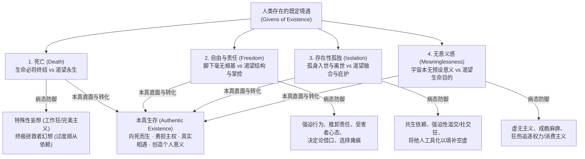

# 存在主义心理治疗 (Existential Psychotherapy)

| 属性维度 | 核心内容 |
| :--- | :--- |
| **创立者与代表人物** | 欧文·亚隆 (Irvin D. Yalom)、罗洛·梅 (Rollo May)、路德维希·宾斯旺格 (Ludwig Binswanger)、梅达·鲍斯 (Medard Boss)、艾米·范·德尔森 (Emmy van Deurzen)、Kirk Schneider |
| **所属流派** | 存在-人本主义心理学派 (Existential-Humanistic Psychology) / 融合欧洲存在主义哲学（克尔凯郭尔、尼采、海德格尔、萨特、加缪）与临床心理动力学 |
| **循证等级** | **Level II**（在晚期癌症/姑息治疗心理干预、丧亲哀伤、存在性危机、中年危机及死亡焦虑领域获高质量RCT与元分析实证支持；Vos et al., 2015 证实结构化存在主义疗法显著提升生命意义感并降低精神病理症状） |
| **核心作用机制** | 剥离神经症性的逃避防御机制，协助来访者勇敢直面人类无法回避的**四大终极存在关怀（死亡、自由与责任、存在性孤独、无意义感）**，将麻痹性的**神经症性焦虑 (Neurotic Anxiety)** 转化为建设性的**存在性焦虑 (Existential Anxiety)**，将**存在性内疚 (Existential Guilt)** 转化为活在当下、承担生命主权的本真生存（Authentic Existence） |

---

## 一、 理论基础与作用机制 (Theoretical Foundation & Mechanism)

### 1. 存在主义动力学模型：与终极关怀的对峙
欧文·亚隆（Irvin D. Yalom）在其1980年出版的传世巨著《存在主义心理治疗》中，将欧洲存在主义哲学（海德格尔的“此在 Dasein 与向死而生”、萨特的“存在先于本质”、克尔凯郭尔的“畏与眩晕”）转化为可操作的临床心理动力学框架。

与弗洛伊德精神分析认为冲突源于“被压抑的本能驱力”不同，存在主义心理治疗提出了一条全新的**存在主义心理动力学公式**：
$$\text{觉察终极存在关怀 (Awareness of Ultimate Concerns)} \longrightarrow \text{存在性焦虑 (Existential Anxiety)} \longrightarrow \text{防御机制与逃避 (Defense Mechanisms)} \longrightarrow \text{临床神经症症状 (Psychopathology)}$$

所谓**“终极存在关怀 (Ultimate Concerns of Existence)”**，是指任何人类只要活着、只要深入反思自身的处境，就无法逃避的四个既定事实（Givens of Existence）。当个体遭遇**“边界境遇 (Boundary Situations / 雅斯贝尔斯概念)”**——如重病诊断、挚爱离世、重大失业、步入中老年、离婚或重大人生抉择时，日常粉饰太平的帷幕被撕裂，个体被迫直面这四大终极事实：

### 2. 四大终极存在关怀及其防御病理学 (The Four Ultimate Concerns)

1. **死亡 (Death)**：
   * **核心存在张力**：对死亡不可避免性的清醒意识，与渴望继续生存下去的本能愿望之间的冲突。
   * **病态防御机制**：亚隆指出，人类为了防御死亡焦虑，发展出两种主要的潜意识神经症盾牌：一是**“个人特殊性信念 (Specialness)”**（认为死亡只发生在别人身上，通过工作狂、病态自恋、控制狂或强迫性积累财富来制造“我不受自然法则限制”的幻觉）；二是**“终极拯救者信念 (The Ultimate Rescuer)”**（将某位伴侣、权威、机构或虚幻力量神圣化，通过彻底的顺从、依赖与讨好，祈求被全能的力量永远庇护）。一旦这两种防御破产，便会爆发惊恐发作、疑病症或深重抑郁。
2. **自由与责任 (Freedom and Responsibility)**：
   * **核心存在张力**：在存在主义看来，宇宙没有任何预设的蓝图，“存在先于本质 (Existence precedes essence)”，人类脚下是毫无根基的深渊（Groundlessness）。个体不仅是自己生活的设计师（Author），更必须为自己的选择、行动乃至不行动承担全部责任。
   * **病态防御机制**：为了逃避自由带来的眩晕感（克尔凯郭尔所称的“自由的眩晕”），人们常通过**责任转移**（怪罪原生家庭、伴侣、社会环境）、**强迫性规则僵化**、**习得性无助与受害者角色**，甚至放弃选择权（拖延症、选择瘫痪）来假装自己“别无选择”。当个体违背自身潜能、未活出本真生命时，便会产生深层的**存在性内疚 (Existential Guilt)**——即对“自己辜负了自己未活出的生命”的愧疚。
3. **存在性孤独 (Existential Isolation)**：
   * **核心存在张力**：不同于人际孤独（缺乏社交技巧）和心理内部孤独（自我割裂），**存在性孤独**是指无论我们与他人的关系多么亲密，在自我与他人之间永远横亘着一道无法彻底跨越的鸿沟——我们独自一人来到这个世界，也终将独自一人离开这个世界。
   * **病态防御机制**：通过**病态共生融合 (Fusion)**（在恋爱或婚姻中完全丧失自我边界，“没有你我就活不下去”）、**被关注成瘾**或将他人当作抵御孤独的“观众与工具”，最终反而因丧失真实自我而更加孤独。
4. **无意义感 (Meaninglessness)**：
   * **核心存在张力**：人类是一个不断追寻意义的物种，却被抛入了一个本身没有内置意义、冷漠而偶然的宇宙之中。
   * **病态防御机制**：陷入虚无主义的快感缺失、犬儒主义、消费主义成瘾或无聊性空虚（Sunday Neurosis 周日神经症）。

### 3. 核心转化机制：从神经症性焦虑到本真生存
罗洛·梅与亚隆指出，治疗的目标**绝不是消除存在性焦虑**（因为只要活着，存在性焦虑就是正常的生命脉搏），而是拆除那些扭曲、僵化、消耗生命力的**神经症性焦虑 (Neurotic Anxiety)** 与防御盔甲。通过海德格尔所说的“向死而生 (Being-towards-death)”，让死亡意识成为唤醒生命紧迫感与优先级的催化剂；通过接纳自由与存在性孤独，学会在“同舟共济的旅伴 (Fellow Travelers)”关系中建立马丁·布伯式的**“我-你关系 (I-Thou Relationship)”**，并在无意义的宇宙中亲手创造属于自己的尘世意义。

---

## 二、 适用情况与边界 (Applicable Conditions & Contraindications)

### 1. 临床适应症 (Clinical Indications)
* **存在性危机与重大生命转折 (Existential Crises & Boundary Situations)**：中年危机（Midlife Crisis）、空巢期、退休适应、重大职业幻灭、移民文化冲击。
* **疾病心理肿瘤学与姑息关怀 (Psycho-Oncology & Palliative Care)**：癌症及重病确诊患者、大病幸存者、慢性进行性疾病患者的死亡恐惧与生命意义重建。
* **复杂性哀伤与丧亲辅导 (Bereavement & Grief)**：挚爱离世不仅带来失去他人的悲伤，更直接撕开幸存者自身的死亡焦虑与存在性孤独。
* **存在性抑郁与无意义感综合征**：物质条件优渥、外在世俗成功，却深感内心空洞、虚无、“不知道活着为了什么”的个体。
* **慢性拖延、决定困难与长期处于耗竭关系中不敢离开的个体**（自由与责任议题）。

### 2. 适用日常情绪、认知扭曲与心理图式
* **核心情绪困扰**：存在性空虚与虚无感、深层死亡/衰老恐惧、存在性内疚（“我这一生都在替别人活，辜负了自己”）、对独处的极度恐慌、选择焦虑。
* **典型认知与防御偏差**：外部控制归因（“都是因为原生家庭/伴侣毁了我，我没办法”）、特殊性全能幻觉（“只要我足够拼命/完美，厄运就不会降临”）、共生拯救幻想。
* **早期适应不良图式 (EMS)**：**依赖/无能图式 (Dependence/Incompetence)**、**纠缠/未分化自我图式 (Enmeshment)**、**脆弱性图式 (Vulnerability to Harm or Illness)**、**自我牺牲图式 (Self-Sacrifice)**。

### 3. 适用人群特征
* 具备一定抽象反思能力与哲学内省倾向，不满足于表层症状消除或机械行为矫正，渴望探讨生命深层价值、自由边界与真实关系的成年来访者。

### 4. 禁忌症与转介红线 (Contraindications & Referral Red Lines)
* **急性自杀危机伴随虚无主义崩溃**：当来访者正处于“既然人终有一死、生命毫无意义，那我现在就去死”的急性自杀意念发作期时，切忌直接进行高强度的“死亡脱敏或宇宙无意义”哲学解构，必须优先执行安全保障、建立危机联结与希望锚点。
* **精神病性障碍急性期、重度躁狂发作或严重认知功能受损**。
* **仅寻求短期特定症状快速消除（如单纯特定动物恐惧症、急性考前失眠技巧）且排斥深层人生反思的来访者**。

---

## 三、 核心技术与具体方法 (Core Techniques & Sub-Methods)

存在主义心理治疗反对机械的技术主义，但其临床大师们发展出了一系列极具震撼力与唤醒力的体验性与现象学技术：

### 1. 死亡唤醒与墓志铭/生命线技术 (Mortality Awakening, Epitaph & Lifeline Exercises)
* **原理**：正如亚隆所言：“虽然死亡在肉体上毁灭了我们，但关于死亡的观念却能够拯救我们。”通过打破对死亡的否认，借用死亡这面最诚实的镜子，瞬间滤除世俗琐事的噪音，照亮什么是生命中真正重要的事。
* **操作公式**：
  $$\text{直面生命有限性可视化} + \text{审视当下生活轨迹与未活出的遗憾} + \text{倒推当下的本真行动选择}$$
* **具体子方法**：
  * **生命尺/直线练习 (The Straight Line)**：在纸上画一条线段，一端代表出生，一端代表死亡，请来访者标出自己目前所在的位置，凝视剩下的线段长度，并探讨：*“看着仅剩的这段距离，你现在每天耗费80%精力去纠结或讨好的事情，在整条线上占什么位置？”*
  * **墓志铭与讣告编写 (Epitaph & Obituary Exercise)**：邀请来访者写下两个版本的墓志铭——版本A：“如果我继续按照目前这种压抑、顺从、拖延的方式活到死，我的墓碑上只能如实写下什么？”版本B：“我内心深处真正渴望在离开世界那天被铭记的墓志铭是什么？”
  * **一年生命假定 (The One-Year-to-Live Fantasy)**：假设生命只剩最后一年（且无躯体剧痛），你将如何度过？你会停止做什么？开始做什么？对谁说出什么话？

### 2. 责任承担语言转换与存在性内疚转化 (Responsibility Assumption & Transforming Existential Guilt)
* **原理**：来访者常使用被动、无助的语言隐藏自己在生活境遇中的共谋角色（Complicity）。治疗师通过精准的语言转换与共谋洞察，将其从“无辜受害者”唤醒为“生命的主体作者”。
* **操作公式**：
  1. **“不能”转换为“不愿/选择不” (Replacing "Cannot" with "Will Not / Choose Not To")**：每当来访者说*“我不能离开这个伤害我的伴侣 / 我不得不每天加班讨好老板”*时，邀请其大声重复：*“我选择不离开他 / 我选择每天加班讨好老板，因为我不愿意承担离开或拒绝所带来的孤独与风险。”*
  2. **挖掘痛苦境遇中的自我共谋 (Identifying Personal Role in Distress)**：温和而犀利地提问：*“即使在这个糟糕的处境中，有99%都是外部环境或他人的错，那属于你自己促成或维持它的1%是什么？”*
  3. **倾听存在性内疚的呼唤**：将“我对不起自己未活出的潜能”的内疚，转化为此刻重掌方向盘的行动燃料。

### 3. 去认同化练习：“我是谁？”剥离技术 (Disidentification Exercise - "Who Am I?")
* **原理**：人们常将自己的存在完全等同于外在的社会角色、头衔、财产或某段关系，一旦失去这些附属物，就会体验到等同于死亡的自我崩溃。
* **操作步骤**：
  1. 请来访者在8张卡片上写下回答“我是谁？”的8个核心身份（如：某公司总监、母亲、某人的妻子、高学历者、好人等）。
  2. 请来访者按重要性从最次要到最核心排列。
  3. 治疗师引导来访者逐一翻面拿走每一张卡片，并在每拿走一张时闭眼冥想1分钟：*“如果剥夺了这个身份，我还存在吗？剩下的我是谁？”*
  4. 帮助来访者触碰到剥离所有社会标签后，那个纯粹的、具有无限选择潜能的**超越性自我意识中心 (Transcendental Ego)**，消解对世俗得失的死亡级恐惧。

### 4. 此时此地真实相遇与解构共生迷思 (Here-and-Now Authentic Encounter & Dismantling Fusion)
* **原理**：治疗室是来访者人际世界的微观缩影（Social Microcosm）。治疗师不扮演高高在上的神秘空白屏幕，而是作为“同舟共济的旅伴”，与来访者在此时此地建立真实的“我-你相遇”。
* **实操要点**：
  * 当来访者试图将治疗师变成“终极拯救者”（过度依赖、讨好或祈求标准答案）或试图用社交寒暄逃避亲密接触时，治疗师在当下直接温和点破：*“我注意到，每当我们靠近你内心孤独的时候，你就会开始讲笑话逗我开心。好像你觉得只有让我感到愉快，我才不会丢下你，是这样吗？”*
  * 协助来访者区分**“源于恐惧匮乏的需要型爱 (Need-Love)”**与**“两个独立完整灵魂自由关怀的给予型爱 (Gift-Love / 存在性爱)”**。

### 5. 尘世意义的四维建构 (Constructing Secular Meaning)
* **原理**：亚隆指出，虽然宇宙没有预设的绝对意义（Cosmic Meaning），但人必须投入并创造个人的尘世意义（Terrestrial Meaning）。
* **四大尘世意义源泉激活**：
  1. **利他主义 (Altruism)**：让世界因自己的存在而稍微变好一点点、减轻他人的痛苦。
  2. **为理想事业奉献 (Dedication to a Cause)**：投入高于纯粹自我利益的目标。
  3. **创造力 (Creativity)**：无论是艺术创作、开发项目、烹饪还是创造一种独特的生活方式。
  4. **自我超越与传承 (Self-Transcendence & Generativity / 波纹效应 Rippling)**：亚隆提出的**“波纹效应 (Rippling)”**——我们每一个善意、智慧或勇敢的举动，都会像投入湖心的石子一样，在周围人、后代乃至陌生人心中荡开看不见的同心圆波纹，跨越死亡继续传递。

---

## 四、 标准化实施流程 (Step-by-Step Implementation Process)

结合艾米·范·德尔森 (Emmy van Deurzen) 的存在维度探索与亚隆的临床路径，标准化实施流程分为以下七个步骤：

### 阶段一：现象学悬置与生命四维世界盘点 (Phenomenological Exploration)
* **Step 1：悬置诊断标签，进入来访者的生活世界 (Bracketing & Entering the Lifeworld)**
  * 放下DSM症状清单的机械归类，以现象学态度倾听来访者此刻在四个存在维度上的真实生存处境：
    * **物理世界 (Umwelt)**：与身体、疾病、衰老、自然环境及死亡的关系；
    * **社交世界 (Mitwelt)**：与他人、亲密关系、孤独及社会角色的关系；
    * **个人内部世界 (Eigenwelt)**：与自我认同、自由选择、内疚及真实性的关系；
    * **精神意义世界 (Überwelt)**：与终极价值、信仰及生命目的的关系。

### 阶段二：识别终极关怀与拆解适应不良防御 (Unmasking Ultimate Concerns & Defenses)
* **Step 2：穿透表层困扰，定位底层终极存在关怀**
  * 分析来访者当前的焦虑、抑郁或关系危机，究竟是哪一个终极关怀（死亡、自由、孤独、无意义）被边界境遇所触发。
* **Step 3：温和暴露神经症性防御机制的代价**
  * 协助来访者看清：为了逃避死亡焦虑而成为工作狂，反而扼杀了当下的生活（*“为了避免死亡，你拒绝了活着”*）；为了逃避自由责任而维持强迫顺从，反而制造了深重的存在性内疚；为了逃避孤独而共生依附，反而失去了真实的爱。

### 阶段三：存在性对峙与主体权能唤醒 (Existential Confrontation & Awakening Agency)
* **Step 4：实施体验性对峙练习（如生命线、墓志铭、责任语言转换）**
  * 引导来访者不再躲避，在治疗关系的安全容器内直面生命的有限性、自身的孤立性以及不可推卸的选择自由。
* **Step 5：哀悼既定限制，认领自由空间 (Mourning the Givens & Claiming Freedom)**
  * 帮助来访者为那些无法改变的既定事实（如无法重来的过去、终将老去的身体、父母的局限）完成真实哀悼，并将全部生命能量收回至当下自己拥有100%主权的选择空间。

### 阶段四：投入生活与意义行动践行 (Engagement & Authentic Action)
* **Step 6：将存在性顿悟转化为具体的生活承诺 (From Insight to Commitment)**
  * 亚隆强调，没有行动的顿悟是苍白的。支持来访者在现实生活中做出勇敢的本真选择（如拒绝虚假社交、开启搁置多年的理想、向挚爱敞开真实脆弱）。
* **Step 7：培养“命运之爱 (Amor Fati)”与治疗收束**
  * 甚至连同治疗的结束（分离本身就是一次微缩的“死亡与孤独”练习）也作为存在主义工作的一部分，帮助来访者带着对生命的深切热爱与勇气独立前行。

---

### ⚡ 【5-10分钟日常自助/陪伴微练习速查版】：“存在主义清醒三问与主权回收”
当你深陷日常琐事内耗、拖延逃避或觉得日子过得像行尸走肉时，用5分钟进行以下存在主义微校准：
1. **第一问【向死而生的视角拉远 (Zoom Out to Mortality)】（2分钟）**：
   * 闭上眼深呼吸，想象自己已经85岁，坐在临终前的摇椅上回望今天。问自己：*“在85岁的我看来，今天让我焦虑崩溃/死要面子的这件事，到底有多重要？85岁的我会对今天的我说一句什么话？”*
2. **第二问【从‘我不得不’到‘我选择’的主权转换】（2分钟）**：
   * 写下一件你最近一直在抱怨的事：*“我不得不忍受______。”*
   * 划掉它，改成：*“我目前选择继续留在/做______，因为这样做帮我逃避了______的风险/代价。同时，我也完全拥有在准备好时做出改变的自由。”*（瞬间消除受害者无力感）。
3. **第三问【今日的本真微承诺 (Authentic Micro-Act)】（1分钟）**：
   * 问自己：*“如果今天是我生命中不可复制的一天，为了不留存在性内疚，我今天可以为自己或我真正在乎的人做哪一件真实的小事？”* 并立即去执行。

---

## 五、 具体实施例子与实操示范 (Concrete Implementation Examples & Vignettes)

### 案例一：重病康复后的“特殊性防御崩溃”与向死而生转化（死亡与意义关怀）
#### 1. 场景背景
来访者赵先生（46岁，律所高级合伙人），半年前体检查出早期肾癌并成功手术切除，医学预后极佳（五年生存率>95%）。但术后赵先生却陷入严重的惊恐发作与虚无性抑郁，完全无法回去工作，整日瘫在沙发上，觉得“赚再多钱、打赢再多官司最后还不是一把灰”。

#### 2. 逐轮引导对话示例（解构特殊性幻觉 + 墓志铭与波纹效应干预）
* **来访者（眼神空洞，苦笑）**：“医生说我肿瘤切得很干净，跟正常人一样了。可只有我自己知道，以前的那个我已经死了。以前我每天工作16个小时，觉得自己是无所不能的金牌律师，只要我账户里的数字一直涨、职位一直升，我就永远处于上风。可躺在手术推车上看着走廊顶灯往后退的那几分钟，我突然发现，在死神面前我跟路边一只蚂蚁没有任何区别。既然最后都要死，我以前像疯狗一样争名夺利到底算什么？全是笑话！”
* **治疗师（深度共情其边界境遇冲击，温和命名“特殊性防御”的瓦解）**：“赵先生，那段躺在手术推车上看顶灯的经历，不仅是一次手术，更是一场地震。在那之前，你用没日没夜的拼命、财富和金牌合伙人的光环，在自己周围筑起了一道高墙，潜意识里以为只要自己足够优秀、足够强大，衰老和死亡的法则就追不上你。而那张诊断书一锤子砸碎了这道墙。你现在感到的虚无，其实是因为旧的盔甲碎了，而你还没找到不靠盔甲活着的方式。”
* **来访者（身体微微前倾，眼神聚焦）**：“对！我以前真的觉得死是七八十岁以后的事，甚至是别人家的事。现在这道墙碎了，我看到前面就是墓地，那我现在干什么还有什么意义？”
* **治疗师（引入墓志铭与未活出的生命视角，区分两类死亡焦虑）**：“我们常以为自己害怕的是‘死去’，但很多时候，最让我们恐慌的其实是——‘当死亡来临时，我发现自己从来没有真正活过’。如果手术推车上的那一刻真的就是终点，回看你过去46年的人生，最让你觉得遗憾、觉得对不起自己的地方是什么？”
* **来访者（沉默良久，声音颤抖）**：“……是我从来没有好好抱过我12岁的女儿，我连她最喜欢什么颜色都不知道；是我年轻时最热爱古典吉他和公益法律援助，但为了爬上合伙人的位置，我把吉他锁进储藏室十年了，接的全是给富豪洗脱责任的商业案子。如果我半年前死了，我的墓碑上只能写：‘这里躺着一个很会赚钱但连女儿都不认识他的机器。’”
* **治疗师（转化存在性内疚，激活本真选择与波纹效应）**：“你听听你刚才说的这句话，多么清醒，又多么珍贵！正是因为那场癌症让你提前看到了墓碑，你才没有在70岁真正临终、再也没有任何时间弥补的时候才发现这个遗憾。手术把生命还给了你——那个‘为虚荣和永生幻觉打工的机器’确实死在了手术台上，那么从今天起，这个重新活过来的赵先生，你想怎样改写这块墓碑？”
* **来访者（眼泪滑落，但眼神里第一次重新燃起光芒）**：“我不想再为了证明自己无所不能去接那些让我恶心的案子了。我想每周留出两天做弱势群体的法律援助，我想今晚回家就打开储藏室把吉他拿出来，陪我女儿一起弹琴。”

---

### 案例二：慢性情感顺从与受害者心态的“自由与责任”唤醒
#### 1. 场景背景
来访者孙女士（38岁，国企职员），在一段冷漠且充满贬低的婚姻中隐忍了10年，同时放弃了原本去外地深造的艺术策展机会。每次会谈都花费大量时间控诉丈夫自私、母亲控制欲强，反复说“我都是被他们逼的，我这辈子全毁在他们手里了”。

#### 2. 逐轮引导对话示例（责任语言转换与共谋洞察）
* **来访者（叹气，满脸怨怼）**：“上周末我老公又当着亲戚的面讽刺我只是个端茶倒水的科员，我妈还帮腔说女人安稳顾家就行。当年要不是我妈以死相逼不让我去上海读研，要不是我老公婚后不支持我考证，我现在早就是策展人了！我每天被困在这个死气沉沉的家里，我真的是一点办法都没有，我不能离婚，也不能辞职，我完全被他们绑架了。”
* **治疗师（温和而坚定地引入存在主义对峙与语言转换）**：“孙女士，我听到了你这十年里压抑了太多的委屈和不甘。但同时，作为陪伴你的旅伴，如果我只是跟着你一起谴责你丈夫和你母亲，那其实是在害你——因为那等于我也认同你是一个毫无力量的木偶。我们今天做一个小实验好吗？把你刚才说的‘我不能离婚，我也不能再去追寻策展’，换成‘我选择不离婚，我选择不去追寻策展’，你试着大声说一遍，看看心里是什么感觉？”
* **来访者（立刻皱眉抗议）**：“什么叫‘我选择’？我怎么可能自己选择受罪！明明是他们逼我的！”
* **治疗师（不退缩，直面自由的眩晕与逃避的收益）**：“他们确实给了你巨大的压力，但今年38岁的你，双腿没有被铁链锁住。请你试着说一遍那句话：‘是我自己选择留在原地。’看看是什么让你做出了这个选择？”
* **来访者（犹豫再三，咬着嘴唇低声说）**：“……是我自己选择不离婚，选择不去上海……（突然愣住，眼泪涌出来）天哪，说这句话让我觉得好难受，甚至有点羞耻。因为……因为如果我不听他们的，如果我真的离婚去上海闯，万一我混得一塌糊涂、穷困潦倒，那就全是我自己的错了！只要我听他们的留在原地，就算过得再不幸福，我也可以一辈子理直气壮地怪他们毁了我，我就不用承担失败的恐惧了……”
* **治疗师（深度肯定这一勇敢的存在性洞察）**：“孙女士，我由衷地敬佩你此刻的诚实！你刚刚看清了一个最深刻的真相：放弃自由、扮演无助的受害者，虽然痛苦，但它替你挡住了‘独自一人为人生兜底’的巨大恐惧。但它的代价是，你每天都在吞咽‘辜负了自己生命’的存在性内疚。现在，既然你知道钥匙其实一直攥在你自己手里，你愿意为自己的幸福承担一点点风险吗？”

#### 3. 【存在主义四大终极关怀自我觉察与转化工作表】（填写实例）

| 终极关怀维度 | 触发的边界境遇 (Boundary Situation) | 旧有的逃避与神经症性防御 (Inauthentic Defense) | 付出的生命代价与存在性内疚 (Existential Guilt) | 本真直面与主权行动重构 (Authentic Action) |
| :--- | :--- | :--- | :--- | :--- |
| **1. 死亡与有限性** | 46岁确诊早期肾癌并手术 | 拼命加班赚钱维持“个人特殊性/无坚不摧”幻觉；术后陷入虚无绝望 | 十年未陪伴女儿成长，放弃热爱的吉他与公益初心 | 接纳生命有限，砍掉虚荣应酬，每周二四早归陪女儿，重启公益法律援助（创造波纹效应） |
| **2. 自由与责任** | 38岁婚姻冷漠与职业停滞 | 用“我不能/都是他们逼我的”受害者叙事推卸选择责任 | 把人生方向盘交给母亲和丈夫，活在慢性怨恨与自我荒废中 | 认领“是我选择用顺从来换取安全感”，报名周末独立策展工作坊，为自己的选择买单 |
| **3. 存在性孤独** | 独居周末或伴侣出差时的极度恐慌 | 疯狂刷社交软件、强迫性参加无意义酒局以填补空白 | 表面热闹，散场后内心更加荒凉空洞，失去与自我相处的能力 | 练习每周独处半天不看手机，在阅读与自然漫步中建立与自我的友好陪伴，在关系中建立真实的“我-你”对话 |
| **4. 意义与无意义** | 晋升总监后陷入深度空虚（成功抑郁） | 沉迷奢侈品消费与绩效排名竞赛 | 沦为外在评价体系的奴隶，内心干涸 | 从“向宇宙索要现成意义”转向“亲手创造尘世意义”，发起青年设计师公益导师计划 |

---

## 六、 权威参考文献 (References)

1. **Yalom, I. D.** (1980). *Existential psychotherapy*. Basic Books. （存在主义心理治疗领域至高无上的里程碑巨著，系统创立“死亡、自由、孤独、无意义”四大终极关怀临床动力学体系）
2. **Yalom, I. D.** (2008). *Staring at the sun: Overcoming the terror of death*. Jossey-Bass. （《直视骄阳：征服死亡恐惧》，深入拆解死亡焦虑的临床表现、觉醒体验、波纹效应及干预技术）
3. **Yalom, I. D.** (2002). *The gift of therapy: An open letter to a new generation of therapists and their patients*. HarperCollins. （《给心理治疗师的礼物》，85条关于此时此地真实相遇、治疗师自我表露与存在主义态度的临床结晶）
4. **May, R.** (1983). *The discovery of being: Writings in existential psychology*. W. W. Norton & Company. （美国存在心理学之父罗洛·梅代表作，阐述“此在 Dasein”、存在性内疚与神经症性焦虑的本质区别）
5. **May, R.** (1977). *The meaning of anxiety* (Rev. ed.). W. W. Norton & Company. （深度剖析焦虑的哲学与心理学根源，提出将存在性焦虑转化为创造性勇气的临床路径）
6. **van Deurzen, E.** (2012). *Existential counselling & psychotherapy in practice* (3rd ed.). SAGE Publications. （英国存在主义治疗学派领军人物代表作，提出物理、社交、个人、精神“四维生命世界 Four Dimensions of Existence”临床评估框架）
7. **Schneider, K. J., & Krug, O. T.** (2017). *Existential-humanistic therapy* (2nd ed.). American Psychological Association. （APA官方出版的存在-人本主义疗法临床指南，整合体验性临在技术与现代实证研究）
8. **Vos, J., Craig, M., & Cooper, M.** (2015). Existential therapies: A meta-analysis of their effects on psychological outcomes. *Journal of Consulting and Clinical Psychology*, 83(1), 115–128. （权威元分析研究，涵盖21项随机对照试验，证实结构化存在主义疗法对提升生命意义感、改善精神病理症状具有显著实证疗效）
