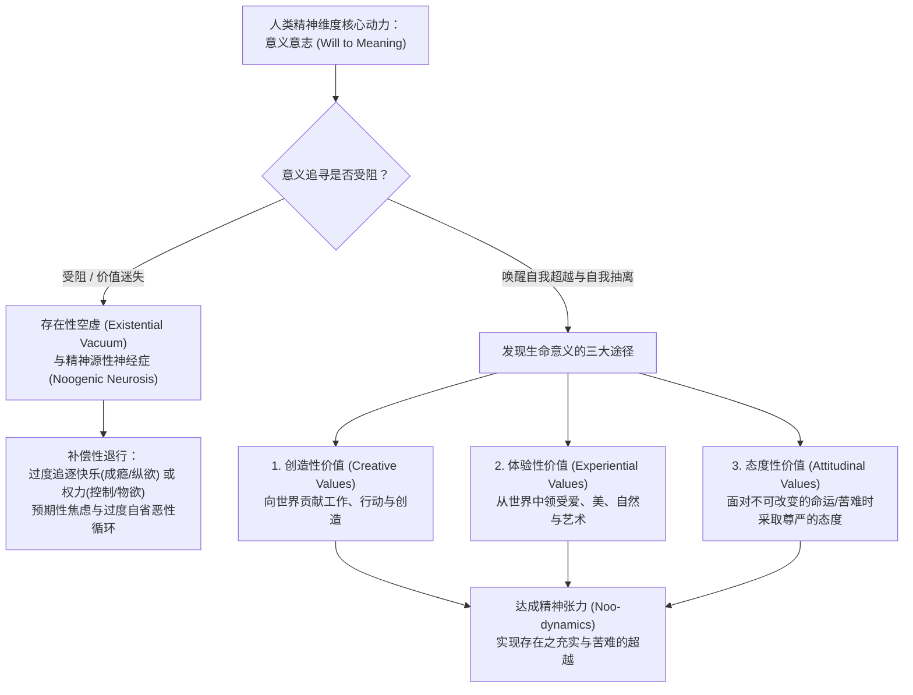

# 意义疗法 (Logotherapy)

| 属性维度 | 核心内容 |
| :--- | :--- |
| **创立者与代表人物** | 维克多·弗兰克尔 (Viktor E. Frankl, 1905–1997)；现代发展代表：Elisabeth Lukas、Alfried Längle、William Breitbart（意义中心心理治疗 MCP 创立者）、Paul T. P. Wong |
| **所属流派** | 维也纳第三心理治疗学派 (The Third Viennese School of Psychotherapy) / 存在主义与意义取向心理治疗 |
| **循证等级** | **Level I - II**（以弗兰克尔意义疗法为核心改编的“意义中心心理治疗 Meaning-Centered Psychotherapy, MCP”获美国NCI与APA最高级别RCT实证支持；矛盾意向法对失眠、强迫及预期性焦虑获Level I实证支持） |
| **核心作用机制** | 唤醒人类精神维度的**意义意志 (Will to Meaning)** 与**自我超越 (Self-Transcendence)** 能力，通过**创造性价值、体验性价值与态度性价值**三大途径填补存在性空虚，并运用**矛盾意向法 (Paradoxical Intention)**、**去反省法 (Dereflection)** 与**苏格拉底式对话**打破预期性焦虑与过度自省的恶性循环 |

---

## 一、 理论基础与作用机制 (Theoretical Foundation & Mechanism)

### 1. 维也纳第三学派：从“快乐/权力意志”到“意义意志”
奥地利神经病学家与精神病学家维克多·弗兰克尔（Viktor E. Frankl）于20世纪30年代创立了**意义疗法 (Logotherapy，源自希腊语 *Logos*，意为“意义”或“精神”)**，并在其历经奥斯威辛、达豪等四个纳粹集中营的生死考验后得到最严酷的实证检验与升华。

弗兰克尔将意义疗法定位为继弗洛伊德精神分析（第一维也纳学派，核心动力为**“求乐意志 Will to Pleasure”**）与阿德勒个体心理学（第二维也纳学派，核心动力为**“求权意志 Will to Power”**）之后的**维也纳第三心理治疗学派**。其核心理论基石由三大支柱构成：
1. **意志自由 (Freedom of Will)**：人类并非完全被生物基因、童年创伤或社会环境所决定的提线木偶。即便在极端不可抗的苦难中，人依然保有选择以何种精神态度去面对处境的终极自由。
2. **意义意志 (Will to Meaning)**：人类最根本、最原始的生命动机既不是追逐快乐，也不是争夺权力，而是**追寻生命的意义**。事实上，快乐只是实现意义之后的自然副产品（Side Effect），权力只是实现意义的手段；唯有当一个人的“意义意志”遭受挫败时，他才会退行性地用沉迷享乐（成瘾、纵欲）或追逐权力（控制狂、金钱崇拜）来填补空虚。
3. **生命的意义 (Meaning of Life)**：生命在任何情况下都具有无条件的意义，直至生命的最后一息。正如弗兰克尔常引用的尼采名言：**“懂得为何而活的人，几乎能够承受任何如何活下去的苦难 (He who has a *Why* to live for can bear almost any *How*)。”**

### 2. 三维人性观与精神源性神经症 (Dimensional Ontology & Noogenic Neurosis)
弗兰克尔提出了**“三维本体论 (Dimensional Ontology)”**：人类由**躯体维度 (Somatic Dimension)**、**心理维度 (Psychic Dimension)** 以及人类独有的**精神/灵性维度 (Noetic / Spiritual Dimension)** 组成。躯体与心理可能会生病、受损或衰老，但人的**精神核心 (Noetic Core)** 具备一种神奇的力量——**自我分离/自我抽离能力 (Self-Detachment)**（能够跳出自身的症状、幽默地审视自己）与**自我超越能力 (Self-Transcendence)**（人类的存在本质上总是指向自身之外的某项事业或某个所爱之人；一个人越是忘记自己去投身于一项使命或去爱一个人，他就越具有人性，越能真正实现自我）。

当个体的“意义意志”受阻，陷入**存在性挫折 (Existential Frustration)** 与**存在性空虚 (Existential Vacuum)**（表现为深层的无聊、冷漠、空洞感，如一停下工作就感到不知所措的“周日神经症 Sunday Neurosis”）时，便可能发展出不同于传统心理冲突的**精神源性神经症 (Noogenic Neurosis)**——其根源不在于本能压抑或童年情结，而在于精神维度的意义迷失与价值冲突。

### 3. 发现生命意义的三大途径 (Three Avenues to Meaning)
弗兰克尔强调，意义不能凭空捏造（Invented），而是需要被**发现 (Discovered)**。在每一个具体的生命境遇中，我们都可以通过以下三条路径找到意义：
1. **创造性价值 (Creative Values — 通过“给予世界什么”发现意义)**：通过完成一项工作、创造一件作品、履行职责、抚育子女或付诸某项具体行动来向世界贡献价值。
2. **体验性价值 (Experiential Values — 通过“从世界领受什么”发现意义)**：通过全身心体验真、善、美——欣赏大自然、沉浸于音乐与艺术，尤其是**通过深切地去爱另一个独特的人**来体验生命的意义。
3. **态度性价值 (Attitudinal Values — 通过“面对不可改变之苦难的姿态”发现意义)**：这是最高境界的意义途径。当个体遭遇无法避免、无法逆转的厄运（如绝症、终身残疾、挚爱离世、集中营囚禁）时，虽然无法改变客观外在处境，但依然可以通过选择**勇敢、尊严、慈悲而不失人性的态度**，将人生的悲剧转化为精神的凯旋（Turning Tragedy into Triumph）。（*注：弗兰克尔明确指出，若苦难是可以避免的，有意义的做法是消除苦难的原因，而非自虐式忍受；唯有面对不可改变的必然苦难时，态度性价值才得以彰显。*）

---

## 二、 适用情况与边界 (Applicable Conditions & Contraindications)

### 1. 临床适应症 (Clinical Indications)
* **预期性焦虑与特定恐惧症/强迫症 (Anticipatory Anxiety, Phobias & OCD)**：如社交脸红/出汗恐惧、公众演讲发抖恐惧、吞咽恐惧、原发性慢性失眠（害怕睡不着）、恐慌发作及强迫性担忧（适用**矛盾意向法**）。
* **功能性性功能障碍与过度关注型躯体化症状**：因过度监控自身表现而导致的心理性勃起功能障碍、性高潮障碍、神经性吞咽或排尿困难（适用**去反省法**）。
* **存在性空虚与精神源性抑郁 (Existential Vacuum & Noogenic Depression)**：外在生活平顺却深感迷茫、空虚、失去生活动力，或经历失业、退休、空巢后的价值崩塌。
* **不可逆创伤、重度疾病、残障适应与哀伤辅导**：晚期肿瘤患者（William Breitbart 据此开发了经典的8次“意义中心心理治疗 MCP”）、截瘫/失明等重大残障患者、痛失至亲者的苦难意义重构（适用**态度性价值与苏格拉底式意义对话**）。

### 2. 适用日常情绪、认知扭曲与心理图式
* **核心情绪困扰**：对症状本身的“恐惧之恐惧 (Fear of Fear)”、空虚无聊感、面对厄运时的绝望与怨天尤人（“为什么偏偏是我？”）、过度自省带来的精神内耗。
* **典型认知与心理机制**：**过度意向 (Hyper-intention)**（越强迫自己入睡/表现自然，越睡不着/越僵硬）、**过度自省 (Hyper-reflection)**（像显微镜一样死死盯着自己的情绪和生理反应，导致症状放大）、宿命论与决定论绝望。
* **早期适应不良图式 (EMS)**：**悲观/消极图式 (Negativity/Pessimism)**、**脆弱性图式 (Vulnerability)**、**情感抑制图式 (Emotional Inhibition)**。

### 3. 适用人群特征
* 陷入“越怕什么越来什么、越想控制什么越失控”怪圈的焦虑/失眠患者；或正在经历重大人生苦难、亟需找到精神支点与生命尊严的个体。

### 4. 禁忌症与转介红线 (Contraindications & Referral Red Lines)
* **矛盾意向法的绝对禁忌症**：**伴有真实自杀意念、自伤冲动或暴力伤人风险的来访者**（例如，绝不能对真正有跳楼自杀倾向的重度抑郁患者使用矛盾意向法说“那你试着去跳”，必须严格区分“强迫性害怕失控的侵入性观念”与“真实的自杀意图”）。
* **器质性或内源性重度精神障碍急性期**：对于由神经递质严重失衡引起的内源性重度抑郁伴木僵、双相情感障碍躁狂期或精神分裂症，弗兰克尔本人作为神经精神科医生明确强调，必须结合精神药理学治疗，不可将生理疾病单纯归咎于“缺乏意义”。
* **切忌“毒鸡汤式说教”**：在来访者刚刚遭遇创伤、尚未得到基本情感共情与哀伤宣泄的急性震惊期，严禁生硬灌输“苦难是有意义的”，否则会造成严重的二次伤害（Spiritual Bypassing 灵性逃避）。

---

## 三、 核心技术与具体方法 (Core Techniques & Sub-Methods)

意义疗法不仅拥有深邃的哲学高度，更发明了心理治疗史上极具独创性与速效性的四大核心临床技术：

### 1. 矛盾意向法 (Paradoxical Intention)
* **病理机制原理**：许多焦虑症、恐惧症与失眠患者陷入了**“预期性焦虑 (Anticipatory Anxiety)”**的恶性闭环：某个症状（如手抖、脸红、心跳加速、失眠）引发了来访者对症状再次出现的极度恐惧（“天哪，千万别在开会时手抖！”），而这种预期性恐惧恰好激活了交感神经系统，直接诱发了该症状的产生；症状的出现又反过来强化了对症状的恐惧。越是逃避恐惧（Flight from fear），恐惧越是追着你跑。
* **操作公式**：
  $$\text{唤醒幽默感（自我抽离能力）} + \text{故意希望/夸张地去做自己最害怕发生的事} \longrightarrow \text{抽干预期性焦虑的燃料}$$
* **实操四步法**：
  1. **精神教育解构闭环**：向来访者画图解释“预期性焦虑导致症状成真”的机制，区分“害怕失控”与“真的会失控”。
  2. **引入幽默与夸张配方 (Injecting Humor & Exaggeration)**：弗兰克尔指出，幽默是人类精神维度最独特的武器（没有动物会笑自己）。协助来访者设计一句带有荒诞幽默色彩的“矛盾心愿”。
  3. **反向意愿实操**：例如：
     * 针对**害怕当众出汗/脸红**：*“以前我每次见客户只出一点汗，今天我要打破吉尼斯纪录，我要在客户面前流出至少两公升的汗，让他看看什么叫真正的瀑布汗！”*
     * 针对**原发性失眠（害怕睡不着）**：*“今晚我绝不闭眼睡觉，我要死死睁着眼睛盯着天花板，看我到底能保持清醒到几点！”*
     * 针对**心脏神经官能症（怕心跳过快猝死）**：*“我现在就要出门跑两步，让我的心脏每分钟跳到200下，就在大街上当场把心脏跳爆给大家看！”*
  4. **体验“风从帆中抽走”**：当来访者带着幽默感真心试图让自己出汗、手抖或保持清醒时，由于反讽意愿取代了恐惧，交感神经瞬间松弛，他会惊讶地发现自己竟然一滴汗都出不来、眼皮沉重得迅速入睡。

### 2. 去反省法 / 转移注意焦点法 (Dereflection)
* **病理机制原理**：人类许多自发性的生理与心理机能（如性反应、睡眠、吞咽、呼吸、自然的社交谈吐、创造力）遵循自动运行法则。一旦个体陷入**“过度意向 (Hyper-intention)”**（过度渴望必须达到高潮/必须表现完美）与**“过度自省 (Hyper-reflection)”**（像旁观者一样时刻紧盯、检查自己的反应），就会像“蜈蚣开始思考自己先迈第几条腿结果寸步难行”一样，彻底破坏自然机能。
* **操作公式**：
  $$\text{停止自我监控 (Ignore the Self/Symptom)} + \text{启动自我超越：将注意力100\%投向伴侣、任务或外部意义对象}$$
* **临床应用范例**：
  * **心理性性功能障碍**：规定夫妻在接下来两周内“严禁发生实质性性交”（解除必须勃起/高潮的过度意向压力），引导来访者停止检查自己的生理反应，将全部注意力转移到倾听伴侣的呼吸、感受伴侣肌肤的温度以及给予对方温柔的爱意上（激活体验性价值）。一旦忘记自我监控，自然生理反应往往水到渠成。
  * **社交焦虑与表现焦虑**：引导演讲者停止关注“我看起来紧张吗？我的声音好听吗？”，将注意力100%去反省并聚焦于“台下听众需要从我这里获得什么有价值的帮助？”。

### 3. 苏格拉底式对话 / 意义探索对话 (Socratic Dialogue / Self-Discovery Discourse)
* **原理**：治疗师绝不把自己的价值观或现成的“意义答案”强加给来访者，而是像助产士一样，通过一系列精准、充满启发性的提问，把来访者潜意识精神库（Spiritual Unconscious）中早已存在的价值感、良知与意义火花引导出来。
* **五大经典苏格拉底意义提问模板**：
  1. **过往闪光点检索**：*“回顾你过去的人生，在哪个瞬间你曾由衷地感到‘活着真好’或觉得自己做了一件极其重要的事？当时是什么让你有那种感觉？”*
  2. **楷模投射提问**：*“在你认识的人或听说过的人物中，你最敬佩谁面对苦难或生活的方式？你敬佩他身上的哪一种品质？”*
  3. **独特不可替代性提问**：*“在这个世界上，有哪一件事情、或者有哪一个人（哪怕是一只宠物、一株植物、一个等待帮助的人），是在等待着唯独你才能去完成或去爱护的？”*
  4. **远景视角拉升（电影隐喻）**：*“如果把你的一生拍成一部电影，现在的这幕困境只是电影中间的一场暴风雨，为了使整部电影成为一部感人而有分量的作品，主角接下来会展现出怎样的姿态？”*
  5. **反向提问（针对绝望者）**：*“既然你觉得活着这么痛苦，是什么力量支撑你直到今天依然坐在这里没有放弃生命？”*（瞬间照亮其隐藏的责任感或牵挂）。

### 4. 态度调适法 (Modification of Attitudes)
* **原理**：针对无法改变的既定命运（如丧子、绝症、终身残疾），引导来访者完成从**“命运的受害者（质问生命：生命亏欠了我什么？）”**向**“生命的回答者（倾听生命：生命此刻在向我提出什么考题？）”**的哥白尼式视角翻转。

---

## 四、 标准化实施流程 (Step-by-Step Implementation Process)

结合弗兰克尔的弟子伊丽莎白·卢卡斯（Elisabeth Lukas）的四步意义干预模型与现代临床规范，标准化流程如下：

### 阶段一：症状抽离与恢复精神自由度 (Step 1: Distance from Symptoms)
* **1.1 区分“我是谁”与“我的症状”**
  * 引导来访者认识到：*“我的心理或身体生病了，但我的精神核心并没有生病；我拥有焦虑/抑郁的症状，但我绝不等于我的症状。”*
* **1.2 实施矛盾意向法或去反省法（针对焦虑/强迫/失眠/躯体化）**
  * 识别预期性焦虑或过度自省闭环，设计与来访者共同发笑的幽默矛盾意向处方，或制定去反省焦点转移计划，快速打破症状锁死状态。

### 阶段二：态度转变与哥白尼式翻转 (Step 2: Modification of Attitudes)
* **2.1 盘点“可改变的领域”与“不可改变的命运”**
  * 划清边界：对于可改变的现实问题，调动意志自由积极行动；对于不可改变的既定苦难，启动态度性价值工作。
* **2.2 执行生命追问的哥白尼式翻转 (The Copernican Turn)**
  * 引导来访者不再追问“我还能从生活里指望得到什么？”，而是自问：“此时此刻，生活正在向我期待什么样的回答与担当？”

### 阶段三：多元意义探索与症状消退 (Step 3: Reduction of Symptoms via Meaning Discovery)
* **3.1 开启苏格拉底式对话，扫描三大意义途径**
  * 系统探索来访者在当前处境下可及的**创造性价值**（工作、创作、志愿服务）、**体验性价值**（爱、自然、艺术审美）与**态度性价值**（勇敢承担苦难的榜样力量）。
* **3.2 建立健康的“精神动力学张力 (Noo-dynamics)”**
  * 打破“追求绝对安逸无压力”的误区，帮助来访者在“当前的自我”与“应当去实现的意义使命”之间建立适度、充满生命活力的精神张力。

### 阶段四：面向未来的意义定向与自我超越巩固 (Step 4: Orientation Toward the Future)
* **4.1 制定具体的“自我超越行动计划”**
  * 将发现的意义具象化为每周、每日指向他人或某项事业的具体行动目标。
* **4.2 巩固存在充实感与预防存在性空虚复发**
  * 协助来访者建立个人《生命意义资产库》，在未来遭遇新挫折时能自主调用三大价值路径。

---

### ⚡ 【5-10分钟日常自助/陪伴微练习速查版】：“弗兰克尔意义唤醒与破局三步法”
当你陷入失眠/表现焦虑，或在低谷中感到痛苦迷茫时，用5分钟执行以下微干预：
1. **针对焦虑/失眠：【1分钟幽默矛盾意向】**
   * 如果正因为怕失眠、怕开会手抖或怕出错而心慌：立刻对自己露出一丝调皮的微笑，在心里大声下达反向指令：*“来吧！今晚我就要通宵瞪大眼睛创下不睡纪录！/ 待会儿上台我就要抖得像触电的筛子一样给大家助兴！”* 瞬间抽走恐惧的燃料。
2. **针对内耗纠结：【2分钟去反省向外看】**
   * 立即停止脑海里“我为什么这么差劲/我好难受”的自我反刍显微镜；抬头环顾四周，把注意力100%投向窗外的一棵树、一段音乐，或者发一条关心身边朋友的信息（用自我超越打断自我沉溺）。
3. **针对痛苦与迷茫：【2分钟三大价值微扫描】**
   * 在纸上写下今天就能兑现的三个微小意义点：
     * **创造（我能给世界留下什么）**：今天认真做好手头的一份文档或做一顿饭；
     * **体验（我能感受什么美好）**：傍晚认真看5分钟晚霞或给爱人一个深长的拥抱；
     * **态度（我如何高贵地面对今日的难处）**：面对今天无法避免的麻烦，我选择不抱怨、保持从容与尊严地度过。

---

## 五、 具体实施例子与实操示范 (Concrete Implementation Examples & Vignettes)

### 案例一：运用“矛盾意向法”治愈长达三年的职场公众发言手抖与出汗恐惧
#### 1. 场景背景
来访者陈先生（29岁，高级财务分析师），每逢在董事会汇报或端起水杯时，就极度害怕手抖和额头冒汗被高管看见。为了控制手抖，他汇报前两小时不敢喝水、用力夹紧双臂、死死攥住激光笔，结果越用力控制，全身颤抖越剧烈、冷汗直流，甚至两次借故请病假逃避汇报，濒临被降职。

#### 2. 逐轮引导对话示例（矛盾意向法 + 幽默自我抽离）
* **来访者（满脸焦虑，手掌潮湿）**：“医生，下周三我又要向集团副总裁汇报季度财报了。我现在只要一想到那个会议室，我的手就开始发抖、额头冒冷汗。上次我拼命在心里告诫自己‘绝对不能抖、绝对不能出汗’，双手死死撑在讲台上，结果腿抖得连裤管都在晃！如果下周再出丑，我的职业生涯就完了。”
* **治疗师（先共情确认，随即画图拆解预期性焦虑机制）**：“陈先生，你这段时间真的像在跟自己的身体打仗一样辛苦。但你看，正是因为你把‘绝对不能出汗和手抖’当成了生死攸关的命令，这种对出汗的极度恐惧（预期性焦虑），直接给你的交感神经踩下了油门，结果你越拼命压制，汗腺和肌肉就越造反。既然‘拼命压制’用了三年都没用，我们这次彻底反过来干，怎么样？”
* **来访者（困惑）**：“反过来干？什么意思？”
* **治疗师（引入幽默与矛盾意向配方）**：“意思就是，下周三走进会议室的时候，你不要再祈祷自己别出汗、别手抖了。相反，你要在心里发誓：‘以前我每次汇报才出那么一丁点汗、手才抖那么几毫米，太不够看了！今天我要向全场高管展示什么叫真正的汗如雨下！我要流出一整盆汗把会议桌淹了，手要把激光笔抖成迪斯科光球！’”
* **来访者（愣了三秒，扑哧一声笑了出来）**：“把激光笔抖成迪斯科光球？这也太荒谬了吧！我怎么可能希望自己那样？”
* **治疗师（微笑着鼓励其激活自我抽离能力）**：“你看，当你笑出来的这一刻，你已经跳出那个恐惧的怪圈了！我们现在就在诊室里演练一次。请你站起来拿着这支笔，看着我，现在请你拼尽全力让你的手抖起来，而且越抖越好，还要逼自己额头立刻冒出大颗的汗珠给我看，开始！”
* **来访者（站起身拿着笔，试图让自己发抖并冒汗，折腾了半分钟后惊讶地放下手）**：“奇了怪了……我刚才真想抖给你看，怎么反而一点都抖不起来？手心好像也没刚才那么湿了！”
* **治疗师（点明机制，布置实操任务）**：“因为当你真心希望它发生、甚至拿它开玩笑的时候，‘预期性焦虑’的燃料瞬间就被抽干了。下周三上台前，你就带着这句‘我要给大家表演迪斯科激光笔和瀑布汗’的秘密任务上台，看看会发生什么。”
* *（后续反馈：下周三陈先生上台前默念该荒诞指令并忍不住在心里发笑，整场20分钟汇报双手平稳，滴汗未出，彻底打破三年恐惧闭环。）*

---

### 案例二：运用“态度性价值与苏格拉底对话”转化晚年丧偶的绝望抑郁
#### 1. 场景背景
来访者沈老先生（74岁，退休大学教授），与相濡以沫50年的妻子感情极深。半年前妻子因病离世后，沈老先生陷入严重哀伤与绝望性抑郁，拒绝出门，反复表示“她走了，我活在这个世界上已经没有任何意义了，我每天都在受毫无意义的酷刑”。（*此案例改编并致敬弗兰克尔临床经典案例*）。

#### 2. 逐轮引导对话示例（苏格拉底式对话 + 苦难的态度性价值赋义）
* **来访者（声音沙哑，双眼浮肿，神情悲戚）**：“医生，你不用劝我想开点。我和老伴一起走过了半个世纪，她就是我生命的全部意义。现在她不在了，每天早上醒来看到空荡荡的另一半床铺，那种深入骨髓的痛让我生不如死。这种日复一日的折磨到底有什么意义？”
* **治疗师（深切、庄重地倾听与停顿，不进行廉价安慰，随后发起苏格拉底式提问）**：“沈教授，五十年相濡以沫的深情，任何叫你‘看开一点’的话都是对这份感情的亵渎。我深深地感受到你此刻承受着多么巨大的撕裂之痛。但我有一个问题想请教你：如果半年前离开的不是你太太，而是你先走了，留你太太一个人活在这个世界上，那现在会发生什么？”
* **来访者（毫不犹豫地回答，眼中闪过强烈的保护欲）**：“那她绝对受不了的！她心思比我细腻敏感得多，如果是我先走了，把她一个人丢在这空荡荡的房子里，她肯定每天以泪洗面，那种痛苦会把她彻底击垮的！”
* **治疗师（温和而有力地完成意义翻转）**：“沈教授，你听听你刚才说的话。因为你还活着，你的太太才得以免受这撕心裂肺的丧偶之痛；而你为此付出的代价，就是由你活下来，替她把这个孤单和悲痛扛在自己的肩膀上。当你每天清晨醒来承受这份痛楚的时候，你其实是在用自己的生命继续保护着她，替她把这份苦受了。”
* **来访者（浑身一震，怔怔地看着治疗师，泪水夺眶而出，但神情从绝望转为庄严的宁静）**：“……原来是这样。如果我活下来承受这份痛苦，就意味着她永远不用受这份罪了……如果是为了替她扛下这份苦，那这苦我吃得心甘情愿。”
* **治疗师（进一步连接创造性与体验性价值）**：“不仅如此，沈教授。如果这个世界上连你也倒下了，那谁还能记得她笑起来的样子？谁还能把你们两人当年共同收集的那些珍贵文史手稿整理出版？只要你带着对她的爱好好活下去，把你们的手稿整理出来，她就通过你的眼睛和你的笔，依然活在这个世界上。”

#### 3. 【意义疗法临床评估与三维价值重构表】（填写实例）

| 临床评估与干预维度 | 案例一：陈先生（汇报手抖与出汗恐惧） | 案例二：沈老教授（丧偶后的绝望与空虚） |
| :--- | :--- | :--- |
| **核心病理机制诊断** | **预期性焦虑 (Anticipatory Anxiety)** + **过度意向 (Hyper-intention)**：越怕出丑、越强迫控制生理反应，交感神经越亢奋。 | **存在性挫折 (Existential Frustration)**：唯一体验性价值源泉（挚爱伴侣）突然丧失，导致苦难显得毫无意义。 |
| **精神维度能力激活** | **自我抽离能力 (Self-Detachment)**：运用幽默感跳出症状，对自己的恐惧一笑置之。 | **自我超越能力 (Self-Transcendence)**：超越个人的悲伤感受，为了保护与延续亡妻的精神遗产而承担痛苦。 |
| **核心临床干预技术** | **矛盾意向法 (Paradoxical Intention)**：故意希望自己“流出一盆汗、把激光笔抖成迪斯科球”。 | **苏格拉底式对话 + 态度性价值重构**：领悟“我活下来承受哀伤，是为了替她免受丧偶之苦”。 |
| **三大价值路径落地** | **创造性价值**：将注意力去反省至“为团队提供精准财务洞察”。 | **态度性价值**：有尊严地背负思念；**创造性价值**：整理出版夫妻二人的文史手稿。 |

---

## 六、 权威参考文献 (References)

1. **Frankl, V. E.** (2006). *Man's search for meaning*. Beacon Press. (Original work published 1946). （《活出意义来》，被美国国会图书馆评为“最具影响力的十本著作之一”，融合集中营生死实录与意义疗法核心纲领）
2. **Frankl, V. E.** (1986). *The doctor and the soul: From psychotherapy to logotherapy* (3rd ed.). Vintage Books. （《医生与灵魂：从心理治疗到意义疗法》，弗兰克尔第一部系统阐述意义疗法临床医学体系与三大价值途径的学术专著）
3. **Frankl, V. E.** (1988). *The will to meaning: Foundations and applications of logotherapy* (Expanded ed.). Meridian. （《追求意义的意志》，深入论述三维本体论、存在性空虚、矛盾意向法与去反省法的理论与临床实证）
4. **Frankl, V. E.** (2004). *On the theory and therapy of mental disorders: An introduction to logotherapy and existential analysis* (J. M. DuBois, Trans.). Brunner-Routledge. （针对各类神经症、内源性精神病及心身疾病的意义疗法临床操作指南）
5. **Lukas, E.** (2014). *Meaning in suffering: Comfort in crisis through logotherapy*. Institute of Logotherapy Press. （弗兰克尔嫡传弟子伊丽莎白·卢卡斯经典临床著作，详述意义疗法四步干预法与苏格拉底式对话实操）
6. **Breitbart, W., & Poppito, S. R.** (2014). *Meaning-centered group psychotherapy for patients with advanced cancer: A treatment manual*. Oxford University Press. （将弗兰克尔意义疗法标准化为8次结构化临床手册，获多项JCO顶级肿瘤学期刊RCT实证支持）
7. **Vos, J., & Vitali, D.** (2018). The effects of psychological meaning-centered therapies on quality of life and psychological stress: A meta-analysis. *Palliative & Supportive Care*, 16(5), 608–632. （大型元分析证实以意义疗法为核心的干预显著改善患者生活质量、生命意义感并降低抑郁与焦虑水平）
