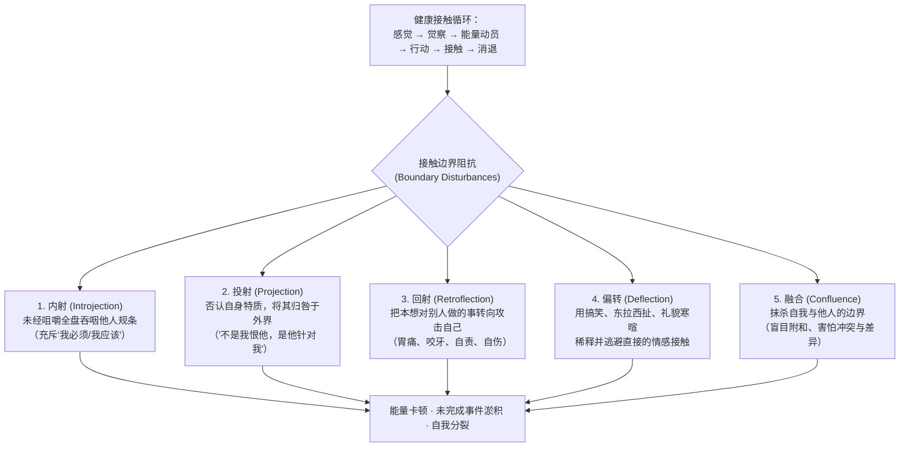

# 格式塔疗法 / 完形疗法 (Gestalt Therapy)

| 属性维度 | 核心内容 |
| :--- | :--- |
| **创立者与代表人物** | 弗里茨·皮尔斯 (Fritz Perls, 1893–1970)、劳拉·皮尔斯 (Laura Perls, 1905–1990)、保罗·古德曼 (Paul Goodman)；现代发展代表：Erving & Miriam Polster、Gary Yontef、Gordon Wheeler、Margherita Spagnuolo Lobb |
| **所属流派** | 人本-存在-体验主义学派 (Humanistic-Existential-Experiential) / 融合格式塔心理学、存在现象学、库尔特·勒温场域理论、威廉·赖希躯体分析及东方禅宗思想 |
| **循证等级** | **Level II**（对抑郁症、焦虑障碍、人际冲突、心身转化症状及未竟创伤具坚实临床实证支持；其发明的“空椅技术”与“此时此地躯体觉察”已被广泛整合进EFT、图式疗法及第三浪潮CBT中） |
| **核心作用机制** | 恢复个体在“有机体-环境场域”中的**此时此地觉察 (Here-and-Now Awareness)**，拆解五大**接触边界障碍（内射、投射、回射、偏转、融合）**，通过体验性实验（空椅子、双椅优劣势犬对话、夸张技术）完成**未完成事件 (Unfinished Business)** 的格式塔闭合，达成阿诺德·贝瑟提出的**“改变的悖论理论 (Paradoxical Theory of Change)”** |

---

## 一、 理论基础与作用机制 (Theoretical Foundation & Mechanism)

### 1. 三大哲学支柱：现象学、场域论与对话式存在主义
由弗里茨·皮尔斯（Fritz Perls）、劳拉·皮尔斯（Laura Perls）与保罗·古德曼（Paul Goodman）于1951年出版《格式塔疗法：人类人格中的兴奋与成长》正式创立的格式塔疗法（德语 *Gestalt* 意为“完形、整体或有机配置”），拒绝将人切割为孤立的零件或沉溺于考古学式的童年归因，而是建立在三大现代哲学支柱之上：
1. **现象学取向 (Phenomenological Perspective)**：关注来访者在**此时此地 (Here and Now)** 如何主观体验并建构世界，重在探索**“正在发生什么 (What)”与“如何发生 (How)”**，而非抽象地追问“为什么 (Why)”（皮尔斯名言：*“‘为什么’只会带来合理化的借口与狡辩，而‘如何’才能带来真实的觉察。”*）。
2. **场域理论 (Field Theory)**：源于库尔特·勒温（Kurt Lewin），认为没有任何个体能脱离其所处的环境而孤立存在。人永远处于动态的**“有机体/环境场域 (Organism/Environment Field)”**之中，一切心理活动都发生在个体与环境交汇的**接触边界 (Contact Boundary)** 上。
3. **图形-背景形成与未完成事件 (Figure-Ground Formation & Unfinished Business)**：健康的有机体能够根据当下最迫切的生理或心理需要，将其从“背景 (Ground)”中凸显为清晰的“图形 (Figure)”，与环境发生充分接触以需要得到满足，随后该图形自然消退回背景（即**格式塔闭合 Gestalt Closure**），为下一个新需要腾出空间。然而，当过去的创伤、未表达的愤怒、哀伤或渴望被强行压抑而未能完成闭合时，就会形成**未完成事件 (Unfinished Business / 蔡格尼克记忆效应 Zeigarnik Effect)**——它们像后台死循环的程序一样不断消耗能量，干扰当下清晰的图形形成，迫使个体在成年关系中强迫性地重复旧剧本。

### 2. 病理发生学：接触循环中断与五大接触边界阻抗 (Contact Boundary Disturbances)
格式塔疗法认为，心理健康依赖于有机体与环境之间富有弹性的“接触-退缩循环 (Cycle of Experience：感觉 $\rightarrow$ 觉察 $\rightarrow$ 能量动员 $\rightarrow$ 行动 $\rightarrow$ 充分接触 $\rightarrow$ 满足与消退)”。当个体在成长中处于不安全的环境时，为了自我保护，会在接触边界上发展出五种典型的**接触边界阻抗/中断机制**（当代格式塔称之为“过时的创造性调适 Creative Adjustments”）：

1. **内射 (Introjection)**：不加批判、未经消化地将父母或社会的标准、教条“整块吞下”（如“男人绝不能哭”、“发脾气就是坏孩子”），这些异物停留在人格中形成严苛的“优势犬 (Topdog)”。
2. **投射 (Projection)**：内射的反面——不敢认领属于自己的真实冲动、欲望或敌意，将其切割出去贴在别人身上（如自己内心充满嫉妒与攻击性，却总觉得周围所有人都在算计、嫉妒自己）。
3. **回射 (Retroflection)**：原本指向外部环境或他人的行动能量（尤其是愤怒或求助），在半途中因恐惧而掉转枪头刺向自己（如想痛骂对方却死死咬紧后槽牙、掐自己的手、引发紧张性头痛、胃溃疡或重度自我贬低）。
4. **偏转 (Deflection)**：通过打哈哈、自嘲、转换话题、使用空洞抽象的哲学词汇、回避眼神接触等方式，像太极推手一样让真实的情感碰撞滑开，使自己永远处于肤浅无感的境地。
5. **融合 (Confluence)**：消除“我”与“你”之间的边界，没有独立观点，习惯说“我们都觉得……”，对任何意见分歧或人际分离感到极度恐慌。

### 3. 核心改变机制：改变的悖论理论 (Paradoxical Theory of Change)
格式塔理论家阿诺德·贝瑟（Arnold Beisser, 1970）总结了格式塔疗法最核心的临床机制——**改变的悖论理论**：
> **“改变发生于一个人成为他真实所是的那一刻，而不是当他试图成为他所不是的样子之时 (Change occurs when one becomes what he is, not when he tries to become what he is not)。”**

人们越是凭借“优势犬（我应该成为的样子）”去强迫、改造、嫌弃“劣势犬（我当下的脆弱与被动）”，就越陷入内耗分裂。唯有通过**此时此地的全方位觉察（躯体、情绪、动作、呼吸）**，全然认领并栖居于自己当下的真实存在状态，被冻结的生命能量才会自动解冻，有机体的自我调节（Organismic Self-Regulation）才能自然发生。

---

## 二、 适用情况与边界 (Applicable Conditions & Contraindications)

### 1. 临床适应症 (Clinical Indications)
* **心身疾病与躯体化转换症状 (Psychosomatic & Somatoform Disorders)**：因长期**回射 (Retroflection)** 压抑情绪引发的慢性肩颈僵硬、紧张性头痛、肠易激综合征、心因性胸闷咽部异物感。
* **未完成事件与复杂性人际创伤 (Unfinished Business)**：对已故亲人、施虐父母、前任伴侣抱有强烈未了结的怨恨、内疚或依恋执念。
* **重度内耗、完美主义与拖延瘫痪 (Topdog-Underdog Split)**：内心“优势犬（苛刻命令者）”与“劣势犬（消极怠工抵抗者）”长期拉锯导致的行动力瘫痪。
* **情感隔离、过度理智化与麻木 (Over-Intellectualization)**：习惯活在头脑概念里、与自身身体感受和真实情绪断联的现代职场高压人群。
* **抑郁症、焦虑障碍及个人成长潜能开发**。

### 2. 适用日常情绪、认知扭曲与心理图式
* **核心情绪困扰**：压抑的愤怒、内疚感、无力感、慢性纠结与摇摆不定、人际边界模糊带来的窒息感。
* **典型接触中断与语言模式**：用“它/人们”代替“我”（去责任化语言）、频繁说“我应该……”（内射）、话语末尾带讨好式苦笑（偏转）。
* **早期适应不良图式 (EMS)**：**纠缠/未分化自我图式 (Enmeshment)**、**情感抑制图式 (Emotional Inhibition)**、**顺从图式 (Subjugation)**、**过高标准图式 (Unrelenting Standards)**。

### 3. 适用人群特征
* 愿意走出纯粹的“空谈（Talking *about* problems）”，尝试在治疗室当下进行躯体动作、声音表达及椅子角色扮演等**体验性实验 (Experiential Experiments)** 的来访者。

### 4. 禁忌症与转介红线 (Contraindications & Referral Red Lines)
* **脆弱型边缘型人格结构、分裂型或精神病性障碍发作期**：早期皮尔斯式的强对抗性（Frustration technique）或高强度空椅角色扮演，容易击穿现实检验边界脆弱者的心理防线，诱发急性解离或精神病性崩溃（对此类人群必须采用当代关系型格式塔疗法 Relational Gestalt，优先巩固接地与安全边界）。
* **重度反社会人格或缺乏基本冲动控制能力的暴力倾向者**：在未建立严密安全容器前，不宜盲目鼓励其“解除回射、向外释放攻击能量”。

---

## 三、 核心技术与具体方法 (Core Techniques & Sub-Methods)

在格式塔疗法中，技术被称为**“实验 (Experiments)”**——它们不是为了达成某种预设结果的机械手段，而是为了扩大来访者此时此地觉察范围的创意探险：

### 1. 此时此地觉察连续体与“如何”提问法 (Continuum of Awareness & "What and How" Questions)
* **原理**：将逃往“过去回忆”或“未来灾难化幻想”的来访者拉回唯一真实存在的时空——**当下 (The Present Moment)**。
* **操作公式**：
  $$\text{打断“关于……的空谈 (Aboutism)”} + \text{聚焦当下三域觉察（外部感官 / 内部躯体感受 / 头脑幻想）}$$
* **经典干预句式**：
  * *“就在你刚刚讲述三年前那件事的这一秒，你注意到自己的呼吸、肩膀和嗓子发生了什么变化吗？”*
  * *“请你试着用三句话，每一句都以‘此时此刻，我觉察到……’开头，告诉我你现在看到了什么、身体感觉到了什么、心里在回避什么。”*

### 2. 空椅子与双椅极性整合：优劣势犬对话 (Empty Chair & Topdog-Underdog Dialogue)
* **原理**：皮尔斯指出，神经症患者内心常上演一场永无休止的酷刑游戏：**“优势犬 (Topdog)”**（由内射进来的父母/社会规条组成，满嘴“你应该、你必须”，专横、正确且居高临下）不断咆哮威逼；而**“劣势犬 (Underdog)”**（充满被动攻击、借口、拖延与卖惨，嘴上说“好的好的我明天一定改，但我实在太累了”）则用消极怠工来赢得隐秘的胜利。
* **操作步骤**：
  1. 设立两把椅子，一把代表“优势犬（严厉督工）”，一把代表“劣势犬（消极反抗者）”。
  2. 请来访者在两把椅子间来回切换，将内心的暗战大声外化演练出来。
  3. 引导双方听见彼此被割裂的真实意图：优势犬渴望的是卓越与安全，劣势犬守护的是有机体的休息权与自主权。最终促成两极从“互相绞杀”走向“合作整合”。

### 3. 夸张与放大实验：让身体语言开口说话 (Exaggeration & Body-Language Amplification)
* **原理**：来访者的嘴可能会说谎或合理化，但身体的微动作（抖腿、握拳、搓手、叹气、说到痛苦处突然微笑）永远在诚实地表达被压抑的未完成图形。
* **操作公式**：
  $$\text{捕捉非言语微动作} \longrightarrow \text{邀请故意重复并逐级放大该动作} \longrightarrow \text{为该动作配上第一人称台词}$$
* **实操示范**：
  * 当来访者一边微笑着说“我对我爸早就没意见了”，一边右手在膝盖上不自觉地紧紧攥成拳头并微微敲击时，治疗师邀请：*“我注意到你的右手握得很紧。请你不要停，试着把这个握拳和敲击的动作放大三倍……再大一点。如果这只紧握的拳头现在有一张嘴，它想对谁吼出什么话？”*（瞬间穿透“偏转”与“回射”防御，释放真实愤怒）。

### 4. 主权语言重塑实验 (Language Ownership Experiments)
* **原理**：语法结构直接反映个体的存在姿态与责任认领程度。格式塔治疗师对来访者的逃避性语言极其敏锐，并现场邀请语言转换实验：

| 逃避性/异化语言模式 | 隐藏的心理防御 | 格式塔主权转换指令 | 唤醒的临床体验 |
| :--- | :--- | :--- | :--- |
| **“它 / 人家 / 大家”替代“我”** （如：“我的手在抖”、“这让人很难受”） | 将身体与感受客体化，逃避主体认领 | 改为**“我”**：*“是我在让我的手发抖，为了保护我自己；是我感到很难受。”* | 收回对身体与情感的主人翁感 |
| **“我不能……”** （如：“我不能直接拒绝婆婆”） | 伪装成无能为力，逃避选择后果 | 改为**“我不愿 / 我选择不……”**：*“我不愿意直接拒绝她，因为我怕她给我脸色看。”* | 从被动无助转向清醒认领选择权 |
| **“是的，但是……” (Yes, but...)** | 劣势犬假意顺从实则全盘推翻 | 改为**“是的，同时……” (Yes, and...)** 或直接说**“不，我不打算这么做”** | 消除虚伪敷衍，建立清晰的边界 |
| **将陈述伪装成提问** （如：“难道你不觉得我这样做很傻吗？”） | 寻求他人背书，不敢直接表达自我判断 | 改为直接陈述句：*“我觉得我自己这样做很傻，而且我担心你也看不起我。”* | 解除投射，直接进行真实接触 |

### 5. 逆转回射实验 (Reversing Retroflection)
* **原理**：当来访者出现明显的回射（如屏住呼吸、双手死死抱紧自己、胃部抽搐或痛骂自己）时，引导其将这股指向内部的力气向外释放出来（如引导抱紧双臂的来访者体会“你想把谁推开？还是想抱住谁？”，并在软垫或空椅上完成向外推开或拥抱的完整动作循环）。

---

## 四、 标准化实施流程 (Step-by-Step Implementation Process)

结合格式塔**经验接触循环 (Cycle of Experience)**，一场完整的格式塔临床干预按以下六个有机阶段推进：

### 阶段一：现象学调谐与唤醒“感觉” (Sensation & Grounding)
* **Step 1：建立“我-你”对话场域与躯体接地**
  * 治疗师以全然临在的姿态与来访者相遇，邀请来访者放下长篇大论的背景故事汇报，先感受双脚踩在地面上的感觉、呼吸的深浅以及此刻身体内部的物理感觉（Sensation）。

### 阶段二：图形浮现与识别接触边界阻抗 (Awareness & Identifying Interruptions)
* **Step 2：追踪觉察连续体，让核心“图形”凸显**
  * 通过“此时此刻你觉察到什么？”的引导，观察来访者在谈及核心议题时，能量在哪里卡住了（如声音突然变小、眼神飘忽、叹气、苦笑），精准识别其正在使用的接触边界阻抗（内射、投射、回射、偏转或融合）。

### 阶段三：共同设计体验性实验，动员被冻结的能量 (Mobilization of Energy)
* **Step 3：协商并邀请进入格式塔实验 (Graded Experiment)**
  * 遵循安全分级原则，向来访者提出实验邀请（如：*“我注意到每当提到你哥哥，你的下巴就咬得很紧。你愿意跟我一起做个小实验，看看这紧咬的下巴里藏着什么话吗？”*）。

### 阶段四：行动演练与全接触突破 (Action & Full Contact)
* **Step 4：执行实验（空椅子、夸张动作、回射逆转或语言主权替换）**
  * 支持来访者跨越惯性阻抗，将回射的能量向外表达，将投射的特质收回认领（如扮演自己在别人身上最讨厌的那个特质），将内射的“应该”吐出来重新咀嚼，在此时此地达到高强度的情感与躯体**充分接触 (Full Contact)**。

### 阶段五：格式塔闭合与同化整合 (Satisfaction, Withdrawal & Assimilation)
* **Step 5：静默停留，品味完形闭合后的自然松弛**
  * 当压抑数年的话终于对着空椅子喊出、或分裂的两极终于达成理解后，治疗师不急于分析，而是邀请来访者安静地坐一会儿，感受胸腔的舒展、呼吸的顺畅，让新体验在身心深处自然同化（Assimilation），旧的未完成图形正式退回背景。

---

### ⚡ 【5-10分钟日常自助/陪伴微练习速查版】：“格式塔此时此地五分钟躯体解码”
当你感到莫名烦躁、纠结内耗或胸口发闷时，用5分钟完成一次格式塔自我完形练习：
1. **第1分钟：三区域觉察扫描 (Three Zones of Awareness)**：
   * 轻声说出三句话：*“此时此刻，我外在看到/听到______；我身体内部感觉到______（如肩膀酸痛/胃里发紧）；我脑海里正在转动的念头是______。”*
2. **第2-3分钟：微动作夸张与配音 (Exaggeration)**：
   * 找到此刻身体最紧绷的一个部位（如皱眉、咬牙、缩肩膀或胸口发堵），故意把这个紧绷感放大一倍保持10秒，然后问它：*“如果我这块紧绷的肌肉能开口说话，它现在最想对谁喊出一句什么话？”*（如：“离我远点！别再逼我了！”）。
3. **第4分钟：逆转回射与主权语言 (Language Ownership)**：
   * 把脑海里的*“我必须/我不得不做某事”*大声改口说成：*“我选择做/不做某事，我愿意为我自己的舒服和边界负责。”*
4. **第5分钟：吐出内射，完成闭合**：
   * 做三次深长的呼气，想象把那些不属于你真实意愿的“别人觉得你应该怎样”的规条随呼气吐出体外，轻轻拍拍自己的肩膀。

---

## 五、 具体实施例子与实操示范 (Concrete Implementation Examples & Vignettes)

### 案例一：运用“夸张技术 + 逆转回射”转化慢性胃痛与职场压抑性愤怒
#### 1. 场景背景
来访者吴女士（35岁，设计院项目经理），近半年频繁出现无器质性病变的胃部痉挛疼痛与咽部异物感（梅核气）。在单位里她是公认的“老好人”，合伙人多次将她的原创署名抢走并把烂摊子甩给她，她从未发作过，但在诊室里谈及此事时表现出一系列典型的**偏转（苦笑）**与**回射（双手死死按压胃部、屏住呼吸）**。

#### 2. 逐轮引导对话示例（捕捉躯体微线索 + 夸张实验 + 空椅释放回射）
* **来访者（嘴角挂着礼貌的微笑，语气平淡，双手却用力抵在胃部）**：“其实也没什么大事啦，我们那个合伙人就是那种爱抢功的性格，大家都是同事，闹翻了不好看，我忍一忍就过去了……就是最近这胃不知道怎么回事，一到下午开例会前就绞着疼。”
* **治疗师（打断“关于事件的偏转”，将焦点直接拉回此时此地的躯体觉察）**：“吴女士，请暂停一下。你注意到吗？当你嘴上笑着说‘忍一忍就过去了’的时候，你的嘴角在笑，但你的两只手正拼命往自己的胃里抠，而且你刚才几乎屏住了呼吸。你现在能感觉到你胃部那股劲儿吗？”
* **来访者（低头看了看自己的手，愣了一下，笑容消失）**：“我……我没注意。确实，我现在胃里就像有一只手在死死拧毛巾一样，嗓子眼也堵得慌。”
* **治疗师（发起夸张实验，唤醒被回射的能量）**：“那是你的身体在替你说话。我们做个小实验好吗？请你不要放松，反而把双手按压胃部、把胃里那种‘死死拧住’的力气稍微再放大一点点……感受那股力气。如果这股拧住你自己的力气，原本不是用来拧你的胃，而是指向外面的某个人，它原本想做什么动作？”
* **来访者（闭上眼体会了十秒，呼吸突然变得粗重，双手从胃部猛地抬起来，五指张开呈推拒状）**：“它想推开！它想把那个合伙人狠狠推开，想揪住他的领子把那份署了他名字的图纸摔在他脸上！”
* **治疗师（指向面前的空椅子，引导逆转回射完成接触循环）**：“原来这股愤怒一直被你咽回肚子里去拧你自己的胃了！你看，那个抢走你署名、把烂摊子丢给你的合伙人现在就坐在对面这把空椅子上。请你不要再把那句话咽回胃里了，看着那把椅子，把你双手想做的动作做出来，把堵在嗓子眼的那句话直接对他喊出来！”
* **来访者（双手向前用力一推，眼眶通红，声音从颤抖变得响亮有力）**：“张×！那份图纸是我熬了两个月画出来的！你凭什么把我的名字抹掉换成你自己的？我不欠你的！我受够了替你背黑锅还要对你陪笑脸了！把属于我的署名还给我！”
* **治疗师（鼓励停留并体察躯体变化）**：“太有力了！再来一次，告诉他你的边界是什么！”
* **来访者（挺直脊背，大口呼吸）**：“那是我的心血，从今天起，不属于我的杂活我一件都不会再接！……（长长地呼出一口气，双手自然垂放在大腿上，惊讶地摸了摸胃部）天哪，好奇怪，我喊出来之后，嗓子眼那个堵着的东西不见了，胃居然一下子变得热乎乎的、松快了！”

---

### 案例二：运用“优劣势犬双椅对话”化解重度考博拖延与完美主义瘫痪
#### 1. 场景背景
来访者小陆（26岁，硕士毕业生），备考博士申请计划书已拖延三个月，每天坐在电脑前10小时却一个字都写不出，陷入“疯狂制定精确到每分钟的计划表 $\rightarrow$ 刷短视频逃避 $\rightarrow$ 深夜痛骂自己到失眠”的死循环。

#### 2. 逐轮引导对话示例（Topdog-Underdog 极性整合）
* **治疗师（设置优劣势犬双椅）**：“小陆，你身体里每天都在打仗。一边是拿着秒表逼你必须写出惊世骇俗论文的‘长官（优势犬）’，另一边是用刷视频、发呆来罢工的‘逃兵（劣势犬）’。请先坐到‘长官椅’上，用你平时制定计划表时的严厉口气，训斥对面的小陆。”
* **来访者【坐优势犬椅 Topdog】（挺胸皱眉，语速极快，充满内射的“应该”）**：“都已经10月中旬了！别人的研究计划书都改了三稿了，你连第一页都没写出来！你每天必须早上6点起床，写不出五千字绝不准休息！要是第一段写得不够顶级水准，博导看一眼就会把你扔进垃圾桶！你不能有一秒钟的松懈！”
* **治疗师**：“好，现在立刻换到对面的‘逃兵椅（劣势犬）’上，回应这个长官。”
* **来访者【坐劣势犬椅 Underdog】（瘫坐在椅子里，翻了个白眼，语气先是讨好随后转为赖皮）**：“好啦好啦，我知道错了，我今晚通宵写还不行吗……但是我真的头好晕啊，你要求第一句话就要写出顶级水准，我怎么可能写得出来嘛？（语气逐渐露出隐秘的得意）你再怎么拿鞭子抽我，只要我不动笔，你就拿我没辙！反正不写就不会被博导否定，我刷会儿手机至少现在是舒服的！”
* **治疗师（点破劣势犬的隐秘主权，促发真实对话）**：“听到了吗？劣势犬刚才说出了大实话——‘你要求那么高，我干脆罢工不动笔，你就拿我没辙’。请你继续坐在劣势犬椅上，不再用装病和刷手机来搞暗算，直接堂堂正正地告诉对面的长官，你为什么罢工？你需要他怎么改？”
* **来访者【劣势犬椅】（坐直身体，认真看着对面）**：“我罢工是因为你根本不把我当人看！你要求我一上来就写出满分的神作，这根本不可能，你把我吓瘫了！我需要允许我先写出一堆狗屎一样的初稿，而且我每天需要正常的睡眠和喘气时间！”
* **治疗师**：“换回长官椅，听到了这个诉求，你愿意怎么跟他和解？”
* **来访者【优势犬椅】（神情缓和下来）**：“……好吧，我承认我把标准定得太吓人了，反而害得我们三个月一个字没写。如果允许你每天只写500字的粗糙初稿，写完就可以痛痛快快去休息，你愿意动笔吗？”

#### 3. 【格式塔接触边界阻抗诊断与实验处方表】（填写实例）

| 接触边界阻抗类型 | 来访者临床表现与微线索 | 核心格式塔干预实验 | 能量转化与完形闭合效果 |
| :--- | :--- | :--- | :--- |
| **内射 (Introjection)** | 满口“我必须完美、绝不能让人失望”，把父母的苛刻标准当成自己的真理 | **咀嚼与吐出实验 + 优劣势犬对话**：将“我必须”大声说出并审视：“这是谁塞进我嘴里的？合我的胃口吗？” | 吐出毒害性的“应该”，建立符合自身有机体节奏的弹性标准 |
| **回射 (Retroflection)** | 对他人愤怒却笑脸相迎，同时双手抠胃、咬紧牙关、频繁胃痛头痛 | **微动作夸张 + 空椅向外释放**：放大胃部拧紧感，转化为双手向外推拒与怒吼 | 躯体紧绷与心身胃痛当场缓解，学会健康设立人际边界 |
| **投射 (Projection)** | 坚称“全办公室的人都在暗中嘲笑我懦弱” | **投射认领角色扮演**：“请你扮演那个最爱嘲笑别人的同事，看看你自己内心是否也有苛刻评判自己和他人的一面” | 收回外投的评判力量，减少被害妄想式的社交草木皆兵 |
| **偏转 (Deflection)** | 谈到母亲去世时不断开玩笑、东拉西扯谈天气和哲学理论 | **当下打断与接地停留**：“请停一下，当你开玩笑时，试着闭上嘴深呼吸三次，感受眼眶里的酸楚” | 穿过麻木与嘻哈面具，触碰并释放真实的哀伤 |

---

## 六、 权威参考文献 (References)

1. **Perls, F., Hefferline, R. F., & Goodman, P.** (1951). *Gestalt therapy: Excitement and growth in the human personality*. Julian Press. （格式塔疗法创世纪奠基之作，系统提出接触边界、创造性调适与觉察实验体系）
2. **Perls, F. S.** (1969). *Gestalt therapy verbatim*. Real People Press. （《格式塔疗法逐字录》，完整记录弗里茨·皮尔斯工作坊实操对话、空椅子技术、梦的工作及此时此地干预精髓）
3. **Polster, E., & Polster, M.** (1973). *Gestalt therapy integrated: Contours of theory and practice*. Brunner/Mazel. （将早期对抗性格式塔转化为温和、系统的临床治疗体系，深入阐述五大接触边界阻抗与接触循环）
4. **Beisser, A. R.** (1970). The paradoxical theory of change. In J. Fagan & I. L. Shepherd (Eds.), *Gestalt therapy now* (pp. 77–80). Harper & Row. （提出“改变的悖论理论”，成为整个人本-体验疗法乃至第三浪潮CBT接纳理念的基石文献）
5. **Yontef, G. M.** (1993). *Awareness, dialogue & process: Essays on Gestalt therapy*. Gestalt Journal Press. （现代关系型格式塔疗法核心著作，系统阐释现象学方法、场域理论与马丁·布伯对话关系）
6. **Joyce, P., & Sills, C.** (2018). *Skills in Gestalt counselling & psychotherapy* (4th ed.). SAGE Publications. （当代最权威实用的格式塔临床技能操作手册，涵盖评估、躯体实验、未完成事件及创伤工作）
7. **Raffagnino, R.** (2019). Gestalt therapy effectiveness: A systematic review of empirical evidence. *Open Journal of Social Sciences*, 7(6), 66–83. （系统综述格式塔疗法在临床随机对照研究中的跨诊断实证有效性）
