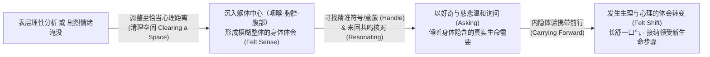

# 聚焦取向心理治疗 (Focusing-Oriented Psychotherapy, FOT)

| 属性维度 | 核心内容 |
| :--- | :--- |
| **创立者与代表人物** | 尤金·简德林 (Eugene T. Gendlin, 1926–2017，哲学家与心理学家，卡尔·罗杰斯的核心合作者与继承人)；现代发展代表：Ann Weiser Cornell、Mia Leijssen、Kevin Krycka、Greg Madison |
| **所属流派** | 体验取向心理治疗核心母体 (Experiential Psychotherapy) / 现象学与具身认知心理治疗 |
| **循证等级** | **Level I - II**（基于过程-结果实证研究创立；来访者“体验水平 Experiencing Scale, EXP”与心理治疗成功率的强正相关获数十项元分析最高级别验证，对心身疾病、创伤、情绪阻滞及抑郁具显著疗效） |
| **核心作用机制** | 引导注意力沉入躯体内部，接触尚未概念化的模糊整体**身体体会 (Felt Sense)**，通过**聚焦六步法（清理空间、形成体会、寻找把手、共鸣核对、温和询问、接纳领受）**促发内在体验向符号化意义的携带前行（Carrying Forward），引发伴随着生理瞬间释然的**体会转变 (Felt Shift)** |

---

## 一、 理论基础与作用机制 (Theoretical Foundation & Mechanism)

### 1. 源于实证的伟大发现：为什么有些来访者能治愈，有些却不能？
20世纪50至60年代，芝加哥大学哲学家与心理学家尤金·简德林（Eugene T. Gendlin）与卡尔·罗杰斯合作开展了一系列轰动心理学界的大型过程-结果研究。他们分析了数百盘不同流派心理治疗的录音磁带，试图找出决定心理治疗最终成败的核心变量。

研究得出了一个颠覆性的结论：**决定治疗成败的关键，既不在于治疗师使用什么流派的技术，也不在于来访者谈论了多少童年创伤或具备多高的智商，而在于来访者在会谈前两次中是否具备一种特殊的具身加工能力——即高“体验水平 (Experiencing Level)”**。
* **失败的来访者**：无论谈论多么深刻的问题，都在用流利、现成的概念作“外在报告”或“理性分析”（Talking *about* feelings），语言干瘪或纯属情绪宣泄，身体内部没有任何新鲜的停顿与摸索。
* **成功的来访者**：在说话时会突然**放慢语速、停顿下来，向内倾听自己身体里某种模糊不清、难以言喻的感受**（例如：“我也不知道怎么说……好像胸口和胃之间有一团闷闷的、沉甸甸的东西……不太像单纯的生气，更像是一种被丢下的荒凉感……”）。为了把这种成功来访者天生的内在倾听能力教给所有人，简德林提炼并创立了**聚焦 (Focusing)** 与**聚焦取向心理治疗 (FOT)**。

### 2. 核心概念：身体体会 (Felt Sense) 与体会转变 (Felt Shift)
简德林在哲学上提出了著名的《内隐哲学 (Philosophy of the Implicit)》：我们的身体并非一块盲目的肉体，而是活生生地与整个生命历史及当下环境交织在一起的**隐含智慧体**。大脑皮层只知道几条干巴巴的逻辑，而身体却同时感知着成千上万条微秒的关系线索。

必须严格区分**“情绪 (Emotion)”**与**“身体体会 (Felt Sense)”**：

| 维度 | 普通情绪 (Emotion) | 身体体会 (Felt Sense) |
| :--- | :--- | :--- |
| **清晰度与性质** | 明确、剧烈、单一、早已熟悉（如：暴怒、大哭、恐慌）。 | 最初是**模糊的、混沌的、难以言喻的整体感 (Unclear, Holistic, Bodily)**（如“心里有一团粘糊糊、拧巴的滋味”）。 |
| **包含的信息量** | 仅反映单一反应结果。 | 浓缩了与整个事件相关的全部背景、矛盾、历史与隐含解决之道（Implicit intricacy）。 |
| **接触后的变化** | 单纯反复发泄情绪往往在原地打转（情绪反刍）。 | 当用精准的语词或意象（把手 Handle）触碰到它并温柔陪伴时，会引发**体会转变 (Felt Shift)**——生理上的瞬间松动、长舒一口气及全新洞见的涌现。 |

### 3. 核心转化机制：恰当距离与“携带前行 (Carrying Forward)”
为什么平时我们无法触发体会转变？因为人们面对痛苦通常只有两种极端错误姿态：
1. **距离太近（淹没/认同 Merged）**：完全掉进情绪漩涡里（“我彻底完蛋了！我恨死他了！”），被情绪吞噬，丧失观察与倾听空间。
2. **距离太远（隔离/批判 Detached/Criticizing）**：站在冷酷旁观者或内在批评者的立场上剖析、指责自己的感受（“我真不该这么想，按心理学来说我这是投射”），导致内在脆弱体会吓得缩回壳里。

**聚焦的核心机制**，就是建立一种像**“温柔的朋友坐在哭泣的孩子身旁陪伴”**一样的**恰当关系距离 (Optimal Focusing Attitude)**——用 Ann Weiser Cornell 的“当下临在聚焦 (Inner Relationship Focusing)”语言来说，就是学会对内在感受说**“我感觉到我里面有某个部分正在…… (I am sensing something in me that feels...)”**，并向它问好（Saying Hello）。当隐含的身体体会得到精准符号化认领时，原本停滞的生命过程便会发生**“携带前行 (Carrying Forward)”**，身体会自动告诉个体下一步该如何行动。

---

## 二、 适用情况与边界 (Applicable Conditions & Contraindications)

### 1. 临床适应症 (Clinical Indications)
* **过度理智化、述情障碍与情感阻滞 (Over-Intellectualization & Alexithymia)**：“道理全懂，心理学科普书看了几十本，但就是做不到、心里依然空虚堵闷”的高知来访者。
* **慢性心身疾病、慢性疼痛与癌症心理康复**：不明原因的胸闷、慢性胃肠不适、纤维肌痛症；简德林团队实证研究表明，结合“清理空间”与身体聚焦能显著减轻癌症患者的疼痛困扰与免疫耗竭。
* **复杂性创伤 (C-PTSD) 与躯体创伤记忆加工**：通过安全、不淹没的“清理空间”技术，在承受窗内温和消化储存在躯体中的创伤记忆（Peter Levine 的躯体体验疗法 SE 正是在简德林聚焦法基础上发展而来）。
* **创作瓶颈、重大人生决策困难与直觉唤醒**：当理性利弊清单（Pros & Cons）打成平手无法抉择时，通过倾听身体体会获取整合性的深层直觉智慧。
* **焦虑、抑郁及长期严苛自我批判的柔和转化**。

### 2. 适用日常情绪、认知扭曲与心理图式
* **核心情绪困扰**：“说不清道不明的烦躁与胸闷”、心累与耗竭感、被巨石压迫的淹没感、对内在感受的排斥与羞耻。
* **典型认知偏差**：将头脑逻辑强加于身体感受之上、全或无的自我批判、过度反刍分析（Rumination）。
* **早期适应不良图式 (EMS)**：**情感抑制图式 (Emotional Inhibition)**、**过高标准图式 (Unrelenting Standards)**、**自我牺牲与忽视自身需求图式 (Self-Sacrifice)**。

### 3. 适用人群特征
* 厌倦了在头脑层面无休止地争辩对错，渴望学习一种终生受用的、温和倾听身体内部声音与直觉的个体；或对强烈冲突性技术（如激烈空椅对抗）感到害怕、需要极度温和安全节奏的来访者。

### 4. 禁忌症与转介红线 (Contraindications & Referral Red Lines)
* **重度解离发作期或躯体妄想症 (Somatic Delusions)**：如精神分裂症伴随怪异躯体幻觉（认为内脏腐烂或被植入芯片），引导向内关注躯体可能强化妄想，属禁忌。
* **急性惊恐发作伴重度过度换气/灾难化躯体监控**：此类患者需先进行外部感官接地（External Grounding，如看房间里的5样物体、踩实地面）以稳定交感风暴，待恢复平静后再以“保持恰当距离”的方式引入温和聚焦。

---

## 三、 核心技术与具体方法 (Core Techniques & Sub-Methods)

简德林将聚焦过程标准化为享誉全球的**“聚焦六步法 (The Six Movements of Focusing)”**，辅以当代聚焦大师 Ann Weiser Cornell 发展的内在关系技术：

### 1. 第一步：清理空间 (Clearing a Space — 建立安全距离与卸载重压)
* **原理**：当一个人被七八件烦心事同时压得喘不过气时，身体内部就像堆满杂物的仓库，无法进行深度工作。通过“清理空间”，将所有问题逐一从身体内部请出来放到面前的安全距离处，找回那个清爽、宁静的“观察性本体自我”。
* **操作公式**：
  $$\text{向内询问“此刻什么正阻碍我感觉良好？”} \longrightarrow \text{只点名不陷进去} \longrightarrow \text{想象将其打包放在面前长椅/草坪上} \longrightarrow \text{体验清空后的喘息空间}$$

### 2. 第二步：形成身体体会 (Felt Sense — 唤起模糊的整体躯体感受)
* **原理**：从刚才摆在面前的一堆问题中，挑出一件最需要关注的事（或针对某个议题），不要用头脑去分析它，而是邀请身体核心区（咽喉、胸口、胃部、小腹）浮现出关于这整件事的“整体滋味”。
* **引导话术**：*“把关于[那件事/那个人]的整个情况带到心头，然后放慢下来，把注意力沉到你的胸口和腹部中央……等一等（停留30-60秒），去感受关于这整件事，你身体里浮现出的那个模糊的、整体的感觉是什么样的？”*

### 3. 第三步：寻找把手 (Getting a Handle — 为体会赋予精准的词或意象)
* **原理**：让这团模糊的身体体会自己生长出一个最贴切的形容词、短语、画面或姿势，就像给一口箱子装上“提手（Handle）”，一旦握住把手，就不会丢失与这团体会的联结。
* **常见把手示例**：
  * 质感词：*“沉甸甸的铅块”、“湿漉漉发霉的棉花”、“紧绷到快要断掉的琴弦”、“拧巴的麻花”*。
  * 意象画面：*“一个缩在墙角发抖的小孩”、“一扇被铁锁锁死的生锈铁门”*。

### 4. 第四步：共鸣核对 (Resonating — 在把手与体会之间来回校准)
* **原理**：绝不随便用一个笼统的词（如“我很难过”）糊弄过去，而是把找到的“把手”拿回身体体会那里去比对，看身体是否给出“没错，就是这个词！”的生理微点头（轻微的松动或贴合感）。
* **操作公式**：
  $$\text{语词/意象 (Handle)} \Longleftrightarrow \text{躯体内部体会 (Felt Sense)}$$
* **引导话术**：*“你说了‘堵得慌’这个词，现在请回到胸口那个感觉去核对一下：‘堵得慌’完全准确吗？还是有更贴切的说法？……哦，你说更像是‘委屈得快要炸开的闷’，对，就是那个，感受一下当找到这个精准词时身体里那一下轻微的点头。”*

### 5. 第五步：温和询问与当下临在陪伴 (Asking & Inner Relationship Presence)
* **原理**：像对待一位害羞、受伤的老朋友一样，带着全然的好奇、无评判与温柔，陪伴在这团身体体会身旁，倾听它背后隐含的故事与生命需要。
* **关键语言转换（Ann Weiser Cornell 临在语言）**：
  * 将*“我很绝望”*转换为：**“我正陪伴着我身体里那个感到很绝望的部分 (I am sensing something in me that feels hopeless)，我向它打个招呼：嗨，我知道你在那里。”**
* **四大经典询问问题**：
  1. *“让这团体会变得如此[把手词，如沉重/紧绷]的最核心的那个点是什么？”*
  2. *“在这团感觉的最深处，它其实在害怕什么？或者在保护我什么？”*
  3. *“如果这团感觉现在能得到它真正需要的东西，它最渴望什么？”*
  4. *“要让它现在稍微好受一点点，生命向前的很小一步会是什么？”*
  * **铁律**：提问后，**严禁用大脑立刻抢答**！必须把大脑的快速回答轻轻拨开，耐心等待15-30秒，等身体体会自己从内部“冒泡”给出一个往往出乎意料的答案。

### 6. 第六步：接纳领受与保护体会转变 (Receiving)
* **原理**：当体会转变（Felt Shift）发生、身体给出一句真实信息并长舒一口气时，无论这个信息是什么，都带着感激与温暖将其领受下来，并保护这个脆弱的新生苗头免受“内在批评者”的攻击（如批评者说：“你想休息？那怎么行！”——需温和地对批评者说：“谢谢你的担心，请先退后一步，让我先把刚才那份真实的感受保护好”）。

---

## 四、 标准化实施流程 (Step-by-Step Implementation Process)

在临床会谈中，聚焦取向心理治疗按以下六个标准化步骤展开：

### 阶段一：放慢节奏与引导具身转向 (Slowing Down & Turning Inward)
* **Step 1：识别“外在空谈”或“情绪淹没”，邀请放慢并进入身体**
  * 当来访者语速飞快地汇报事件或陷入概念打转时，治疗师放慢自身语速，温和邀请：*“这件事包含太多复杂的滋味了。如果我们现在暂停一下头脑的分析，闭上眼睛或垂下目光，把注意力温和地放到你的喉咙、胸口和肚子这一带，你愿意试试看吗？”*

### 阶段二：清理空间与调节最佳聚焦距离 (Clearing a Space & Finding Optimal Distance)
* **Step 2：执行清理空间与“我感觉到我里面有……”语言转换**
  * 若来访者压力过载，先做3分钟清理空间；若来访者被某单一强烈情绪吞没，引导其使用“我感觉到我身体里有一个部分正在……”的句式，建立温柔的陪伴者位置（Self-in-Presence）。

### 阶段三：等待身体体会形成与捕捉把手 (Cultivating Felt Sense & Handle)
* **Step 3：保持静默陪伴，协助形成身体体会并提炼把手**
  * 治疗师留出充足的静默时间（20-40秒），用轻柔、缓慢的语调支持来访者停留在那个模糊、不确定的躯体边缘，直到浮现出具象的形容词或画面（Handle）。
* **Step 4：引导共鸣核对 (Resonating)**
  * 重复来访者给出的把手词，邀请其向内核对是否严丝合缝，直至出现第一次微小的生理贴合感（Mini-shift）。

### 阶段四：深层对话、处理内在批评者与促发体会转变 (Asking & Felt Shift)
* **Step 5：拦截内在评判，向身体体会发出温和询问**
  * 若途中出现自我评判（如“我不该有这种软弱的感觉”），引导来访者对评判部分也温柔地说“我知道你也很着急”，然后重新回到那团核心体会旁，温和询问其最深处的痛点与正向生命诉求，静待**体会转变 (Felt Shift)** 与生理长呼气的发生。

### 阶段五：领受整合与生成行动微步 (Receiving & Action Step)
* **Step 6：锚定新体验，聆听身体指向的下一步行动**
  * 邀请来访者将手放在刚刚发生松动的身体部位，温柔感谢身体的智慧，并询问身体：*“带着现在这份松快和清晰的感觉，回到现实生活中，哪一个小小的举动最能守护这份新感受？”*

---

### ⚡ 【5-10分钟日常自助/陪伴微练习速查版】：“六步随身聚焦微冥想 (Pocket Focusing)”
无论在办公桌前、通勤路上还是睡前，只要感到心里乱糟糟或堵得慌，用6分钟跟着以下口令做一次自我聚焦：
1. **第1分钟【清理空间】**：闭眼深呼吸，把此刻脑子里压着的3-5件烦心事逐一打包，想象把它们暂时放在房间外面的走廊长椅上，感受身体内部腾出一片清爽的空地。
2. **第2分钟【形成体会】**：挑出一件最想关心的事，不分析对错，只把注意力沉到胸口或胃部，问：*“这整件事在我身体里激起的整体感觉是什么样的？”* 耐心等它浮现。
3. **第3分钟【寻找把手】**：看看这团感觉像什么？是“一块冰冷的铁”、“一团乱麻”还是“被勒紧的绳子”？找到最准的词。
4. **第4分钟【共鸣与问候】**：把手放在那个部位，在心里对它说：*“嗨，我知道你在那里，我感觉到你像[把手词]一样难受，我陪着你。”*
5. **第5分钟【温和询问】**：轻声问这团感觉：*“让你这么难受的最核心点是什么？你最需要我为你做什么？”* 不要用大脑编答案，静静等身体深处浮现出一句话，感受随之而来的一口长长的舒气（Felt Shift）。
6. **第6分钟【温柔领受】**：对身体说一声*“谢谢你告诉我，我已经完全听见了”*，轻轻睁开眼睛。

---

## 五、 具体实施例子与实操示范 (Concrete Implementation Examples & Vignettes)

### 案例一：打破“理性利弊分析死结”——重大职业去留抉择中的身体体会唤醒
#### 1. 场景背景
来访者张博士（31岁，生物医药研究员），拿到了一家薪资翻倍、头衔极高的跨国药企管理岗 Offer，但同时现有一线科研实验室也在挽留他。他用 Excel 列了整整两页“利弊权重打分表”，跨国药企得分88分，现有实验室得分72分，按理说完全应该跳槽，但他连续两周失眠，每当准备点下“接受新Offer”的确认键时就感到莫名的烦躁与抗拒，陷入严重的分析瘫痪。

#### 2. 逐轮引导对话示例（聚焦六步法完整实操）
* **来访者（拿着打印出来的Excel表格，语速飞快）**：“老师你看，从薪资、抬头、大城市户口、职业天花板所有理性指标算下来，去这家跨国药企都是完胜！我老婆和导师也说不去是傻子。但我不知道自己到底犯了什么病，合同摆在桌上一周了，我就是签不下去，每天脑子里像有两个辩论队在吵架，头都要炸了！”
* **治疗师（邀请放下Excel表，从头脑分析转向具身聚焦 Step 1-2）**：“张博士，你的大脑已经算得不能再清楚了，如果靠列Excel表格能解决，你一周前就已经签好字了。显然，你身体里有一些没有被写进Excel表格的重要信息正在拽着你的手。我们现在把这张表格翻过来扣在桌子上，把那两个吵架的辩论队请出房间，直接去听听你身体的声音，好吗？”
* **来访者（把纸扣下，长出一口气，闭上眼睛）**：“好，我脑子确实吵累了。”
* **治疗师（引导形成体会与寻找把手 Step 2-3）**：“现在，请把注意力轻轻地从头脑降下来，降到你的咽喉、胸膛和腹部中央……我们先试着想象：你现在已经签了字，正式走进那家跨国药企豪华的写字楼，坐在高管办公室里了。不要去想薪水和头衔，只感受你的胸口和胃部，浮现出了什么样的整体身体体会？”
* **来访者（安静等待了约30秒，眉头微微蹙起，右手不自觉地摸着喉咙下方）**：“……好奇怪。当我看见自己坐在那个豪华办公室里的时候，我胸口上方和嗓子眼这里，突然涌上来一种……很干瘪、很冷、像被装进真空塑料袋里抽干了空气一样的感觉。”
* **治疗师（共鸣核对 Step 4）**：“‘干瘪、很冷、像被装进真空塑料袋里抽干了空气’……请你把这个画面带回胸口核对一下，这个形容完全贴切吗？”
* **来访者（轻轻点头）**：“非常准。就是那种虽然穿着昂贵的西装，但整个人像个死掉的标本一样的窒息感。”
* **治疗师（温和询问 Step 5）**：“好，我们不评判它，只是温柔地陪着这个‘像被装进真空塑料袋里的标本’一样的感觉。请你向它打个招呼，然后温和地问问这团干瘪冰冷的感觉：‘让你觉得这么窒息、这么像标本的最核心的原因是什么？’不要用大脑抢答，等它自己告诉你。”
* **来访者（沉默了近40秒，眼皮微微颤动，突然眼角滑下一滴泪，深深地吸了一口气又长长吐出——**发生显著的体会转变 Felt Shift**）**：“……它说：‘那个岗位以后再也不能碰显微镜和实验台了，每天全是在做PPT汇报和商务应酬。’我突然明白了！我从小到大真正让我觉得自己活着的时刻，是在实验室里亲手看着细胞在显微镜下发生反应的那种着迷和兴奋！Excel表里算了钱、算了面子，唯独漏掉了我的灵魂靠什么呼吸！”
* **治疗师（引导接纳领受 Step 6）**：“你听听，刚才你长长吐出那口气的时候，你的身体把那个连你自己都差点弄丢的真相还给你了。现在再感受一下你的胸口，是什么感觉？”
* **来访者（睁开眼，眼神清澈明亮，肩膀彻底放松）**：“那个真空塑料袋破了，胸口热乎乎的，特别踏实。我知道该怎么选了，而且我知道该怎么跟实验室谈提升待遇但保留一线科研的条件了。”

---

### 案例二：运用“内在关系聚焦”温柔化解创伤性社交退缩与内在批评者
#### 1. 场景背景
来访者小芸（24岁，插画师），每次去参加行业聚会前都会突然腹痛、全身发冷，随后临时取消行程，事后又被自己内心的“批评者”痛骂“你是个胆小如鼠的怪胎”。

#### 2. 逐轮引导对话示例（陪伴内在批评者与脆弱体会）
* **来访者（沮丧低头）**：“昨晚的画展酒会我又临阵脱逃了。快出门的时候我肚子突然一阵发凉发紧，我就退缩了。然后我躺在床上一整晚都在骂自己：‘你真是个没出息的社交废物！’”
* **治疗师（引导建立临在陪伴距离，处理内在批评者）**：“小芸，当你躺在床上骂自己是‘社交废物’的时候，你身体里其实有两个部分都很苦：一个是那个肚子发凉发紧、不敢出门的部分；另一个是那个急得跳脚、骂你没出息的批评部分。我们今天试着用聚焦的方式，先对那个骂你的声音温和地说一句：‘我知道你骂我是因为你也很着急，怕我错失机会。请你先往后退半步，让我先去看看那个肚子发凉的部分怎么了。’你试试看，那个批评的声音愿意稍微让开一点空间吗？”
* **来访者（闭眼体会片刻）**：“嗯……当我承认它是为了我好、不是跟它吵架的时候，它好像安静下来，退到旁边去了。”
* **治疗师（引导接触腹部身体体会）**：“太好了。现在把你温暖的注意力，像捧着一只受惊的小猫一样，轻轻放到你肚子发凉、发紧的那个地方。对它说：‘嗨，我感觉到你在发凉发紧，我现在不逼你出门，我就在这儿陪着你。’看看这团发凉的感觉是什么样的？”
* **来访者（双手轻轻覆在小腹上，声音变得轻柔）**：“它缩成小小的一团，像一颗冰凉的小石子……当我跟它说‘我不逼你出门，我陪着你’的时候，它好像微微颤抖了一下，没那么硬了。”
* **治疗师（引导温和询问与领受）**：“真好，继续温柔地陪着这颗冰凉的小石子，轻声问问它：‘你在害怕酒会上的什么呢？你最需要我怎么保护你？’”
* **来访者（停顿片刻，长舒一口气）**：“它给我看了一个画面——初中时有一次班级聚会，我穿了一件自己觉得好看的裙子，结果被几个女生围着哄堂大笑。原来它不是讨厌画展，它是害怕我再一次在人群里毫无防备地被人围观嘲笑！它对我说：‘如果你去酒会的时候，允许我只待半个小时、只跟一个熟悉的朋友说话，随时不舒服就可以立刻回家，不骂我，我就敢跟你去。’”

#### 3. 【聚焦取向心理治疗六步过程记录表】（填写实例）

| 聚焦六步阶段 | 案例一：张博士（职业去留抉择） | 案例二：小芸（社交临阵脱逃） |
| :--- | :--- | :--- |
| **1. 清理空间 (Clearing a Space)** | 放下两页Excel利弊打分表，将父母、妻子与世俗评价的声音请出身体空间 | 温和安抚并请退“骂自己社交废物”的内在批评者，腾出安全慈悲的内在空间 |
| **2. 形成身体体会 (Felt Sense)** | 想象入职跨国药企高管岗，沉入咽喉与胸口中央等待整体感受 | 将注意力温柔放在出门前小腹发凉发紧的区域 |
| **3. 寻找把手 (Handle)** | **“干瘪、冰冷、像被装进真空塑料袋里抽干空气的标本”** | **“缩成一团、冰凉坚硬的小石子”** |
| **4. 共鸣核对 (Resonating)** | 来回比对，确认“真空塑料袋里的标本”100%精准捕捉了那种窒息感 | 核对“冰凉的小石子”，身体给出微弱颤抖的确认信号 |
| **5. 温和询问与体会转变 (Asking & Felt Shift)** | 身体冒泡揭示：离开一线实验台等于抽干生命热情；眼角落泪并长舒一口气 | 浮现初中聚会被围观嘲笑的创伤记忆；提出“只待半小时、允许随时离开”的安全边界 |
| **6. 接纳领受 (Receiving)** | 胸口恢复温热踏实，决定留在科研一线并争取合理薪酬匹配 | 小腹回暖放松，与内在脆弱部分签订“半小时随时撤离且绝不自责”的温柔契约 |

---

## 六、 权威参考文献 (References)

1. **Gendlin, E. T.** (1982). *Focusing* (2nd ed.). Bantam Books. （简德林面向全球读者与临床工作者的《聚焦》经典原著，销量逾百万册，详述聚焦六步法）
2. **Gendlin, E. T.** (1996). *Focusing-oriented psychotherapy: A manual of the experiential method*. Guilford Press. （《聚焦取向心理治疗：体验方法手册》，简德林集大成之临床巨著，系统阐述如何将聚焦整合入各类心理障碍与梦的工作中）
3. **Gendlin, E. T.** (1962). *Experiencing and the creation of meaning: A philosophical and psychological approach to the subjective*. Free Press. （简德林的哲学奠基之作，提出“内隐体验与符号化相互作用创造意义”及“携带前行 Carrying Forward”理论）
4. **Cornell, A. W.** (1996). *The power of focusing: A practical guide to emotional self-healing*. New Harbinger Publications. （当代聚焦大师 Ann Weiser Cornell 代表作，创立“内在关系聚焦 Inner Relationship Focusing”，革新了临在语言与内在批评者工作）
5. **Cornell, A. W.** (2013). *Focusing in clinical practice: The essence of change*. W. W. Norton & Company. （面向专业心理治疗师的现代FOT临床实操进阶指南，深入拆解创伤、成瘾与重度抑郁中的具身聚焦干预）
6. **Purton, C.** (2004). *Person-centred therapy: The focusing-oriented approach*. Palgrave Macmillan. （系统论述从卡尔·罗杰斯以人为中心疗法向简德林聚焦取向疗法演进的理论与技术桥梁）
7. **Hendricks, M. N.** (2002). Focusing-oriented/experiential psychotherapy. In D. J. Cain & J. Seeman (Eds.), *Humanistic psychotherapies: Handbook of research and practice* (pp. 221–251). American Psychological Association. （全面综述89项关于体验水平 EXP 与聚焦取向心理治疗临床疗效的实证研究与元分析数据）
