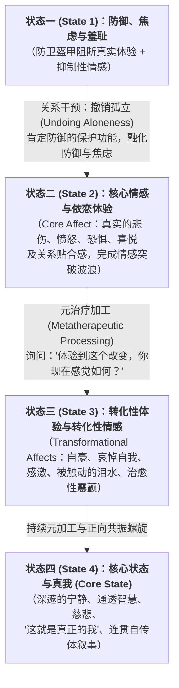

# 加速体验动力学心理治疗 (Accelerated Experiential Dynamic Psychotherapy, AEDP)

| 属性维度 | 核心内容 |
| :--- | :--- |
| **创立者与代表人物** | 戴安娜·佛osha (Diana Fosha, PhD)；核心代表人物：Kari Gleiser、Natasha Prenn、Benjamin Lipton、Danny Yeomans、SueAnne Piliero |
| **所属流派** | 体验-短程动力-关系整合心理治疗 (Experiential-Psychodynamic-Relational) / 融合依恋理论、人际神经生物学 (IPNB)、情感神经科学、短程动力疗法 (ISTDP) 与发展心理学母婴互动研究 |
| **循证等级** | **Level II**（多项随机对照试验与前瞻性临床结局研究如 Iwakabe et al., 2020, 2022 证实，16次AEDP对重度抑郁、复杂性依恋创伤、情绪失调及人际困扰具高大效应量改善，且促进显著的创伤后成长） |
| **核心作用机制** | 通过治疗师积极温暖的右脑对右脑共情调谐，率先**撤销孤立 (Undoing Aloneness)**，进行**二元情感调节 (Dyadic Affect Regulation)**，引导来访者沿**转化性四状态模型 (State 1 防御/焦虑 $\rightarrow$ State 2 核心情感突破 $\rightarrow$ State 3 转化性元加工 $\rightarrow$ State 4 核心状态与真我绽放)** 演进，激活先天自愈潜能（Transformance） |

---

## 一、 理论基础与作用机制 (Theoretical Foundation & Mechanism)

### 1. 从“防御病理学”到“转化力 (Transformance)”与撤销孤立
由戴安娜·佛osha（Diana Fosha）于2000年出版《情绪的转化力量 (The Transforming Power of Affect)》正式创立的**加速体验动力学心理治疗 (AEDP)**，是一门将**依恋理论 (Bowlby)**、**发展心理学母婴二元互动研究 (Stern, Tronick)**、**情感神经科学 (Panksepp, Damasio, Porges 多迷走神经理论)** 与**深入体验性短程心理动力学**完美熔铸一炉的现代疗法。

AEDP 提出了两个极具颠覆性的核心理论洞见：
1. **转化力 (Transformance — 与阻抗 Resistance 相对的先天治愈驱力)**：传统精神分析关注病理与防御（Resistance），而 AEDP 认为，人类大脑与心灵深处天生具备一股强大的、指向疗愈、真实联结、整合与自我纠偏的积极神经生物动力——佛osha 将其命名为 **“转化力 (Transformance)”**。哪怕在最僵化的创伤防御背后，也潜藏着渴望破土而出的转化力火花。治疗师从第一秒钟起，就要像雷达一样捕捉并放大这些细微的转化力萌芽。
2. **病理的根源是“独自面对压倒性情绪”，解药是“撤销孤立 (Undoing Aloneness)”**：为什么童年创伤会形成心理病理？佛osha 指出，**创伤的本质不仅在于发生了可怕的事件，更在于当那个年幼的孩子经历极度恐惧、悲伤或羞耻时，他是彻底孤立无援的（Unbearable Aloneness）**。由于没有安全依恋对象进行二元情感调节，孩子稚嫩的神经系统无法独自消化如此剧烈的情感，只能启动防御机制（隔离、压抑、解离、自责）以求生存。因此，AEDP 的第一条临床铁律是：**绝不让来访者独自一人去面对痛苦情绪**。治疗师不再是中立冷漠的观察者，而是作为“足够好的、真实卷入的安全基地”，通过眼神、声音、表情与心手相连的陪伴，在此时此地与来访者共同分担并调节情感（**二元情感调节 Dyadic Affect Regulation**），直接从根源上**撤销孤立**。

### 2. 核心临床地图：转化性四状态模型 (The Four-State Transformational Process)
AEDP 最伟大、最独特的贡献，在于它发现：绝大多数心理治疗流派在帮助来访者宣泄完痛苦情绪、症状减轻后就停下了脚步；而 AEDP 发现，**当痛苦的核心情感被彻底走完之后，如果对“改变和被治愈的体验本身”进行再次聚焦加工（即“元治疗加工 Metatherapeutic Processing”），会开启一个前所未有的正向神经可塑性螺旋，进入深邃宁静的“核心状态 (Core State)”**。

#### 四大状态及各状态专属情感解析：
* **状态一 (State 1)：防御与抑制性情感 (Defenses & Inhibitory Affects)**
  * 来访者通过理智化、回避、自嘲、麻木或讨好来隔绝真实感受；伴随两大**抑制性情感**——**焦虑 (Anxiety)** 与 **羞耻 (Shame)**（因为靠近真实感受在过去意味着危险）。
* **状态二 (State 2)：核心情感 (Core Affect)**
  * 当防御被安全关系融化后，进化赋予人类的真实**核心情感**如海浪般涌现：纯粹的悲伤（Grief）、适应性愤怒（Anger）、恐惧（Fear）、喜悦（Joy）及关系亲密渴望。核心情感一旦在二元调节中被完整体验到底（Riding the wave to completion），就会释放出巨大的生命活力与清晰感。
* **状态三 (State 3)：转化性体验与六大转化性情感 (Transformational Affects)**
  * 当状态二的核心痛苦释放完毕，治疗师引导来访者回看刚刚发生的突破（“回头看看刚才那么勇敢哭出来的自己，你现在感觉怎么样？”），此时会激发状态三独有的**六大积极转化性情感**：
    1. **掌控自豪感 (Mastery Affects)**：为自己终于跨过难关感到骄傲与力量（Joy & Pride）；
    2. **哀悼自我之痛 (Emotional Pain / Mourning-the-Self)**：为过去的自己受了那么多苦而流下温柔心疼的眼泪；
    3. **治愈性震颤情感 (Tremulous Affects)**：面对突如其来的美好改变时，混杂着敬畏、微弱颤抖与惊喜的感动；
    4. **愈合与感激情感 (Healing Affects)**：面对治疗师的深切陪伴，涌起由衷的感激（Gratitude）、被爱与温柔感（Tenderness），常流下“喜悦/感动的泪水 (Happy/Healing Tears)”；
    5. **领悟惊叹感 (Realization Affects)**：“哇！原来是这样！”的豁然开朗感；
    6. **复苏活力感 (Enlivening Affects)**：身心充满能量的跃动感。
* **状态四 (State 4)：核心状态 (Core State)**
  * 经过状态三的多次元加工波浪，来访者自然落入一种无需费力的、深邃宁静、开放通透的**核心状态**。此时没有任何防御与焦虑，来访者体验到深层的真我感（“This is me”）、对自我与他人的深切慈悲，并自发生成高度连贯、整合的生命叙事（与安全型依恋成人依恋访谈 AAI 的高连贯性特征完全吻合）。

---

## 二、 适用情况与边界 (Applicable Conditions & Contraindications)

### 1. 临床适应症 (Clinical Indications)
* **关系型创伤与复杂性依恋创伤 (Relational Trauma & Complex PTSD)**：童年期长期遭受情感忽视、孤立、羞辱、父母情绪不可预测，形成不安全依恋（回避型、焦虑型或混乱型）的成年个体。
* **重度抑郁症与慢性情绪麻木/快感缺失 (Depression & Anhedonia)**：不仅需要缓解负性抑郁情绪，更需要通过状态三、四的正向情感元加工重新激活大脑奖赏与联结回路。
* **严苛羞耻感、习惯性自我孤立与“病态独立 (Pathological Self-Reliance)”**：“我从不向任何人求助，我觉得需要别人是可耻且危险的”的高防御人群。
* **焦虑障碍、人际亲密恐惧及治疗僵局突破**。

### 2. 适用日常情绪、认知扭曲与心理图式
* **核心情绪困扰**：深入骨髓的孤立感（Existential/Attachment Aloneness）、靠近亲密或温暖时的恐惧与尴尬（“积极情感恐惧症 Phobia of Positive Affect”）、慢性羞耻与情感冻结。
* **典型认知与防御机制**：情感隔离、否认自身脆弱、贬低人际联结价值（“靠人不如靠己”）、面对夸奖或关怀时立刻弹开（Deflecting care）。
* **早期适应不良图式 (EMS)**：**情感剥夺图式 (Emotional Deprivation)**、**社交孤立/疏离图式 (Social Isolation)**、**缺陷/羞耻图式 (Defectiveness/Shame)**、**不信任/虐待图式 (Mistrust/Abuse)**。

### 3. 适用人群特征
* 在传统偏冷峻、中立或纯认知导向的咨询中感到“冰冷、被评判或独自挣扎”，渴望在一段温暖、鲜活、有真实情感回响的安全关系中获得深层依恋修复的来访者。

### 4. 禁忌症与转介红线 (Contraindications & Referral Red Lines)
* **重度解离性身份障碍 (DID) 急性碎片化失控期**：需使用专门针对重度解离改编的“结构化分阶段 AEDP (Intra-relational AEDP)”先行建立内部安全稳态。
* **急性精神病性发作、重度物质中毒/戒断期、或完全缺乏治疗动机的强制转介反社会人格**。

---

## 三、 核心技术与具体方法 (Core Techniques & Sub-Methods)

AEDP 的技术体系围绕“关系安全构建 $\rightarrow$ 体验深化 $\rightarrow$ 元治疗加工”三大支柱展开，极具操作细腻度：

### 1. 二元情感调谐与“撤销孤立”技术 (Dyadic Affect Regulation & Undoing Aloneness)
* **原理**：通过运用多迷走神经理论中的**社会参与系统 (Social Engagement System — 腹侧迷走神经通路)**，治疗师用温暖的眼神、充满韵律的语调（Prosody）、微前倾的姿态以及明确的陪伴语言，向来访者的边缘系统发送强烈的安全信号。
* **核心操作话术**：
  * **明确宣告同在**：*“你现在不是一个人待在那个黑暗的房间里了，我就在这里陪着你，我们一起来看这个部分，好吗？”*
  * **治疗师真实的情感共鸣表露 (Relational Self-Disclosure)**：当来访者讲述创伤却满脸麻木时，治疗师坦诚分享自己被触动的感受：*“当你说到7岁的你独自坐在医院走廊里哭的时候，我看着你，我的心都揪紧了，我眼里都泛起泪水了。那个小女孩太孤单了。”*

### 2. 防御肯定与绕过技术 (Affirming Defenses & Bypassing Resistance)
* **原理**：不同于传统短程动力疗法（ISTDP）直接强力挑战拆毁防御，AEDP 认为防御曾是来访者在孤立无援中保命的功臣。**对防御表示深切敬意与感激，防御反而会自动卸下**。
* **操作公式**：
  $$\text{识别当下防御动作} + \text{肯定并感激其历史保护功劳} + \text{温和询问当下是否愿意尝试放下一点点}$$
* **示范话术**：
  * *“我注意到每当我们快要碰到你心里的难过时，你就会立刻扬起嘴角笑一笑，把话题岔开。我其实特别敬佩你这个‘微笑盔甲’，当年家里没有人接得住你的眼泪，是这副盔甲保护了你没被压垮。只是今天在这里，只有我和你，你觉得这副盔甲愿不愿意稍微休息五分钟，让我们看看盔甲下面那个真实的你？”*

### 3. 躯体追踪与核心情感描绘：把波浪推向顶点 (Somatic Tracking & Portrayal of Core Affect)
* **原理**：通过极其精细的微观现象学追踪（Moment-to-moment tracking），捕捉来访者眼眶泛红、喉头滚动、呼吸微颤等转化力线索（Green lights），帮助其停留在状态二的核心情感中，并通过**想象描绘 (Portrayal)** 完成未竟的保护或哀悼行动。
* **操作步骤**：
  1. **毫秒级躯体放大**：*“停一下，别让这一秒溜走！我看到你的眼圈刚刚红了一下，把手放在胸口，感受那股涌上来的酸楚……”*
  2. **完成情感波浪与想象描绘 (Dynamic Portrayal)**：当来访者充分体验到童年的恐惧或愤怒时，邀请其在想象中把现在的成年自我（或治疗师）带入童年创伤现场，完成当年未能完成的保护动作（如把受虐的小孩抱出房间、对施暴者大声说不），直到生理能量彻底释放完毕，出现自然的舒缓呼吸。

### 4. 元治疗加工技术：对改变本身进行加工 (Metatherapeutic Processing / Metaprocessing)
* **原理**：这是 AEDP 皇冠上的明珠（从状态二跃升至状态三、四的引擎）。每当来访者取得哪怕一丁点突破（如第一次在别人面前掉眼泪、第一次没有自责、第一次感受到治疗师的善意），治疗师立即暂停内容讨论，将聚光灯打向这一改变本身，触发正向神经可塑性的指数级放大。
* **黄金元加工三连问公式**：
  1. **聚焦体验改变**：*“刚才你第一次没有把眼泪憋回去，而是当着我的面这么真实地哭了出来，而且现在感觉轻松了——体验到这个变化，你此时此刻心里和身体里是什么感觉？”*
  2. **聚焦关系接收 (Relational Metaprocessing)**：*“当你看到我非但没有像你父母那样嫌弃你哭，反而这么心疼地陪着你的时候，看着我的眼睛，你接收到了什么？这让你心里有什么感觉？”*
  3. **交替波浪深化**：当来访者回答“我感到一种很暖、很不可思议的感动（状态三转化性情感）”时，继续追问：*“那感受到这股暖流和感动，对你来说又意味着什么？”* 直至进入状态四的核心宁静与真我认领。

---

## 四、 标准化实施流程 (Step-by-Step Implementation Process)

一场标准的 AEDP 会谈犹如一场精密而温暖的双人舞，遵循以下四个状态演进阶段（共七步）：

### 阶段一：建立安全基地与化解状态一防御 (Phase 1: Working with State 1)
* **Step 1：全神贯注迎接，捕捉第一缕“转化力”微光**
  * 从会谈第一分钟起，治疗师不仅倾听问题，更积极点亮来访者身上展现出的勇气、诚实或求生努力（Affirmation），迅速建立温暖、非评判的安全感。
* **Step 2：识别防御与抑制性情感（羞耻/焦虑），实施二元陪伴与防御致敬**
  * 当来访者卡在状态一（自责、麻木、回避眼神）时，通过“我们在一起”的语言撤销孤立，感激防御的保护历史，温和融化焦虑与羞耻。

### 阶段二：核心情感突破与状态二波浪完成 (Phase 2: Facilitating State 2 Core Affect)
* **Step 3：微观追踪躯体情感线索，下沉进入核心情感**
  * 抓住来访者微表情变化，放慢速度，邀请其放下头脑故事，全然进入胸腹部的核心悲伤、愤怒或恐惧之中。
* **Step 4：陪伴冲浪至波峰与波谷，必要时进行想象修复描绘 (Portrayal)**
  * 治疗师全程通过眼神与声音提供二元情感调节（“我在这儿，你做得很好，让它流出来”），直至核心情感波浪自然走完，身体出现深呼吸与释放感。

### 阶段三：启动元治疗加工，进入状态三转化螺旋 (Phase 3: Metaprocessing into State 3)
* **Step 5：发起元治疗提问，唤醒转化性情感**
  * 在核心痛苦消退、轻松感浮现的黄金窗口，立即提问：*“回头看看刚刚跨过那道坎的自己，你此刻是什么感觉？”* 引导来访者体验自豪感、自我心疼的眼泪（Mourning-the-self）以及对治疗关系的感激与温暖。
* **Step 6：破解“积极情感恐惧”，练习领受善意与关怀 (Receiving Care)**
  * 许多创伤幸存者面对温暖和夸奖会本能退缩或流下害怕的眼泪。治疗师温和鼓励：*“允许自己把这份温暖吸进身体里一点点，看看身体哪一部分正在接收这份善意。”*

### 阶段四：栖居状态四核心状态与真我叙事整合 (Phase 4: Consolidating State 4 Core State)
* **Step 7：品味核心状态的宁静与生成新自传体真相**
  * 在深度宁静与开放的核心状态中，邀请来访者用凝练、真挚的语言宣告此刻关于自我的新真相（如：*“我终于知道，我从来就不是一个冷血的怪物，我只是一个曾经太孤单、现在终于安全了的人”*）。

---

### ⚡ 【5-10分钟日常自助/陪伴微练习速查版】：“AEDP 自我撤销孤立与正向元加工四步法”
当你陷入创伤触发、孤立无助，或刚刚完成一件难事却习惯性忽略它时，用5分钟完成以下 AEDP 微练习：
1. **第1分钟【撤销内部孤立 (Undoing Inner Aloneness)】**：
   * 双手交叉抱住自己的双肩（蝴蝶抱）或一手放胸口一手放腹部，温柔而坚定地对正在受苦的自己说：*“亲爱的，这一次我绝不会丢下你一个人挨骂或硬扛。无论你现在多害怕、多难过，我就在这里陪着你。”*
2. **第2分钟【向防御致敬 (Honoring the Defense)】**：
   * 如果发现自己在麻木刷手机、想逃避或冷漠，不要骂自己，而是说：*“谢谢你，我的逃避盔甲，我知道你又出来保护我免受伤害了。现在我是安全的，你可以稍微歇一歇。”*
3. **第3分钟【陪伴核心感受波浪】**：
   * 允许盔甲下面的委屈、悲伤或害怕在呼吸中自然起伏1分钟，不催促、不压制，像海浪一样流过身体。
4. **第4-5分钟【日常元加工放大 (Daily Metaprocessing)】**：
   * 看着刚刚哪怕只是平静了一点点的自己，问自己两个问题：*“1. 看到自己刚才没有自暴自弃、而是温柔地抱住了自己，我现在心里有什么感觉？（感受那一丝温暖与自豪）；2. 把这股温暖和自豪吸进胸口停留30秒，它想告诉我一句关于我自己的什么好话？”*

---

## 五、 具体实施例子与实操示范 (Concrete Implementation Examples & Vignettes)

### 案例一：从“病态独立与麻木防御（State 1）”到“核心状态真我绽放（State 4）”的完整四状态演进
#### 1. 场景背景
来访者林先生（33岁，外科医生），童年时父母离异且各自重组家庭，他从8岁起经常独自一人留在空房子里发烧也没人管。成年后极度“病态独立”，在医院里是冷峻镇定的手术高手，但在亲密关系中一旦女友对他表现出心疼与照顾，他就立刻感到窒息、恶心并提出分手，随后陷入严重的孤独与抑郁。

#### 2. 逐轮引导对话示例（展示四状态完整转换与元治疗加工）
* **来访者【处于 State 1：冷漠理智化防御】**：“我觉得人本来就应该自己搞定自己的一切。上周我做完八小时手术发烧了，我女朋友非要熬粥喂我，还摸我的额头说心疼我，我当时瞬间觉得浑身起鸡皮疙瘩，甚至冲她发火把她赶走了。其实我小时候8岁高烧40度，自己爬去厨房喝冷水也没死，哪里需要别人假惺惺地心疼？（嘴角露出一丝冷笑，眼神飘向窗外）。”
* **治疗师【撤销孤立 + 肯定防御 + 表达关系共鸣】**：“林医生，我听着你用那么平静、甚至带着一点冷笑的口气讲8岁的自己高烧40度爬去喝冷水，我的心一下子揪得好疼。（治疗师声音放柔，眼神温暖而专注地看着他）那个从8岁起就学会‘绝对不指望任何人、自己救自己’的本领，真的太了不起了，是这副坚硬的铁甲救了那个小男孩的命，还让你成为了今天这么优秀的医生。但是，当你刚才看向窗外的时候，我好像看到铁甲缝隙里那个8岁的小男孩，当时在漆黑的厨房里其实冷得直发抖……现在你不是一个人在那个厨房里了，我就在这里陪着你。如果我们一起去看看那个发着高烧的小男孩，你身体里有什么感觉？”
* **来访者【防御松动，进入 State 2：核心悲伤情感突破】**（眼神从窗外收回，与治疗师温暖的目光相遇，喉结剧烈上下滚动，拼命想忍住但眼泪瞬间决堤，双手捂住脸失声痛哭）：“……太冷了……那个厨房的地砖太冰了……我当时喊妈妈，根本没有人应我，我以为我要死在那个厨房里了……”
* **治疗师【二元情感调节，陪伴走完核心悲伤波浪】**（身体前倾，语调充满慈悲与坚定）：“我在这里，林先生，我听见你了，我陪着你。让那些憋了二十五年的眼泪流出来吧，你再也不用一个人趴在冰冷的地砖上了，我就在你身边……”
* **来访者**（痛哭了约两分钟后，哭声逐渐平息，放下双手，长长地、深深地呼出一大口气，拿纸巾擦干眼泪，眼神变得清澈柔和）：“……呼……天哪，我二十多年没哭过了，哭出来之后，胸口那块像冻肉一样僵硬的地方，居然化开了。”
* **治疗师【启动元治疗加工 Metaprocessing，进入 State 3：转化性情感】**：“这是一次多么勇敢的跨越！林先生，请你不要急着滑过去，回头看一看刚刚发生的这一切：那个二十五年来从不敢在任何人面前流露一丝软弱的你，刚刚当着我的面，允许自己那么真实地为8岁的自己哭了一场。体会一下这个变化，而且看着我现在看着你的眼神——你此时此刻心里是什么感觉？”
* **来访者【State 3：治愈性震颤与感激情感浮现】**（看着治疗师充满敬意与关怀的眼睛，眼眶再次湿润，但嘴角浮现出温暖的微笑）：“我觉得……很不可思议，有一点点发抖，但不是害怕的抖，是一种特别暖的震动。我以前总觉得，只要别人看到我软弱，就会像丢垃圾一样把我丢掉；可刚才我哭得那么狼狈，你非但没有走开，还一直陪着我……原来被人接住、被人疼惜，是这么暖和的感觉。”（**流下治愈性的感动泪水 Healing Tears**）
* **治疗师【第二轮元加工，推向 State 4：核心状态】**：“把这份‘原来被人接住是这么暖和’的感觉，再往胸口里吸进去一点点。此时此刻，在这份温暖和宁静里，你觉得那个8岁的小男孩和你自己，是什么样的？”
* **来访者【抵达 State 4：核心状态 Core State 与真我叙事整合】**（呼吸深沉而平稳，面容舒展，散发出一种宁静庄严的光彩）：“我现在觉得心里特别安静、特别通透。我看到我现在紧紧抱着那个8岁的小男孩，我对他说：‘你当年能活下来真的太勇敢了，但以后你不用再假装是个铁人了。’我突然明白我为什么把我女朋友推开了——不是我讨厌她照顾我，是那个小男孩太怕一旦贪恋那碗热粥，万一再被丢下就会痛死。今晚回去，我想抱抱我女朋友，告诉她我其实很渴望她的那碗粥。”

---

### 案例二：运用“关系性元加工”转化羞耻感与“积极情感恐惧症”
#### 1. 场景背景
来访者小孟（27岁，中学教师），自幼遭受母亲严苛贬低，患有严重的“表扬过敏/积极情感恐惧症”。在会谈中她讲述自己顶着巨大压力帮一名受欺凌的学生走出了困境，治疗师表达由衷赞赏时，她立刻低头缩肩、摆手说“没有没有，我其实做得一塌糊涂”。

#### 2. 逐轮引导对话示例（捕捉防御肯定后的关系性元加工）
* **治疗师**：“小孟，请慢一点！你注意到刚刚发生了什么吗？当你讲完你那样保护那个学生时，我眼里满是对你的敬佩和赞赏；可就在我的赞赏刚要飘到你身上的那一秒，你的头立刻低了下去，双手摆得像风扇一样把它挡开了。如果把镜头放慢，刚才我的赞赏靠近你的时候，你身体里发生了什么？”
* **来访者（脸颊泛红，不好意思地摸着脖子）**：“我……我听到你夸我的时候，胸口突然咚咚跳，觉得特别尴尬、特别慌，脑子里有个声音说‘别信她，她要是知道你私底下有多笨，才不会夸你呢’。”
* **治疗师（共情防御，邀请尝试微剂量接收善意）**：“原来在你的生命经验里，被夸奖是一件很危险的事，因为以前每次被夸之后往往紧跟着更狠的挑剔。所以你摆手挡开，是为了保护自己不受失望的伤。但是现在，请你试着只抬起头看我三秒钟，好吗？（来访者缓缓抬头）看着我的眼睛，我刚才对你的敬佩不是客套，我是真心被你保护那个孩子的善良和勇敢打动了。如果你允许这句赞赏只进去10%，停留在你胸口三秒钟，你感觉到了什么？”
* **来访者（注视治疗师，眼圈微微发红，胸口轻轻起伏，轻声说）**：“……感觉胸口像有一小束阳光照进来，酸酸的，又暖暖的……其实我心里好渴望有人能对我说一句‘你做得很好’，我等这句话等了太久了。”

#### 3. 【AEDP 四状态转化追踪与临床干预工作表】（填写实例）

| AEDP 演进阶段 | 来访者临床状态与躯体标记 | 治疗师核心干预动作 | 激发的情感与神经生物转化 |
| :--- | :--- | :--- | :--- |
| **State 1： 防御与抑制性情感** | 冷笑讲述童年独自高烧（理智化隔离）；面对女友照顾起鸡皮疙瘩；面对夸奖立刻摆手低头（羞耻/焦虑） | **撤销孤立 + 向防御致敬 + 治疗师真实心疼表露**：“那是救了你命的铁甲，但现在我陪着你” | 腹侧迷走神经社会参与系统激活，威胁警报解除，防御铁甲主动打开缝隙 |
| **State 2： 核心情感突破波浪** | 喉结滚动、眼泪决堤，痛哭喊出8岁在冰冷厨房里的恐惧与孤单 | **二元情感调节 + 毫秒级躯体追踪**：“我就在这儿，让憋了25年的眼泪流完” | 核心悲伤与依恋痛楚波浪完整释放，长舒一口气，胸口冻肉感融化 |
| **State 3： 元治疗加工与转化性情感** | 体验到哭泣后未被抛弃反而被接住，流下温暖震颤的眼泪（Tremulous & Healing affects） | **元治疗提问**：“回头看看刚才勇敢哭出来的自己，以及看着我此刻的眼神，你心里感觉如何？” | 激活大脑正向奖赏与神经可塑性螺旋，消除积极情感恐惧症，内化安全基地 |
| **State 4： 核心状态与真我叙事** | 呼吸深沉宁静，眼神清澈通透，在内心深情拥抱8岁的自己，决定回家向女友敞开脆弱 | **见证与巩固真我宣告**：“把这份宁静与通透深深印在身体里” | 达成高连贯性自传体叙事，实现从回避型依恋向获得性安全型依恋（Earned Security）的跃迁 |

---

## 六、 权威参考文献 (References)

1. **Fosha, D.** (2000). *The transforming power of affect: A model for accelerated change*. Basic Books. （AEDP 开山奠基巨著，系统创立情绪转化模型、撤销孤立与二元情感调节临床体系）
2. **Fosha, D. (Ed.).** (2021). *Undoing aloneness & the transformation of suffering into flourishing: AEDP 2.0*. American Psychological Association. （《撤销孤立与将苦难转化为繁盛：AEDP 2.0》，佛osha 领衔撰写的最新权威专著，完整阐述转化力 Transformance、四状态模型与元治疗加工技术）
3. **Fosha, D., Siegel, D. J., & Solomon, M. F. (Eds.).** (2009). *The healing power of emotion: Affective neuroscience, development & clinical practice*. W. W. Norton & Company. （汇集Panksepp、Porges、Siegel、Schore与Fosha的跨学科巅峰巨著，奠定AEDP的情感神经科学基石）
4. **Prenn, N., & Fosha, D.** (2017). Supervision essentials for accelerated experiential dynamic psychotherapy. *American Psychological Association*. （AEDP 标准化临床操作与督导微技能手册，详述毫秒级躯体追踪与元加工提问句式）
5. **Iwakabe, S., Edlin, J., Fosha, D., Gretton, H., Joseph, A. J., Nunnink, S. E., ... & Thoma, N. C.** (2020). The effectiveness of accelerated experiential dynamic psychotherapy (AEDP) in private practice settings: A transdiagnostic study conducted within the context of a practice-research network. *Psychotherapy*, 57(4), 548–561. （大型跨诊断实证研究，证实16次AEDP治疗在抑郁、人际问题、情绪调节及自尊维度均取得大效应量显著改善）
6. **Iwakabe, S., Edlin, J., Fosha, D., Thoma, N. C., Gretton, H., Joseph, A. J., & Nakamura, K.** (2022). The long-term outcome of accelerated experiential dynamic psychotherapy: 6- and 12-month follow-up results. *Psychotherapy*, 59(3), 431–446. （随访实证研究证实AEDP引发的神经可塑性与依恋安全感改善在治疗结束6个月及12个月后依然高度稳固并持续增长）
7. **Russell, E.** (2015). *Restoring resilience: Discovering your clients' capacity for transformance*. W. W. Norton & Company. （专门探讨如何在AEDP临床中识别并激活来访者先天“转化力 Transformance”与心理韧性的实操指南）
