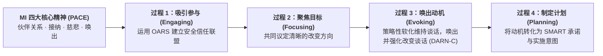

# 动机式访谈与自我决策平衡 (Motivational Interviewing & Self-Decisional Balance, MI)

> **学术与自主适用性审定说明**：动机式访谈（MI）在传统临床中是咨询师引导来访者的对话范式。在 O.L.I.V.I.A. 陪伴系统中，系统一方面将 MI 的 PACE 核心精神（伙伴关系、接纳、慈悲、支持自主权）融入大模型陪伴基准与纠正反射克制中；另一方面将经典“决策平衡（Decisional Balance）”工具解构为**由用户自主完成的“改变与维持利弊自我盘点微练习”**，避免外部说教与强加意志，赋能用户由内而外探索改变动力。

| 属性维度 | 核心内容 |
| :--- | :--- |
| **创立者与代表人物** | 威廉·米勒 (William R. Miller) 与 斯蒂芬·罗尔尼克 (Stephen Rollnick)；核心代表人物：Theresa B. Moyers、Christopher C. Wagner、Sylvie Naar |
| **所属流派** | 以人为中心-目标导向整合流派 (Person-Centered & Goal-Oriented Approach) / 融合罗杰斯以人为中心疗法、费斯汀格认知失调理论及贝姆自我知觉理论 |
| **循证等级** | **Level I (最高循证等级)**（拥有超过2,000项随机对照临床试验 RCT 与上百项元分析支持，被WHO、APA、SAMHSA及英国NICE列为成瘾行为、慢病管理、健康行为改变及跨诊断治疗依从性提升的黄金一线干预） |
| **核心作用机制** | 秉持**MI精神（PACE：伙伴关系、接纳、慈悲、唤出）**，坚决克制**纠正反射 (Righting Reflex)**，运用**OARS核心微技能**与策略性反映，在消解**维持谈话 (Sustain Talk)** 与人际不和谐的同时，选择性地识别、唤出并强化来访者自身的**改变谈话 (Change Talk: DARN-C)**，化解改变的**矛盾心理 (Ambivalence)**，让来访者“自己说服自己走向改变” |

---

## 一、 理论基础与作用机制 (Theoretical Foundation & Mechanism)

### 1. 为什么“苦口婆心的劝说”往往适得其反？——矛盾心理与纠正反射
20世纪80年代初，威廉·米勒（William R. Miller）在治疗酒精成瘾患者时发现了一个极具颠覆性的现象：传统戒酒治疗常采用严厉质对、说教、恐吓（“你再喝酒肝就废了、妻离子散了！”），这种对抗性风格非但不能降低饮酒量，反而激起患者强烈的否认与逆反；而当治疗师采用卡尔·罗杰斯式的共情倾听时，患者的戒酒成功率竟翻倍提升。米勒随后与斯蒂芬·罗尔尼克（Stephen Rollnick）合作，正式创立了**动机式访谈 (Motivational Interviewing, MI)**。

米勒与罗尔尼克在《动机式访谈（第4版）》中将其定义为：**“一种协作性的、以目标为导向的沟通风格，特别关注改变的语言；它旨在通过在接纳和慈悲的氛围中探索并化解矛盾心理，来强化个人对特定目标的改变动机与承诺。”**

要理解 MI 的作用机制，必须掌握三大底层心理定律：
1. **矛盾心理的普遍性 (Ambivalence is Normal)**：绝大多数迟迟不改变的人（如明知吸烟/熬夜/暴食有害却不改、明知该运动/服药/做暴露练习却拖延），并不是“无知”或“不可救药”，而是处于正常的**矛盾心理 (Ambivalence)** 之中——他们内心同时住着两个声音：一边是“我想改变的理由（改变谈话 Change Talk）”，另一边是“我维持现状的好处与改变的困难（维持谈话 Sustain Talk）”。
2. **纠正反射的灾难性后果 (The Trap of the Righting Reflex)**：助人者（医生、心理咨询师、父母、伴侣）天生有一种想要“纠正错误、给人支招、讲道理说服对方改变”的冲动，MI 称之为**“纠正反射 (Righting Reflex)”**。然而，**当一个人处于矛盾心理中（天平两端各占50%），如果外部助人者强行站在“你应该改变”那一端去说教施压，为了维持心理平衡与自主权（心理抗拒理论 Psychological Reactance），来访者会本能地跳到天平的另一端，拼命为“不改变”辩护！**
3. **自我知觉理论 (Self-Perception Theory, Daryl Bem)**：**“人们更相信自己亲口说出来的话，而不是别人塞进他耳朵里的话 (People learn what they believe by hearing themselves speak)。”** 来访者越是被迫开口为你辩解“我为什么改不了”，他就越坚定地维持现状；反之，如果通过精巧的提问与反映，让来访者亲口说出“我为什么想改变、我能怎么改变”，他就会在听见自己声音的过程中，自己说服自己走向改变！

### 2. MI 的灵魂：四大核心精神 (The Spirit of MI — PACE)
米勒反复告诫临床工作者：**没有 MI 精神的 MI 技术，只是一场冷酷的心理操纵**。真正的 MI 必须浸透在 **PACE** 四大精神态度中：
* **P — 伙伴关系 (Partnership)**：去权威化。治疗师是“引导向导 (Guide)”，而非高高在上的“驾驶专家”或被动跟随者。治疗师懂心理学过程，但来访者永远是自己人生的最高专家。
* **A — 接纳 (Acceptance)**：融合罗杰斯与积极心理学，包含四个构件：① **绝对价值 (Absolute Worth)**（无条件尊重其人格尊严）；② **准确共情 (Accurate Empathy)**；③ **支持自主权 (Autonomy Support)**（打心底承认并尊重来访者拥有“选择不改变”的终极自由——恰恰只有当一个人觉得自己有权利说“不”时，他才可能真正安全地说“是”）；④ **肯定 (Affirmation)**（积极寻找并点亮来访者的优势与良善意图）。
* **C — 慈悲 (Compassion)**：主动致力于促进来访者的福祉，绝不为了机构考核、自身虚荣或控制欲而利用技术摆布来访者。
* **E — 唤出 (Evocation / Empowerment)**：弃用“填鸭式灌输模式（你缺道理，我塞给你）”，坚信改变的智慧、价值与动机早已像金矿一样埋藏在来访者内心深处，治疗师的任务是将其**唤醒并开采出来**。

### 3. 核心心理语言学机制：改变谈话 (DARN-C / CAT) 与维持谈话
基于心理语言学家 Paul Amrhein 的突破性实证研究，MI 将来访者在会谈中关于改变的正面语言精确编码为两大阶段（共七类），简称 **DARN-CAT**：
* **第一阶段：准备性改变谈话 (Preparatory Change Talk — DARN，松动土壤)**
  * **D — 愿望 (Desire)**：表达“想要、希望、渴望”（如：*“我其实挺希望能早点睡的。”*）
  * **A — 能力 (Ability)**：表达“能够、可以、做得到”（如：*“如果我把手机放客厅，我应该能做到11点躺下。”*）
  * **R — 理由 (Reasons)**：表达改变的具体好处（如：*“早睡的话，我第二天开会脑子会清醒很多，皮肤也会变好。”*）
  * **N — 需要/紧迫性 (Need)**：表达必须改变的迫切性（如：*“我真的不能再这样熬下去了，再熬身体要垮了。”*）
* **第二阶段：动员性改变谈话 (Mobilizing Change Talk — CAT，直接预测行为改变)**
  * **C — 承诺 (Commitment)**：表达“我将要、我保证、我决定”（如：*“我今晚回去就买个传统闹钟。”*）
  * **A — 激活 (Activation)**：表达已准备好行动（如：*“我已经准备好从这周开始了。”*）
  * **T — 已迈出步骤 (Taking Steps)**：表达近期已做出的微小尝试（如：*“其实昨天我已经少抽了两根烟。”*）

**临床黄金法则**：会谈中来访者说出的 **DARN-CAT 比例越高、强度越大**，且在会谈尾声呈现上升趋势，其现实生活中的真实行为改变成功率就越高！

---

## 二、 适用情况与边界 (Applicable Conditions & Contraindications)

### 1. 临床适应症 (Clinical Indications)
* **物质与行为成瘾干预 (Substance & Behavioral Addictions)**：酒精依赖、烟草戒断、药物滥用、网络/游戏成瘾、病理性赌博、暴食与强迫性购物。
* **慢性病管理与健康生活方式改变**：糖尿病/高血压饮食与运动管理、减重干预、睡眠卫生调整、长期服药依从性不良。
* **跨诊断“前意向期/意向期 (Precontemplation / Contemplation)”破冰**：根据 Prochaska & DiClemente 的跨理论改变阶段模型（TTM），当来访者处于“根本不想改”或“极度纠结改不改”阶段时，直接上 CBT 暴露或行为计划往往遭遇高脱落率；以 MI 作为**前置预处理 (MI as a Prelude)**（仅需1-4次），可大幅提升后续 CBT、ERP 或精神科治疗的依从性与疗效。
* **青少年心理咨询、司法矫正及“被家属逼来咨询”的非自愿来访者**。

### 2. 适用日常情绪、认知扭曲与心理图式
* **核心情绪与动机状态**：“我知道这不好，但我就是不想动/戒不掉”的矛盾撕扯感、面对他人催促时的逆反愤怒（“你越逼我，我越不干”）、多次尝试失败后的习得性无助与低自我效能感。
* **典型认知偏差**：将现状合理化、全或无的改变挫败感（“既然昨天破戒吃了一顿夜宵，那减肥彻底失败了，干脆暴饮暴食吧”）。
* **早期适应不良图式 (EMS)**：**自制力/自律不足图式 (Insufficient Self-Control)**、**失败图式 (Failure)**、**纠缠/逆反依赖模式**。

### 3. 适用人群特征
* 对说教、指导、权威命令高度敏感甚至产生生理性逆反的个体（尤其是青少年与高自主需求成年人）；或深陷“三分钟热度、反复立 Flag 又反复倒下”怪圈的人群。

### 4. 禁忌症与转介红线 (Contraindications & Referral Red Lines)
* **涉及道德/法律底线或单方利益诱导的“有害目标”**：当目标本身违背来访者最佳利益或涉及伤害自己/他人时，严禁使用 MI 唤出技术去促成该目标。
* **真正需要“中立危机决策”的情境（需切换为平衡决策法 Equipoise）**：例如来访者面临“是否捐献活体器官”或“是否终止妊娠”等无客观好坏之分的纯个人价值抉择时，治疗师不可预设方向使用单向唤出技术，而必须保持绝对中立的平衡探索。
* **已高度准备好改变、仅缺乏具体技能的行动期来访者**：若来访者已经100%下定决心改变，急需具体操作方法，继续反复盘问“你为什么想改”反而会拖慢进程，应直接进入第四过程（制定计划与技能训练）。

---

## 三、 核心技术与具体方法 (Core Techniques & Sub-Methods)

MI 的技术操作体系精密如瑞士钟表，由基础微技能 **OARS** 与高级动机唤出策略构成：

### 1. 基础沟通四微技能：OARS (Open Questions, Affirmations, Reflections, Summaries)
在 MI 会谈中，治疗师遵循 **“2:1 黄金法则”**——每提1个问题，至少配合2次共情反映（避免将访谈变成审讯）：
1. **O — 开放式提问 (Open-Ended Questions)**：邀请深入思考与探索，尤其用于定向唤出改变谈话（DARN）。
2. **A — 肯定 (Affirmations)**：真诚点亮来访者的个人品格优势、过往努力与微小进步（注意：尽量用以**“你”**开头的肯定句，如*“哪怕家里人都反对，你依然为了孩子的健康坚持跑来找我谈，你真的很看重做母亲的责任”*，而非居高临下的“我很表扬你”）。
3. **R — 反映性倾听 (Reflections)**：MI 最核心的发动机！分为：
   * **简单反映 (Simple Reflection)**：重述表面意思，稳定情绪；
   * **复杂反映 (Complex Reflection)**：增加深层含义、打比方、猜测未说完的下半句，或使用**双面反映 (Double-Sided Reflection)**——**注意语序铁律：永远把“维持谈话”放在前面，把“改变谈话”放在连接词“同时 (and)”的后面！**（例如：*“一方面晚上下班抽根烟确实能帮你瞬间解压；同时，你也越来越担心孩子吸二手烟咳嗽，很想为他戒掉。”*——因为人类倾向于顺着别人话语的最后半句往下接话！）。
4. **S — 总结 (Summaries)**：像采摘一束鲜花（Bouquet of Change Talk）一样，将来访者在过去10分钟里零星说出的所有“改变谈话”收集起来，打包集中反馈给来访者，产生强大的动机轰鸣效应。

### 2. 重要性标尺与信心标尺技术 (Importance & Confidence Rulers)
* **原理**：改变动机的公式为 $\text{动机} = \text{重要性 (Why)} \times \text{信心/自我效能 (How)}$。通过0-10分标尺提问，精准诊断短板并瞬间诱发改变谈话。
* **操作公式与反直觉追问技巧**：
  1. **设定标尺**：*“如果从0到10打分，0代表完全不重要/完全没信心，10代表极其重要/百分百有信心，关于[目标改变]，你现在的重要性打几分？信心打几分？”*
  2. **黄金第一问（永远往下比，绝不往上比！）**：假设来访者回答“我打4分”。
     * ❌ **错误问法**：“为什么只有4分，不是8分？”（这会逼来访者立刻列举一堆“我为什么改不了”的维持谈话！）。
     * ✅ **MI 黄金问法**：**“为什么你打的是4分，而不是0分或1分呢？”**（来访者为了解释为什么有4分，瞬间就会滔滔不绝地亲口说出他所有想改变的理由与优势！）。
  3. **黄金第二问（向前推半步）**：*“如果要让你的分数从4分稍微涨到5分或6分，需要发生什么？或者你需要什么样的支持？”*

### 3. 顺应阻抗与化解维持谈话技术 (Dancing with Sustain Talk & Discord)
当来访者满嘴抱怨、抵触、辩解（“我就是改不了！你别管我！”）时，MI 绝不硬碰硬（Wrestling），而是像跳华尔兹一样顺着对方的力道轻巧化解（Dancing）：
* **强调个人自主权 (Emphasizing Personal Control)**：最强大的破冰器！真诚告诉对方：*“说到底，每天喝多少酒、戒不戒酒，100%是由你自己决定的。没有任何人能强迫你，哪怕是我也一样。”*（瞬间卸下对方的逆反铠甲）。
* **放大/夸张反映 (Amplified Reflection)**：以温和、不带任何讽刺的语调，将来访者的维持谈话稍微往极端方向推一点点，诱使来访者自己往回拉并说出改变谈话（例如：来访者说*“我抽烟跟心脏病一点关系都没有”* $\rightarrow$ 治疗师温和反映：*“所以在你看来，抽烟对你的身体是一点坏处都没有的，完全不需要有任何担心。”* $\rightarrow$ 来访者往往会自己退一步说：*“那倒也不是完全没坏处，早上起来痰确实挺多的……”*）。
* **转移焦点与重新框定 (Shifting Focus & Reframing)**：将“我戒烟失败了三次，我太没毅力了”重新框定为*“你居然已经主动向烟瘾发起了三次挑战，每一次你都更清楚哪个时间段最难熬了”*。

### 4. 唤醒价值冲突：探索两极与展望未来 (Developing Discrepancy & Looking Forward/Back)
* **核心价值卡片分类 (Values Card Sort)**：请来访者选出人生中最看重的3-5项核心价值（如：健康的身体、成为孩子的榜样、自由独立），然后温和探索：*“你目前每天熬夜打游戏到凌晨4点的生活状态，与你最看重的‘自由独立和身体健康’，它们之间是怎么配合的？”*（不加指责地引发健康的认知失调）。
* **展望未来双轨法 (Looking Forward)**：邀请来访者想象5年后的两个平行时空——时空A：“如果接下来5年一切照旧，5年后的你过着怎样的生活？”时空B：“如果从今天开始做出改变，5年后的你会是什么样子？”

### 5. E-P-E 信息提供法：请求许可-提供信息-唤出反应 (Elicit-Provide-Elicit / Ask-Offer-Ask)
当必须向来访者提供专业心理教育或医学建议时，严禁直接开启“爹味说教”，必须遵循 **E-P-E 三明治结构**：
1. **Elicit（先问许可与已有认知）**：*“关于熬夜对抑郁情绪的影响，你之前了解过哪些？如果我跟你分享一点最新的神经科学研究发现，你愿意听听看吗？”*（获得许可后再说）。
2. **Provide（提供简短中立的信息）**：用客观语言简短说明1-2个核心点（*“研究发现，有些人和你一样……”*）。
3. **Elicit（唤出来访者自己的解读）**：*“听到这个信息，你觉得对你自己的情况有什么启发？你是怎么看的？”*

---

## 四、 标准化实施流程 (Step-by-Step Implementation Process)

米勒与罗尔尼克将 MI 的临床实施过程确立为层层递进的**四大核心过程 (The Four Processes of MI)**：

### 第一过程：吸引参与——建立稳固的安全伙伴同盟 (Process 1: Engaging)
* **Step 1：收起纠正反射，用 OARS 倾听来访者的核心关切**
  * 不急于推销改变议程，通过开放式提问与准确共情反映，让来访者感受到被深深理解、尊重且毫无被评判或被控制的压力。

### 第二过程：聚焦目标——议定清晰的改变靶点 (Process 2: Focusing)
* **Step 2：议程映射 (Agenda Mapping) 与目标协商**
  * 当存在多个潜在问题（如失眠、拖延、饮酒、关系冲突）时，使用可视化“气泡菜单”与来访者共同商议：*“在这些议题中，今天你最想我们先聚焦哪一个？”* 将模糊的困扰转化为具体、可界定的行为改变目标。

### 第三过程：唤出动机——点亮并培育改变谈话 (Process 3: Evoking)
* **Step 3：运用唤出式提问与标尺技术，采集 DARN 准备性改变谈话**
  * 围绕选定的目标，使用重要性/信心标尺、展望未来、回顾过往成功经验等技术，专门引出来访者自己的愿望（Desire）、能力（Ability）、理由（Reasons）与需要（Need）。
* **Step 4：选择性反映放大改变谈话，用总结花束推向高潮**
  * 每当来访者说出一句改变谈话，治疗师立刻用复杂反映或肯定将其接住并放大（让来访者再听一遍自己说过的话）；最后用一段大总结将所有 DARN 串联起来，并抛出关键过渡问题：*“既然你这么渴望改变，也有这么多理由和过往经验，那么接下来你打算怎么做呢？”*（促发 CAT 动员性改变谈话）。

### 第四过程：制定计划——从动机走向坚定承诺 (Process 4: Planning)
* **Step 5：识别准备就绪信号，共同制定具体行动与防滑坡计划**
  * 当来访者维持谈话明显减少、开始主动询问“那我具体该怎么做？”时，运用 E-P-E 提供菜单式选项，协助来访者制定高可行性的第一小步行动计划，并预演障碍应对策略（Implementation Intentions：“如果遇到X诱惑，我就采取Y行动”），锁定最终承诺（Commitment）。

---

### ⚡ 【5-10分钟日常自助/陪伴微练习速查版】：“MI 自我破除拖延/戒瘾五分钟自问表”
当你面对一件“明知该做却死活不想动”（如去运动、写报告、戒夜宵、早睡）的事情时，放下自我唾骂，用5分钟对自己进行一次温柔的 MI 访谈：
1. **第1分钟【归还自主权，停止内耗】**：
   * 对自己大声说一句：*“我今天完全有权利选择不去运动/继续熬夜，没人拿枪指着我。决定权100%在我自己手里。”*（瞬间消除身体里的逆反心理）。
2. **第2分钟【双面诚实接纳】**：
   * 诚实说出：*“一方面，我现在确实很累，刷手机躺着真的很爽（接纳维持谈话）；同时，我也知道如果今天动起来15分钟，我今晚入睡的时候会特别踏实、特别为自己骄傲（点亮改变谈话）。”*
3. **第3分钟【0-10分标尺往下比】**：
   * 问自己：*“我现在想做这件事的意愿有几分？（假设3分）。为什么我有3分，而不是0分呢？”* 写下那3分背后的2个最重要理由（DARN）。
4. **第4分钟【展望明早的自己】**：
   * 想象明天早上醒来，那个因为昨晚兑现了微承诺而神清气爽的自己，会对现在的自己说什么？
5. **第5分钟【把门槛降到8分信心】**：
   * 问自己：*“如果把目标缩小到我有8分以上信心能立刻做到的程度，这最小的一步是什么？”*（如：“只穿好跑鞋下楼走5分钟”或“只打开文档写3行字”），并立刻去做这5分钟！

---

## 五、 具体实施例子与实操示范 (Concrete Implementation Examples & Vignettes)

### 案例一：化解非自愿来访者的强烈逆反——糖尿病合并重度酒精依赖干预
#### 1. 场景背景
来访者老王（52岁，建筑工程包工头），因2型糖尿病血糖失控及酒精性脂肪肝住院，在妻子以“不去看心理科就离婚”的威胁下黑着脸走进诊室。处于典型的**前意向期 (Precontemplation)**，充满敌意与维持谈话。

#### 2. 逐轮引导对话示例（展示顺应阻抗、归还自主权、双面反映与标尺技术）
* **来访者（大马金刀坐下，冷哼一声）**：“大夫，我丑话先说在前头，我是被我老婆逼来走个过场的。我们在工地上跑业务，不喝点酒根本谈不成事，而且我喝了三十年酒身体硬朗得很，你别跟我念那些戒酒的紧箍咒，我一个字都不想听！”（**强烈的人际不和谐 Discord 与维持谈话**）
* **治疗师（完全克制纠正反射，顺应阻抗 + 归还100%自主权 + 肯定）**：“王大哥，我特别欣赏你的直爽，心里有什么直接放桌面上说。而且你放心，我今天绝不会给你念任何戒酒紧箍咒——因为说实在的，酒杯端在你自己手里，你出了这个门喝不喝酒、喝多少，100%是你自己说了算，无论是你太太还是我，都没法替你做决定。我反而挺好奇，既然你这么反感被逼着来，你今天依然还是推开这扇门坐在这儿了，是什么让你愿意为你太太走这一趟呢？”
* **来访者（原本竖起的刺瞬间软了大半，神色缓和下来）**：“……还能为什么，跟她过了二十多年，她上周看到我的化验单急得高血压都犯了，一宿没睡。我再怎么混蛋，也不能真把老伴气出个好歹来啊。”（**被成功唤出第一句隐含价值与改变谈话：在乎妻子**）
* **治疗师（复杂反映 + 肯定其重情义的核心价值）**：“原来在工地上雷厉风行的王大哥，心里最柔软、最看重的地方其实是家里相濡以沫的老伴。你不希望她为你担惊受怕，这份担当和情义真的很难得。”
* **来访者（叹了口气，语气变得真实）**：“唉，我也知道现在这身体不如从前了。上周在工地爬三楼脚手架，我居然眼前一黑差点栽下去，把我自个儿也吓出一身冷汗。我也知道这酒再这么每天一斤地喝下去肯定要出事，可一到饭局上兄弟们一起哄，或者晚上浑身骨头疼睡不着的时候，不喝两口真顶不住啊！”（**浮现典型的矛盾心理 Ambivalence**）
* **治疗师（使用黄金双面反映：先维持谈话，后改变谈话）**：“一方面，这酒陪了你三十年，既是你在工地上应酬的润滑剂，也是你晚上缓解骨头疼和失眠的老伙计；**同时**，上周脚手架上那次眼前发黑真的给你敲了警钟，而且看着老伴急得犯高血压，你心里很清楚，为了自己能平安站在脚手架上、为了老伴能睡个安稳觉，这酒的喝法真的到了不得不改的时候了。”
* **来访者（用力一拍大腿）**：“可不是嘛！我要是真从脚手架上摔下来瘫在床上，这辈子就全完了！”（**强烈的 Need 改变谈话**）
* **治疗师（趁热打铁引入重要性与信心标尺）**：“王大哥，如果从0到10打分，现在‘把饮酒量降到安全范围’这件事对你的重要性有几分？”
* **来访者**：“重要性那肯定是9分！但我怕我控制不住，信心顶多也就4分吧。”
* **治疗师（黄金往下比追问，激发自我效能 Ability）**：“9分的重要性，说明你守护自己和老伴的决心非常大！而信心这一块，你打了4分，为什么是4分而不是0分呢？是什么让你觉得自己有这4分的底气？”
* **来访者（眼睛一亮，回忆起过往优势）**：“因为五年前我查出胃溃疡的时候，大夫让我戒辣椒，我那么爱吃辣的人，说戒也就硬生生戒了半年！而且其实平时在家里自己吃饭那顿，只要老伴把酒瓶收起来、给我泡壶浓茶，我是完全可以一口不喝的！”（**成功唤出强大的 Ability 与行动线索**）

---

### 案例二：运用“价值冲突探索 + 收集总结”唤醒青年职场人的运动与睡眠改变承诺
#### 1. 场景背景
来访者小赵（27岁，程序员），体检出现重度脂肪肝、尿酸高及轻度抑郁，但每天下班后仍报复性熬夜吃炸鸡打游戏到凌晨3点。

#### 2. 逐轮引导对话示例（展望未来 + 总结花束促发承诺）
* **治疗师（探索未来5年双轨图景）**：“小赵，如果我们把时间快进5年，到你32岁的时候。假如这5年里你继续保持现在每天凌晨3点睡、靠炸鸡解压、完全不运动的状态，你闭上眼看看，32岁的你是什么样子的？”
* **来访者（皱起眉头，声音低沉）**：“……挺可怕的。肚子可能大得连鞋带都系不上，痛风发作得走不了路，脑子越来越迟钝，可能在35岁裁员潮前就被公司淘汰了，更别提找女朋友了，想想都觉得窒息。”
* **治疗师（收集总结 Summary Bouquet + 关键过渡提问）**：“小赵，我想把刚才这二十分钟里你自己告诉我的话整理一下：你非常坦诚地看到，熬夜吃夜宵确实给了你每天晚上短暂的两小时放空自由；但同时，你也对我说，你非常讨厌第二天早上醒来时那种头昏脑涨的自我厌恶感（Reason），你很渴望能恢复大学时打篮球那种轻盈有活力的身体状态（Desire），你刚才甚至看到了如果5年不改，32岁被痛风和裁员困住的可怕画面，你觉得绝不能让那一幕发生（Need），而且你还提到上周二你其实已经试过一次晚上去公园快走了半小时，那天晚上你12点就睡着了（Taking Steps）。听了你自己说的这一切，接下来你打算迈出怎样的第一步？”
* **来访者（眼神坚定，主动进入 Planning 阶段）**：“我不能再等了。从今晚开始，我每周一、三、五下班先去公司楼下健身房快走40分钟再回家，而且晚上11点半把手机锁进定时盒里！”（**达成强有力的 Commitment 承诺语言**）

#### 3. 【MI 语言编码与治疗师策略反应对照表】（填写实例）

| 来访者原话类型与编码 | 传统“纠正反射”错误回应 ❌ | MI 策略性黄金回应 ✅ | 激发的来访者后续反应 |
| :--- | :--- | :--- | :--- |
| **维持谈话 (Sustain Talk)**： *“我每天工作这么累，晚上喝两杯酒怎么了？完全没问题！”* | *“你怎么能说没问题呢？你的肝功能指标都超标三倍了，必须戒！”*（引发对抗争辩） | **顺应与双面反映**：*“在工地上辛苦了一整天，那两杯酒是你目前唯一能让自己松口气的办法。”* | 防御解除，主动说出：*“是啊，不过最近确实喝得有点太多了，胃也有点烧……”* |
| **改变谈话 - 愿望 (Desire)**： *“我有时候也挺羡慕那些早上能起来晨跑、精神百倍的人。”* | *“那你明天早上6点就定闹钟起来跑5公里啊！”*（步子太大，引发退缩） | **复杂反映放大**：*“你内心其实很向往那种掌控自己身体、充满生命活力的状态，那才是你想要的生活。”* | 进一步深化理由：*“对，我大学时就是那样的，那时候整个人特别自信……”* |
| **改变谈话 - 能力 (Ability)**： *“其实只要周末去郊外徒步，我一整天不看手机也完全没问题。”* | *“周末一天有什么用，关键是工作日！”*（贬低来访者优势） | **肯定 (Affirmation)**：*“这证明你并不是完全被手机绑架的人，当生活里有吸引你的真实体验时，你完全拥有放下手机的自制力。”* | 信心提升（从3分升至6分），开始探索如何在工作日晚上复制这种状态。 |

---

## 六、 权威参考文献 (References)

1. **Miller, W. R., & Rollnick, S.** (2023). *Motivational interviewing: Helping people change and grow* (4th ed.). Guilford Press. （《动机式访谈：帮助人们改变与成长（第4版）》，MI 领域最新最高权威圣经，全面更新四大过程与成长导向应用）
2. **Miller, W. R., & Rollnick, S.** (2012). *Motivational interviewing: Helping people change* (3rd ed.). Guilford Press. （第3版经典巨著，正式确立 PACE 四大精神、四大过程及 DARN-CAT 心理语言学机制）
3. **Rollnick, S., Miller, W. R., & Butler, C. C.** (2022). *Motivational interviewing in health care: Helping patients change behavior* (2nd ed.). Guilford Press. （专门针对临床医疗、慢病管理与精神卫生场景的短程 MI 实操手册）
4. **Arkowitz, H., Miller, W. R., & Rollnick, S. (Eds.).** (2015). *Motivational interviewing in the treatment of psychological problems* (2nd ed.). Guilford Press. （系统阐述如何将 MI 与 CBT、暴露疗法等整合，应用于焦虑、抑郁、OCD、PTSD及进食障碍）
5. **Rosengren, D. B.** (2017). *Building motivational interviewing skills: A practitioner workbook* (2nd ed.). Guilford Press. （MI 国际培训师网络 MINT 官方推荐的临床微技能刻意练习工作手册）
6. **Amrhein, P. C., Miller, W. R., Yahne, C. E., Palmer, M., & Fulcher, L.** (2003). Client commitment language during motivational interviewing predicts drug use outcomes. *Journal of Consulting and Clinical Psychology*, 71(5), 862–878. （里程碑式心理语言学实证研究，首次证实来访者会谈中的 DARN-C 承诺语言强度直接预测真实行为改变结局）
7. **Lundahl, B. W., Kunz, C., Brownell, C., Tollefson, D., & Burke, B. L.** (2010). A meta-analysis of motivational interviewing: Twenty-five years of empirical studies. *Research on Social Work Practice*, 20(2), 137–160. （涵盖119项研究的超大型元分析，证实 MI 在成瘾、健康行为及治疗参与度上具有跨诊断稳健疗效）
