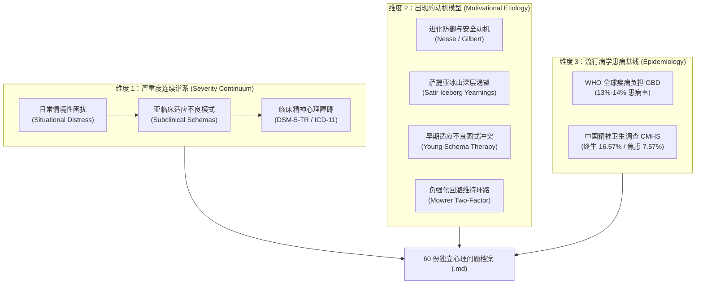

# 🧠 现代心理问题全景统一分类与循证档案库 (Psychological Situations Atlas)

> **定位说明**：本档案库为 **O.L.I.V.I.A.**（*Observant Listener & Introspective Verbal Interaction Agent*）核心知识库与情境感知基础设施。  
> 汇集现代人群中从**日常情境性心理困扰**、**亚临床心理亚健康/早期适应不良图式**到**临床精神心理障碍（DSM-5-TR / ICD-11 / HiTOP）**共 **11 大核心分类谱系、60 个具体心理问题情况档案**。  
> 每一个心理问题均建立独立 Markdown 档案，准确剖析其**出现的进化/深层心理动机**与**全球/中国本土流行病学患病情况**，并与系统的感知引擎 `M.I.Y.I.` 与循证干预状态机 `C.O.L.B.O.` 严格对齐。

---

## 🗺️ 一、 统一多维分类框架与理论基石

为了破除传统单一病理化贴标签的弊端，本档案库整合了四大学术体系建立**四维统一分类模型**：

1. **严重度连续谱维度 (Severity Continuum)**：
   - **日常情境性困扰 (Situational Distress)**：由特定环境事件（如失恋、换工作、长假结束、重要汇报）诱发，持续时间短，社会功能完好；
   - **亚临床适应不良模式 (Subclinical / Maladaptive Patterns)**：未达临床诊断门槛，但长期通过严苛自责、拖延、讨好、情绪性暴食或报复性熬夜等防御习惯消耗自我；
   - **临床心理障碍 (Clinical Mental Disorders)**：严格符合 DSM-5-TR / ICD-11 诊断标准（达到症状条目、持续病程与严重社会功能受损三项硬指标）。
2. **出现动机的核心动力学解释维度 (Why It Emerges: The Motivational Core)**：
   - **进化防御动机**：症状不是“故障”，而是远古生存雷达（捕食者逃生、部落排斥防御、能量休眠保存、安全检查）在现代环境中的过度敏化；
   - **萨提亚冰山渴望 (Satir Iceberg Model)**：每个看似荒谬或痛苦的行为冰山底下，都隐藏着合理的心理营养渴望（无条件接纳、确定感、自主权、自我价值、安全联结）；
   - **勒温动机冲突与负强化闭环**：通过回避、强迫或自我设障获得短暂情绪止痛（负强化），却阻断了长期的适应性成长。
3. **宏观流行病学基准 (Macro-Epidemiology)**：
   - **全球基线 (WHO 2022/2025)**：全球约 9.7 亿–10.7 亿人患有明确精神心理障碍（占全球总人口约 13%–14%），抑郁障碍与焦虑障碍高居全球致残健康寿命损失年（YLDs）前列；
   - **中国基线 (CMHS, The Lancet Psychiatry, 2019)**：中国成人各类精神障碍（不含痴呆）**终生患病率为 16.57%**（12个月患病率为 9.32%）。其中**焦虑障碍终生患病率最高（7.57%）**，心境障碍次之（7.37%，其中抑郁症 3.4%），物质使用障碍（4.67%）。
4. **干预对齐：C.O.L.B.O. 双翼干预策略与 SUDS 标尺映射 (Bilateral Wings & SUDS Calibration)**：
   - **左翼 (Left Wing / Somatic & Compassion)**：自下而上 (Bottom-up) 躯体稳定化与情绪容纳（生理性叹息、3-2-1感官着陆、Neff 自我关怀）。当 $Arousal \ge 0.80$（SUDS $\ge 8/10$）或交感神经剧烈过载时触发，优先恢复生理安全感；
   - **右翼 (Right Wing / Cognitive & Action)**：自上而下 (Top-down) 认知重构与行为激活（CBT 想法检验、好友视角、去灾难化、BA 2分钟微破冰）。仅在 $Arousal < 0.80$ 且心力电量 $\ge 0.40$ 时放行；
   - **双翼协同 (Bilateral Synergy)**：高唤醒伴随深层内耗时，先由左翼稳定化平抑生理激惹，待唤醒度降至安全区间后，无缝桥接右翼认知赋能；
   - **SUDS 0–10 标尺与系统唤醒度映射**：档案头部标注的临床主观困扰刻度（SUDS 0–10，如 `6-8/10`）与算法归一化唤醒度区间 $[0.0, 1.0]$ 严格线性对齐（$\text{Arousal} = \text{SUDS} / 10$）；
   - **情绪别名临床映射说明**：档案元数据中出现的 `procrastination`（拖延）、`self_criticism`（自我苛责）、`insomnia`（失眠）、`rumination`（反刍）在临床上属于应对行为或心身症状，系统在 `taxonomy.yaml` 的 `emotion_aliases` 中已建立向下兼容映射，分别映射至底层核心情绪（`overwhelm`、`shame`、`anxiety`），确保感知预测与先验计算的严谨自洽。

---

## 📚 二、 11 大分类谱系与 60 份心理问题档案全览

| 档案编号 | 心理问题名称 | 核心分类谱系 | 出现的动机机制概括 | 患病情况/流行病学基线概括 | 对应文件链接 |
| :--- | :--- | :--- | :--- | :--- | :--- |
| **SIT-01-01** | 广泛性焦虑障碍与慢性游离焦虑 | 01_焦虑与惊恐谱系 | 威胁预警雷达过度敏化；将语言性担忧作为认知回避以换取虚假掌控感 | 全球终生患病率 3.7%–5.7%；中国焦虑障碍首位（终生7.57%），亚临床焦虑检出率达15%–25% | [查看档案](./01_01_GAD.md) |
| **SIT-01-02** | 惊恐发作与惊恐障碍 | 01_焦虑与惊恐谱系 | 急性战斗或逃跑/虚假窒息警报；灾难化内感受误读导致的恶性循环 | 偶发惊恐发作终生发生率达 13.2%–22.7%；临床惊恐障碍全球患病率 1.7%–2.7% | [查看档案](./01_02_Panic_Disorder.md) |
| **SIT-01-03** | 社交焦虑障碍与被审视恐惧 | 01_焦虑与惊恐谱系 | 防御被群体排斥驱逐的进化动机；聚光灯效应与自我监控导致真实交往受阻 | 全球终生患病率 4.0%–12.1%（第三大心理障碍）；高校学生亚临床社恐比例达 30%–45% | [查看档案](./01_03_Social_Anxiety.md) |
| **SIT-01-04** | 疾病焦虑与疑病困扰 | 01_焦虑与惊恐谱系 | 生命保存本能；将无法掌控的人际或存在孤独置换具象化到身体监控 | 综合医院门诊患病率 5.7%–10.0%；网络疑病症（Cyberchondria）青年检出率 20%–35% | [查看档案](./01_04_Illness_Anxiety.md) |
| **SIT-01-05** | 场所恐惧症与特定恐惧症 | 01_焦虑与惊恐谱系 | 进化预备威胁回避；收缩生活领地以规避在陌生开阔/密闭场所的失控无助 | 特定恐惧症全球终生患病率 7.4%–12.5%；场所恐惧症终生患病率 1.5%–2.6% | [查看档案](./01_05_Agoraphobia_Specific_Phobia.md) |
| **SIT-01-06** | 成人分离焦虑与预期性灾难焦虑 | 01_焦虑与惊恐谱系 | 依恋呼救本能与客体恒常性未固化；试图通过提前透支焦虑来做好全天候战备 | 成人分离焦虑终生患病率达 4.8%（超40%成年后首发）；周日夜晚焦虑发生率 65%–76% | [查看档案](./01_06_Separation_Anticipatory_Anxiety.md) |
| **SIT-01-07** | 错失恐惧症与数字信息过载焦虑 | 01_焦虑与惊恐谱系 | 基本心理需要未满足；远古部落情报遗漏恐慌被算法信息流精准劫持 | 18–35岁青年中 FOMO 发生率达 56%–69%；超72%青年存在睡前强迫刷屏习惯 | [查看档案](./01_07_FOMO_Digital_Anxiety.md) |
| **SIT-02-01** | 重性抑郁发作与深度情绪低落 | 02_抑郁与心境低落谱系 | 慢性挫败后的能量保存休眠机制；社会竞争让步以防止更严重的消耗崩盘 | 全球超2.8亿患者；中国抑郁障碍终生患病率 6.8%（近9500万人），治疗缺口超90% | [查看档案](./02_01_MDD.md) |
| **SIT-02-02** | 持续性抑郁障碍（恶劣心境）与高功能“微笑型抑郁” | 02_抑郁与心境低落谱系 | 假性自体（False Self）生存铠甲；以体面懂事换取安全接纳，压抑深层脆弱 | 持续性抑郁终生患病率 1.5%–3.6%；职场骨干中高功能抑郁亚临床检出率达 10%–18% | [查看档案](./02_02_PDD_Smiling_Depression.md) |
| **SIT-02-03** | 快感缺失与情感麻木/解离性冷漠 | 02_抑郁与心境低落谱系 | 情绪超载后的神经保护性降敏（类似听觉降噪）；多巴胺奖赏回路下调 | 抑郁症中 70%–75% 伴随快感缺失；高压青年职业倦怠中无感状态达 30%–40% | [查看档案](./02_03_Anhedonia_Emotional_Blunting.md) |
| **SIT-02-04** | 双相情感障碍与环性心境波动 | 02_抑郁与心境低落谱系 | 行为激活系统（BAS）超敏与躁狂防御；昼夜节律钟基因与神经递质周期失调 | 全球双相谱系终生患病率 2.4%；中国患病率约 0.6%，初诊误诊为单相抑郁率超60% | [查看档案](./02_04_Bipolar_Cyclothymia.md) |
| **SIT-02-05** | 季节性情感障碍与节假日后心理落差 | 02_抑郁与心境低落谱系 | 进化冬眠与光照敏感节律；对手过程理论（高峰兴奋后的反向多巴胺下调） | 高纬度地区 SAD 患病率达 4%–9.7%；超55%–65%职场人经历节后综合征落差 | [查看档案](./02_05_SAD.md) |
| **SIT-02-06** | 围产期与产后抑郁/焦虑困扰 | 02_抑郁与心境低落谱系 | 雌孕激素断崖下跌与GABA刹车失灵；护幼高警觉与母亲主体性丧失哀悼 | 产后心绪不良发生率 50%–80%；临床产后抑郁全球患病率 13%–17.7%（中国约 14.7%） | [查看档案](./02_06_Perinatal_Depression.md) |
| **SIT-03-01** | 消极思维反刍与慢性精神内耗 | 03_强迫思维与反刍谱系 | 分析性问题解决引擎死循环空转；积极元认知误以为“多想就能想通” | 抑郁焦虑群体中达 80%–90%；中国调查显示超 60% 青年自认长期处于精神内耗 | [查看档案](./03_01_Rumination_Mental_Friction.md) |
| **SIT-03-02** | 强迫症与侵入性思维困扰 | 03_强迫思维与反刍谱系 | 进化安全防范模块停止信号缺失；思维-行动融合下的过度道德与安全代偿 | 全球终生患病率 1.6%–2.5%；中国成人终生患病率 2.4%；84%–94%健康人有同类侵入念头 | [查看档案](./03_02_OCD.md) |
| **SIT-03-03** | 关系强迫症与伴侣反复确认困扰 | 03_强迫思维与反刍谱系 | 规避择偶重大投入风险与亲密恐惧；试图用绝对确定性逻辑度量流动情感 | 临床 OCD 患者中 10%–18% 表现为关系强迫；青年婚恋群体中亚临床过度审查达 15%–25% | [查看档案](./03_03_ROCD.md) |
| **SIT-03-04** | 躯体变形障碍与重度容貌焦虑 | 03_强迫思维与反刍谱系 | 将内在“缺陷/不配得”图式外化投射至外貌毫米级瑕疵；局部视觉加工失衡 | 临床 BDD 患病率 1.7%–2.9%（医美求美者中达13%–20%）；高校大学生容貌焦虑达 59% | [查看档案](./03_04_BDD_Appearance_Anxiety.md) |
| **SIT-03-05** | 决策疲劳、选择瘫痪与过度分析 | 03_强迫思维与反刍谱系 | 最大化者思维（Maximizer）；将过度分析作为认知拖延以逃避潜在后悔自责 | 约 25%–35% 成年人属于最大化决策者；毕业/就业/转型青年决策焦虑超 50% | [查看档案](./03_05_Analysis_Paralysis.md) |
| **SIT-03-06** | 囤积障碍与控制型安全感依恋 | 03_强迫思维与反刍谱系 | 通过物品/数字堡垒代偿人际依恋缺失与匮乏恐慌；物品被视作记忆与自我的外包 | 临床囤积障碍患病率 2.0%–2.5%（老年群体达5%–6%）；青年数字囤积发生率达 30%–45% | [查看档案](./03_06_Hoarding_Distress.md) |
| **SIT-04-01** | 适应不良完美主义与全或无自我苛责 | 04_完美主义与自我苛责谱系 | 完美主义是防备羞耻与拒绝的防弹衣；误将“苛求完美”当成获得安全感的唯一通道 | 跨世代研究证实年轻一代完美主义水平激增 10%–33%；高校与高压职场检出率达 28%–42% | [查看档案](./04_01_Maladaptive_Perfectionism.md) |
| **SIT-04-02** | 冒充者综合征与配得感缺失 | 04_完美主义与自我苛责谱系 | 预防性自我贬低以防从高处跌落；成功外部归因与失败内部归因的认知扭曲 | 70% 的人一生中至少经历一次冒充者体验；名校硕博与新晋升骨干中检出率达 30%–56% | [查看档案](./04_02_Impostor_Syndrome.md) |
| **SIT-04-03** | 条件化自我价值（要够好才配被爱）与讨好型耗竭 | 04_完美主义与自我苛责谱系 | 4F 创伤迎合反应（Fawn）；早年习得“只有懂事有用、让人满意才配被爱和留在关系里” | 青年与职场人群中拒绝困难与讨好型内耗达 40%–55%（东亚集体主义文化中高发） | [查看档案](./04_03_Conditional_Worth_Fawning.md) |
| **SIT-04-04** | 休息羞耻感与“毒性效率”焦虑 | 04_完美主义与自我苛责谱系 | 优绩主义与自我工具化；将放松状态与“即将遭受惩罚/落后危险”建立了恐惧联结 | 高校学生、科研与高压职场人群中显著休息羞耻感发生率达 50%–68%（系统高频模式） | [查看档案](./04_04_Rest_Guilt_Toxic_Productivity.md) |
| **SIT-04-05** | 毒性羞耻感与严苛内在父母批判 | 04_完美主义与自我苛责谱系 | 顺从性自我攻击防御；试图通过比别人骂得更狠来逃避外部惩罚，误将自虐当自律 | 临床抑郁、社交焦虑与 CPTSD 群体中达 75%–90%；普通完美主义群体中约 40%–55% | [查看档案](./04_05_Toxic_Shame_Inner_Critic.md) |
| **SIT-04-06** | 同辈压力、上行社会比较与年龄/里程碑焦虑 | 04_完美主义与自我苛责谱系 | 社会比较定位本能过载；用自己的幕后花屑对比全网精修切面，社会时钟异化 | 社交媒体使用显著正相关抑郁焦虑；20–35岁青年中同辈与年龄焦虑超过 75% | [查看档案](./04_06_Peer_Comparison_Envy.md) |
| **SIT-05-01** | 情绪性拖延、任务启动冻结与习得性无助 | 05_执行功能与倦怠耗竭谱系 | 短期情绪修复失灵；拖延是完美主义者用来保护自尊免受“能力不足”审判的盾牌 | 普通成年人慢性拖延率 15%–20%；高校与科研人群中高达 70%–85% | [查看档案](./05_01_Emotional_Procrastination.md) |
| **SIT-05-02** | 职业倦怠与学业空心化耗竭 | 05_执行功能与倦怠耗竭谱系 | 要求-资源失衡；冷漠去人性化（Cynicism）是身心防止彻底烧毁的自我保护防火墙 | 全球职场中重度倦怠率 28%–44%（医护/教师达45%–60%）；中国调研超60%报告倦怠 | [查看档案](./05_02_Burnout_Syndrome.md) |
| **SIT-05-03** | 报复性睡前拖延与自主权补偿 | 05_执行功能与倦怠耗竭谱系 | 自主感（Autonomy）过度饥渴；被白天剥夺主体性后通过透支健康夺回时间主权 | 青年白领与大学生中发生率高达 55%–74%；现代城市青年慢性缺眠第一行为诱因 | [查看档案](./05_03_Revenge_Bedtime_Procrastination.md) |
| **SIT-05-04** | 成人注意缺陷多动困扰与执行功能过载 | 05_执行功能与倦怠耗竭谱系 | 兴趣驱动神经系统与多巴胺阈值异常；时间盲区与前额叶抑制控制信号失调 | 全球成人 ADHD 患病率 2.5%–4.4%；超 75%–85% 成年患者在童年期从未被识别诊断 | [查看档案](./05_04_Adult_ADHD_Executive_Dysfunction.md) |
| **SIT-05-05** | 共情疲劳与长期照料者心理耗竭 | 05_执行功能与倦怠耗竭谱系 | 过度共情痛苦（Empathic Distress）灼伤痛觉网络；拯救者情结与自我牺牲图式反噬 | 医护助人从业者发生率 40%–65%；失能慢病长期家庭照料者抑郁耗竭达 35%–55% | [查看档案](./05_05_Compassion_Fatigue_Caregiver_Burnout.md) |
| **SIT-06-01** | 急性应激障碍与创伤后应激障碍 | 06_创伤、应激与哀伤谱系 | 极端致命威胁下的过度保护性神经刻录；创伤记忆未被海马体整合归档 | 全球创伤暴露率超70%，临床 PTSD 终生患病率 3.9%（灾难受害者达15%–40%） | [查看档案](./06_01_ASD_PTSD.md) |
| **SIT-06-02** | 复杂性创伤后应激障碍与童年情绪忽视 | 06_创伤、应激与哀伤谱系 | 童年依恋悖论与道德防御；通过自我归咎换取希望感，情绪闪回机制 | 临床 CPTSD 患病率 1.0%–3.8%；在经历童年不良经历（ACEs）人群中达 20%–45% | [查看档案](./06_02_CPTSD_Childhood_Trauma.md) |
| **SIT-06-03** | 适应障碍与人生转折失衡（失业/搬迁/毕业/分手） | 06_创伤、应激与哀伤谱系 | 旧心理地图与新环境失衡；身份认同悬停期（Liminal Space）的应激重校 | 临床心理咨询最常见诊断；经历失业、搬迁或分手人群中发生率高达 15%–30% | [查看档案](./06_03_Adjustment_Disorder.md) |
| **SIT-06-04** | 延长哀伤障碍与未完成丧失悲恸 | 06_创伤、应激与哀伤谱系 | 依恋断裂与持续联结（Continuing Bonds）；将痛苦作为证明爱与忠诚的唯一纽带 | 自然丧亲者中发生率 9.8%；突发意外/失独创伤性丧亲人群中高达 30%–49% | [查看档案](./06_04_Prolonged_Grief_Disorder.md) |
| **SIT-06-05** | 解离状态与人格解体-现实解体障碍 | 06_创伤、应激与哀伤谱系 | 超载压力下的终极心理保险丝（前额叶死踩情绪刹车）；阻断痛苦的防震气泡膜 | 短暂解离终生发生率高达 26%–74%；临床持续性 DPDR 患病率约 1.0%–2.0% | [查看档案](./06_05_Dissociation_DPDR.md) |
| **SIT-06-06** | 替代性创伤与道德伤害困扰 | 06_创伤、应激与哀伤谱系 | 滚烫良知与高共情系统在无力现实中的震荡；公正世界信念与核心道德图式撕裂 | 灾难新闻受众替代性应激达 15%–28%；一线审核/记者/医护中检出率达 30%–50% | [查看档案](./06_06_Vicarious_Moral_Injury.md) |
| **SIT-07-01** | 焦虑迷恋型依恋与被抛弃恐惧图式 | 07_依恋与亲密关系谱系 | 间歇性强化喂养的依恋过度激活；抗议行为（Protest Behavior）是绝望的呼救 | 成人中焦虑依恋约占 18%–22%；在因情感危机寻求心理咨询青年中占比高达 45%–60% | [查看档案](./07_01_Anxious_Attachment_Abandonment.md) |
| **SIT-07-02** | 疏离回避型依恋与亲密窒息防御 | 07_依恋与亲密关系谱系 | 次级去激活防御策略；切断依恋雷达以防“期待落空的心碎”，将靠近视作侵入 | 回避型依恋约占成年人口的 20%–28%；在当代都市恐婚恐恋青年中呈明显上升趋势 | [查看档案](./07_02_Avoidant_Attachment_Intimacy_Fear.md) |
| **SIT-07-03** | 共生依赖（共同依赖）与人际边界丧失 | 07_依恋与亲密关系谱系 | 自我分化不足与情绪配偶化；通过成为不可或缺的拯救者来换取不被抛弃的控制感 | 东亚家庭代际咨询中边界模糊占比达 40%–60%；深层影响婚恋择偶与自我独立 | [查看档案](./07_03_Codependency_Boundary_Loss.md) |
| **SIT-07-04** | 拒绝敏感性烦躁与人际微表情过度解读 | 07_依恋与亲密关系谱系 | 社会痛觉神经末梢裸露超敏；提前预判拒绝以启动逃避保护，误判中性信号 | 成人 ADHD 中 RSD 比例高达 70%–90%；普通高敏感与社交焦虑青年中达 25%–38% | [查看档案](./07_04_RSD_Rejection_Sensitivity.md) |
| **SIT-07-05** | 慢性孤独感、社会联结断裂与都市疏离 | 07_依恋与亲密关系谱系 | 荒野孤立生物警报（Cacioppo）；神经系统误入戒备高警觉悖论，自我封闭锁死 | WHO 报告全球约 24%–25% 成年人长期孤独；中国青年中度以上孤独感达 35%–52% | [查看档案](./07_05_Chronic_Loneliness_Isolation.md) |
| **SIT-07-06** | 隐性自恋虐待、煤气灯操纵与自我怀疑创伤 | 07_依恋与亲密关系谱系 | 间歇性奖惩多巴胺劫持；自省与共情本能被操控者反向利用，现实检验力被蚕食 | 亲密关系与职场中情感虐待与操纵经历发生率达 25%–40%；常遗留长程认知怀疑 | [查看档案](./07_06_Gaslighting_Relational_Trauma.md) |
| **SIT-08-01** | 慢性失眠障碍与睡前认知-生理高唤醒 | 08_睡眠、躯体化与进食谱系 | 睡眠努力悖论（Sleep Effort）；把睡觉当成必达考核反而激活觉醒警报 | 全球慢性失眠障碍患病率约 10%；中国成人睡眠障碍发生率高达 38.2%（超3亿人） | [查看档案](./08_01_Chronic_Insomnia_Hyperarousal.md) |
| **SIT-08-02** | 躯体症状障碍与心理压力躯体化（肠易激/紧张性头痛/心因性疼痛） | 08_睡眠、躯体化与进食谱系 | 替嘴巴说话的器官；情绪表达受阻时通过疾病角色获得合法的休息与关怀豁免 | 综合门诊中功能性无器质病变症状占 25%–33%；中国门诊患者躯体化倾向达 30%–45% | [查看档案](./08_02_Somatic_Symptom_Somatization.md) |
| **SIT-08-03** | 暴食障碍、情绪性进食与神经性贪食 | 08_睡眠、躯体化与进食谱系 | 严苛节食引发反饥荒神经肽暴发；咀嚼吞咽作为即时逃离自我意识的止痛药 | 暴食障碍终生患病率 1.5%–3.5%（进食障碍首位）；年轻女性亚临床暴食达 20%–35% | [查看档案](./08_03_Binge_Eating_Bulimia.md) |
| **SIT-08-04** | 神经性厌食与过度限制性进食控制 | 08_睡眠、躯体化与进食谱系 | 争夺人生主权与绝对控制感；进食激活焦虑警报，挨饿反向提供确定感解脱 | 女性终生患病率 0.8%–1.4%；精神障碍中致死率最高（全因死亡率高出普通人群5-10倍） | [查看档案](./08_04_Anorexia_Restrictive_Eating.md) |
| **SIT-09-01** | 边缘型情绪失调、分裂防御与情绪风暴 | 09_情绪失调与人格脆弱谱系 | 生物社会易感性与无效化环境碰撞；用最高分贝的危机警报抵抗被忽视的绝境 | 普通人群患病率 1.6%–2.7%（精神科门诊达10%–20%）；约 70%–75% 有自伤行为 | [查看档案](./09_01_BPD_Emotion_Dysregulation.md) |
| **SIT-09-02** | 述情障碍（情感盲）与情绪压抑隔离 | 09_情绪失调与人格脆弱谱系 | 创伤麻醉生存策略；切断前额叶与边缘系统连接以抵御童年不可承受之重 | 普通人群中达标率 10%–13%（男性稍多）；在心身疾病与自闭谱系中高达 30%–50% | [查看档案](./09_02_Alexithymia.md) |
| **SIT-09-03** | 慢性易激惹、被动攻击与间歇性暴怒障碍 | 09_情绪失调与人格脆弱谱系 | 次生情绪屏障（掩盖底层脆弱、无助与受伤）；压抑-爆发压力锅效应 | 间歇性暴怒障碍终生患病率 2.7%–5.4%；高压都市青年慢性易激惹与路怒达 25%–35% | [查看档案](./09_03_Anger_Dysregulation_IED.md) |
| **SIT-09-04** | 脆弱型（隐性）自恋与羞耻驱动的自尊崩塌 | 09_情绪失调与人格脆弱谱系 | 未成熟自体遭受镜映剥夺后的自大代偿；以受害者特权感防御深层毒性羞耻 | 青年与知识分子隐性自恋检出率 10%–18%（社交网络落差加剧该特质上升） | [查看档案](./09_04_Vulnerable_Narcissism_Fragile_Ego.md) |
| **SIT-09-05** | 回避型与依赖型人格适应不良模式 | 09_情绪失调与人格脆弱谱系 | 回避型以隐退消除拒绝风险；依赖型以顺从扮演弱者换取保护，逃避独立生存责任 | C类人格模式在普通人群中占 2%–3.5%；在心理门诊患者中显著伴随者达 20%–35% | [查看档案](./09_05_Avoidant_Dependent_Patterns.md) |
| **SIT-10-01** | 短视频/算法信息流成瘾与多巴胺奖赏劫持 | 10_成瘾、冲动控制与多巴胺代偿谱系 | 可变比率随机奖赏诱发多巴胺劫持；现实压力下的零门槛即时情绪离线避难所 | 中国短视频用户超10亿，40%–55%青年承认中重度失控沉迷；严重损耗工作记忆 | [查看档案](./10_01_Digital_Short_Video_Addiction.md) |
| **SIT-10-02** | 游戏障碍与虚拟成就代偿性逃避 | 10_成瘾、冲动控制与多巴胺代偿谱系 | 自我决定理论（胜任感/自主权/归属感）完美模拟器；现实荒芜时的虚拟浮木 | 全球游戏障碍患病率 3.05%（年轻男性达5%–8%）；中国青少年问题性使用达 4.2%–7.8% | [查看档案](./10_02_Gaming_Disorder_Escapism.md) |
| **SIT-10-03** | 强迫性购物与冲动消费情绪安抚 | 10_成瘾、冲动控制与多巴胺代偿谱系 | 购买动作作为对抗内在自卑与失控的代偿；以占有物品构建虚假的理想自我 | 普通成人临床强迫购买患病率 4.9%–5.8%；移动分期支付普及下青年失控达 8%–15% | [查看档案](./10_03_Compulsive_Buying_Oniomania.md) |
| **SIT-10-04** | 酒精与成瘾物质依赖（“自我药疗”假说） | 10_成瘾、冲动控制与多巴胺代偿谱系 | 自我药疗假说（借化学物质止痛与麻醉神经警报）；清醒的现实太痛苦不可承受 | 全球近3亿人酒精依赖；中国成人终生患病率 4.67%（男性高达 8.8%，呈现极强性别差） | [查看档案](./10_04_Substance_Use_Self_Medication.md) |
| **SIT-10-05** | 聚焦于躯体的重复行为障碍（拔毛癖/强迫性抠皮/咬指甲） | 10_成瘾、冲动控制与多巴胺代偿谱系 | 远古置换梳理本能；通过微小刺痛在过度唤醒或低唤醒时提供即时感官镇痛调节 | 临床拔毛癖与抓痕障碍患病率 1%–2.5%；亚临床咬甲/抠皮在青年中达 10%–20% | [查看档案](./10_05_BFRB.md) |
| **SIT-11-01** | 存在性虚无、意义丧失与青年“空心病” | 11_存在主义与终极意义谱系 | 工具化优绩主义教育扼杀真实自我；外部跑道终结后内在自我同一性脱锚坍塌 | 顶尖高校新入学生中“空心病”倾向达 30%–40%；高学历青年存在虚无感达 40%–50% | [查看档案](./11_01_Existential_Vacuum_Hollow_Disease.md) |
| **SIT-11-02** | 青年四分之一人生危机与中年存在危机 | 11_存在主义与终极意义谱系 | 身份认同在现实社会碰撞重塑；内在灵魂对机械复制人生剧本发起的觉醒罢工 | 25–35岁青年中危机发生率达 60%–75%；40–50岁中年存在性瓶颈与焦虑超 50% | [查看档案](./11_02_Quarter_Midlife_Crisis.md) |
| **SIT-11-03** | 死亡焦虑、时间流逝恐慌与存在性孤独 | 11_存在主义与终极意义谱系 | 恐惧管理理论（TMT）；意识终结与肉体必然死亡冲突下的原初恐惧与生命审视 | 几近 100% 健康成人曾经历深夜死亡焦虑；10%–20% 在重大关口出现中重度惊恐发作 | [查看档案](./11_03_Death_Anxiety_Thanatophobia.md) |
| **SIT-11-04** | 宏观社会不确定性焦虑与未来失控感 | 11_存在主义与终极意义谱系 | 超大规模宏观威胁感知与微小个人干预力脱节（Agency Gap）；不可控慢性应激 | 柳叶刀全球调查显示 59% 青年极度担忧未来；职场青年宏观失控与养老焦虑超 65% | [查看档案](./11_04_Eco_Macro_Uncertainty_Anxiety.md) |

---

## 🛠️ 三、 档案检索与 O.L.I.V.I.A. 陪伴系统交互指引

每一个档案文件均严格保持**头部元数据 + 六大主体章节的完整七模块规范**：
1. **文件头部元数据与标准编码映射**（一级分类、二级谱系、严重度连续谱、DSM-5-TR / ICD-11 编码、O.L.I.V.I.A. 系统映射）
2. **第一节：问题定义与四维症状画像**（情绪 Affective、认知 Cognitive、躯体 Somatic、行为 Behavioral）
3. **第二节：出现的动机与深层心理机制**（进化防御动机、萨提亚冰山深层渴望、核心图式冲突、神经生物机制）
4. **第三节：患病情况与流行病学数据**（全球与中国患病率、高发人群特征、病程与就诊缺口）
5. **第四节：典型触发情境与内心独白画像**（辅助 M.I.Y.I. 中文情感感知与意图种子对齐）
6. **第五节：循证心理调节方向与临床转诊红旗边界**（对应 C.O.L.B.O. 循证微干预推荐先验与安全边界）
7. **第六节：权威学术参考文献**（同行评审国际权威期刊与专著）

在命令行交互中，可配合 `olivia` CLI 工具调用：
- 查看当前属地危机求助卡片：`olivia resources`
- 查看或配置所在城市与时区：`olivia region`
- 清除本地保存的属地偏好：`olivia region --clear`
